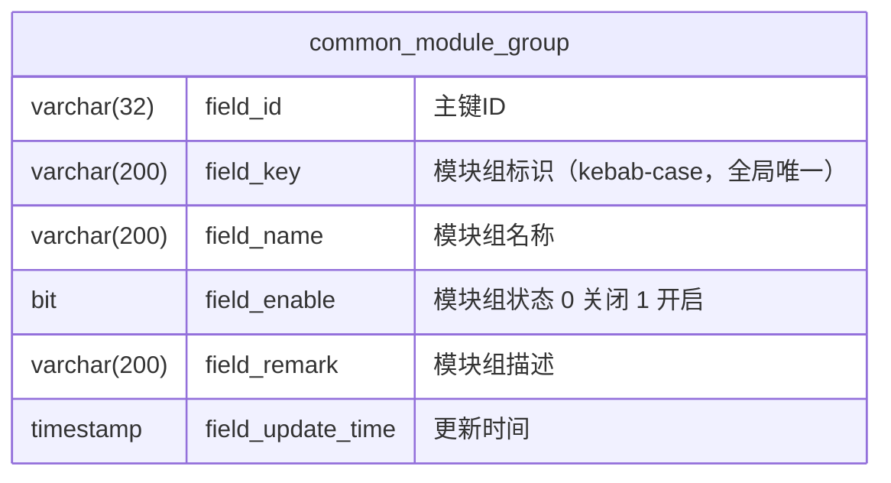

# 接口开关机制数据库设计分册

> 本文档为接口开关机制（V1.1，模块组级启停）的数据库分册，依据《接口开关机制设计方案-修订稿.md》（下称「修订稿」）第 4 / 5 / 6 节拆分整理。
> 迁移脚本：`backend/src/main/resources/db/migration/V1_01_043__common_module_group_schema.sql`（序号接续当前最新 `V1_01_042`，不得复用或跳回旧序号）。
> 字段统一 `field_` 前缀；本表为配置型表，公共字段按第 4 节声明裁剪。
> 配套分册：[接口开关机制需求分册.md](接口开关机制需求分册.md)、[接口开关机制UI设计分册.md](接口开关机制UI设计分册.md)、[接口开关机制API设计分册.md](接口开关机制API设计分册.md)。

## 1. 表清单

| 表名 | 用途 | 形态 |
| --- | --- | --- |
| common_module_group | 模块组状态表（模块组级接口启停，`field_key` 全局唯一） | 配置型主表 |

本特性仅此一张表；模块组与各模块 `moduleGroup.yml` 声明按 `field_key` 逻辑关联，**不做物理外键**。

## 2. 表字段结构



| 字段名 | 类型 | 空 / 默认 | 说明 |
| --- | --- | --- | --- |
| field_id | VARCHAR(32) | NOT NULL，主键 | 主键 ID，`IDUtil.initID()`（毫秒时间戳 + UUID v4）生成；由启动同步维护 |
| field_key | VARCHAR(200) | NOT NULL | 模块组标识，kebab-case，全局唯一（`uk_module_key` 兜底）；幂等同步键与 `@ModuleGroup(moduleGroupKey)` 注解引用键 |
| field_name | VARCHAR(200) | NOT NULL | 模块组名称（页面展示中文名，如「日程」「组织架构-群组」） |
| field_enable | BIT(1) | NOT NULL，DEFAULT b'1' | 模块组状态：0 关闭 / 1 开启；遵循全工程启用位惯例（替代原方案 `field_status tinyint(1)`） |
| field_remark | VARCHAR(200) | NULL | 模块组描述（管理页卡片描述） |
| field_update_time | TIMESTAMP | NOT NULL，DEFAULT CURRENT_TIMESTAMP ON UPDATE CURRENT_TIMESTAMP | 更新时间，由数据库自动维护（本表无更新人字段，见第 4 节） |

`field_enable` 的取值语义：新导入模块组默认开启（b'1'）；管理员经 `/enable` 通道切换；启动同步**一律不改写**该字段（见第 6 节）。

## 3. 索引与约束

| 约束 / 索引 | 定义 | 说明 |
| --- | --- | --- |
| 主键 | PRIMARY KEY (field_id) | 32 位主键 ID |
| 唯一索引 | UNIQUE KEY uk_module_key (field_key) | `field_key` 是幂等同步键与注解引用键，缺失唯一约束会在重复/并发同步时插入重复行（先例：`common_setting` 的 `uk_setting_type_key`） |
| 外键 | 无 | 与各模块 `moduleGroup.yml` 按 `field_key` 逻辑关联，不做物理外键 |
| 引擎 / 字符集 | ENGINE=InnoDB DEFAULT CHARSET=utf8mb4 | 全工程惯例 |
| 建表方式 | CREATE TABLE IF NOT EXISTS | 幂等脚本，空库与既有库均可重复执行 |

## 4. 公共字段裁剪声明

本表**无** `field_creator_id`、`field_create_time`、`field_updater_id`：

- 本表与 `common_setting` 同为配置型表，只维护「元信息 + 启用状态 + 更新时间」，无创建人/创建时间/更新人（`common_setting` 建表脚本已在注释中声明同样理由，本表照此补充声明）；
- `field_update_time` 由数据库 `DEFAULT CURRENT_TIMESTAMP ON UPDATE CURRENT_TIMESTAMP` 自动维护，不依赖应用层写入更新人/更新时间；
- 保留 `field_enable`（启用位）承载开关状态本身。

## 5. 迁移脚本

- 文件：`backend/src/main/resources/db/migration/V1_01_043__common_module_group_schema.sql`；
- 序号：接续当前最新 `V1_01_042` 取 `V1_01_043`，命名 `V{大版本}_{小版本}_{序号}__{英文下划线描述}.sql`；
- 幂等：`CREATE TABLE IF NOT EXISTS`；全表 `field_` 前缀、`utf8mb4`、无外键；
- DDL（与修订稿 4.1 一致，实现以此为准）：

```sql
CREATE TABLE IF NOT EXISTS common_module_group (
    field_id          VARCHAR(32)  NOT NULL COMMENT '主键ID',
    field_key         VARCHAR(200) NOT NULL COMMENT '模块组标识（kebab-case，全局唯一）',
    field_name        VARCHAR(200) NOT NULL COMMENT '模块组名称',
    field_enable      BIT(1)       NOT NULL DEFAULT b'1' COMMENT '模块组状态 0 关闭 1 开启',
    field_remark      VARCHAR(200) NULL COMMENT '模块组描述',
    field_update_time TIMESTAMP    NOT NULL DEFAULT CURRENT_TIMESTAMP ON UPDATE CURRENT_TIMESTAMP COMMENT '更新时间',
    PRIMARY KEY (field_id),
    UNIQUE KEY uk_module_key (field_key)
) ENGINE=InnoDB DEFAULT CHARSET=utf8mb4 COMMENT='模块组状态表';
```

- 无初始化 `INSERT` 语句：全部数据经启动同步按各模块 `moduleGroup.yml` 增量维护（见第 6 节），Flyway 只建结构。

## 6. 数据来源与生命周期

数据来源：各模块 `resources/properties/{common|sys}/{模块}/moduleGroup.yml` 的 `module-group` 段（首批仅 `sys/calendar`、`sys/org` 两个模块创建；`third-party` 仅设计占位、不建 yml）。启动同步作为第 10 个启动任务追加到 `SysStartupTask#run`，幂等三边界：

| 边界 | 行为 |
| --- | --- |
| 不存在 → 插入 | 按 yml 条目插入，`field_enable` 默认开启 |
| 已存在 → 只回写元信息 | `name / remark` 变更时更新；`field_enable` **一律不动**（管理员关闭后重启不得被 yml 重置，机制成立前提） |
| yml 中移除 → 库中记录保留 | 不删除、不改状态、不加下线标记，可人工清理（来自修订稿默认决策 D3） |

配套约束：

- `name / remark` 缺失时同步任务告警并跳过该条目；
- 同步完成后启动期校验全部 `@ModuleGroup` 注解的 key 在本表存在，未知 key 记 WARN（不阻断启动）；
- 同步完成后全量预热状态缓存（进程内 TTL 缓存，默认 30 秒）。

## 7. 实体与 Mapper 落点

- 实体：`CommonModule extends BaseModel`（`com.eric.base.common.module.model`），`fieldId` 之外新增 `fieldKey / fieldName / fieldEnable(Boolean) / fieldRemark / fieldUpdateTime`，命名遵循 `common/setting` 模块先例（`CommonSetting`）；
- Dao / Mapper：`common/module/dao` 与 `common/module/mapper` 一对一，Mapper XML 落 `resources/mappers/common/module/`（与 Java 包路径对应），基础 SQL 全落 XML、无注解拼 SQL：
  - 全量查询（按 `field_key` 排序）；
  - 按 `field_key` 查询；
  - 按 `field_key` 批量回写元信息（仅 `name / remark`，**不动 `field_enable`**）；
  - `/enable` 通道更新（按 `field_id` 更新 `field_enable`）。

## 8. 数据字典

| 字段 | 取值 | 说明 |
| --- | --- | --- |
| field_enable | b'1' | 开启（默认） |
| field_enable | b'0' | 关闭 |
| field_key | kebab-case 字符串 | 全局唯一、一经发布不复用/不重命名（重命名视为新模块组，旧组按"yml 移除"保留在库）；首批：`calendar`、`org-group`（`third-party` 占位） |
