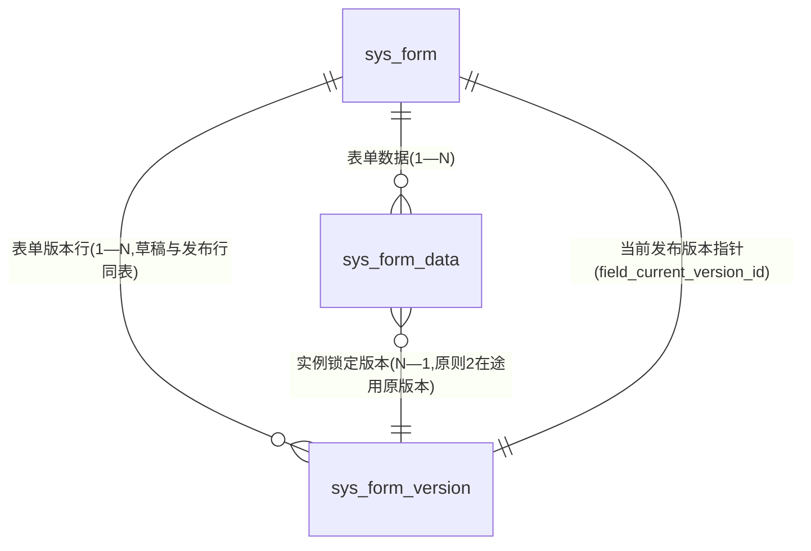

# 自定义表单数据库设计分册（v1.5）

## 1. 文档信息

| 项目 | 内容 |
| --- | --- |
| 文档定位 | 自定义表单 v1_5 的**数据库设计权威分册**（Wave 0 任务 F15-DOC-003 产出）：表清单裁决（R05）、基类归属、逐表字段与索引、JSON 列口径、注解同步与验证口径；下游 Wave 1 的 F15-DB-001 / F15-DB-002 按本分册实现 |
| 目标版本 | v1.5（自定义表单：组件协议 + 表单设计器 + 动态渲染器 + 规则引擎 + 数据引擎） |
| 模块编号 | F15（模块 key `form`，包 `com.eric.base.sys.form`，实体落 `sys/form/model/`，Mapper XML 落 `resources/mappers/sys/form/`） |
| 文档版本 | V1.0 |
| 创建日期 | 2026-11-23 |
| 文档状态 | 评审稿（Wave 0 任务 F15-DOC-003 产出；R05 已裁决，表结构未实现，随 F15-DB-001/002 编码落地并与实体注解同批收口） |
| 输入依据 | [自定义表单功能详细设计.md](自定义表单功能详细设计.md)（F15-DOC-001 产出：§2 Schema 协议、§5 版本机制、§6 数据引擎、§0.4 ADR-06 规则随版本内嵌）、[自定义表单API接口设计分册.md](自定义表单API接口设计分册.md)（F15-DOC-002 产出：15 接口查询路径、§10 待确认事项登记）、[自定义表单开发任务清单.md](自定义表单开发任务清单.md)（§4.3 任务卡、§6 R05 风险行）、[AGENTS.md](../../AGENTS.md) §4（`field_` 前缀、公共字段、流水表口径）、[注解维护表结构设计方案.md](../v1_3-数据源/1_3_2-注解维护表结构替换flyway/注解维护表结构设计方案.md)（引擎口径）、[流程v1_7数据库设计分册.md](../设计文档/sys/process/流程v1_7数据库设计分册.md)（文档结构先例）、既有实体注解代码事实（`SysFormula` / `SysProcessTemplateLine` / `SysProcessExample` / `SysNumberRule` / `SysCalendarMain` / `SysAttMain`） |

### 1.1 范围声明

- **本文档即 v1_5 表结构权威口径**：表名、基类归属、字段、类型、索引、JSON 列口径以本文档为准（[自定义表单API接口设计分册.md](自定义表单API接口设计分册.md) §1.2 同口径登记）；与功能设计表述冲突时以本文档为准并回写功能设计（回写点见 §9.3）；实现偏差以实体注解为准回写本文档（F15-DOC-006 收口复核）。
- **本批新增 3 张表**：`sys_form`（表单主档表）、`sys_form_version`（表单版本表）、`sys_form_data`（表单数据表）；均为全新表、无存量数据 → **无 `SourceDataMigration`、无任何迁移脚本**，建表与后续演进全部走实体注解（`@TableSource` / `@ColumnField` / `@TableIndex`）+ 注解同步引擎。
- **本批不涉及**：存量表列变更、存量表索引调整、Flyway 存档脚本（`db/migration/` 为只读历史档案）、`common_setting` 配置项、`CS_*` 部署参数新增（表结构同步门禁 `CS_SOURCE_SYNC_MODE` 为既有部署参数）。
- 字段命名、公共字段、流水表裁剪规则以 [AGENTS.md](../../AGENTS.md) 第 4 节与本文 §4/§5 为准；接口契约（查询路径、请求/响应字段）见 [自定义表单API接口设计分册.md](自定义表单API接口设计分册.md)，页面契约见 UI 设计分册（F15-DOC-004，待编）。

### 1.2 版本变更记录

| 版本 | 日期 | 变更说明 |
| --- | --- | --- |
| V1.0 | 2026-11-23 | 初版（Wave 0 / F15-DOC-003）：R05 裁决定稿一期三表 + 五表裁减；三表基类归属定稿（`sys_form` / `sys_form_version` = `MainModel`，`sys_form_data` = `BaseModel`）与草稿行/发布行同表承载确认；逐列定义、索引清单（含并发发布防护唯一索引）、实体注解声明样例、JSON 列结构引用、注解同步与验证口径、ER 图与枚举值全集；API 分册 §10 登记给本分册的开放点逐条定稿（§9.1） |

---

## 2. 表变更总览（R05 裁决）

### 2.1 R05 裁决结论：一期三表

要点文档第 10 步的 8 表规划草案（`sys_form` / `sys_form_version` / `sys_form_data` / `sys_form_component` / `sys_form_rule` / `sys_form_permission` / `sys_form_attachment` / `sys_form_operation_log`）为建议性草案（其自注「表名为规划草案、字段以正式数据库设计文档为准」）。**R05 裁决定稿：一期仅建三表**——

| 表 | 中文名 | 承载职责 | 基类 |
| --- | --- | --- | --- |
| `sys_form` | 表单主档表 | 一行一表单：编码（全局唯一）、名称、当前发布版本指针、状态与启停用 | `MainModel` |
| `sys_form_version` | 表单版本表 | 不可变版本快照：草稿行与发布行同表承载，`field_schema_json` 单列内嵌组件树 + 规则（ADR-06） | `MainModel` |
| `sys_form_data` | 表单数据表 | 表单实例数据：JSON 存储 + 归属 + 业务关联（v1.8 流程关联预留列） | `BaseModel` |

- 其余五表全部裁减（逐表理由见 §3）：规则随版本内嵌、权限随 Schema 内嵌 + v1.8 流程侧承载、附件/日志复用既有公共模块、组件注册二期。
- 本批三表为全新表、无存量数据 → **不新增 `SourceDataMigration`**（数据回填 SPI 无回填对象）、**不写任何 SQL 迁移脚本**（`db/migration/` 只读存档不新增）；建表由注解同步引擎在 dev（`CS_SOURCE_SYNC_MODE=APPLY`）启动期完成。

### 2.2 变更汇总

| # | 表名 | 中文名 | 变更类型 | 继承基类 | 变更内容 | 关联任务 |
| --- | --- | --- | --- | --- | --- | --- |
| 1 | `sys_form` | 表单主档表 | **新增表** | `MainModel` | 4 业务列 + 1 索引（`uk_form_code`） | F15-DB-001 |
| 2 | `sys_form_version` | 表单版本表 | **新增表** | `MainModel` | 5 业务列 + 2 索引（`idx_form_version_form`、`uk_form_version_form_version`） | F15-DB-001 |
| 3 | `sys_form_data` | 表单数据表 | **新增表** | `BaseModel`（流水结构） | 7 业务列 + 2 索引（`idx_form_data_form`、`idx_form_data_business`） | F15-DB-002 |

> 存量表变更：无；存量数据迁移：无（全新表无回填）；本批全部变更均为 **L1 新增对象**（缺失表），见 §7.2。

### 2.3 变更后的表清单（自定义表单模块）

| 分组 | 表名 | 中文名 | 关系定位 |
| --- | --- | --- | --- |
| 定义面 | `sys_form` | 表单主档表 | 表单主档（`MainModel`），一行一表单 |
| 定义面 | `sys_form_version` | 表单版本表 | 与主档一对多（草稿 + 发布行同表，`MainModel`） |
| 数据面 | `sys_form_data` | 表单数据表 | 与主档一对多、与版本行多对一（实例锁定版本，`BaseModel` 流水） |

---

## 3. 表清单裁减说明（R05）

五张草案表全部不建，逐表裁减理由如下（结论与功能设计 §0.4 ADR-06 / §6.5、API 分册 §5 一致）：

| 草案表 | 裁决 | 裁减理由 |
| --- | --- | --- |
| `sys_form_rule` | **不建** | 规则随版本内嵌：规则存于字段对象 `rules[]`，随 `field_schema_json` 单列快照承载（ADR-06，功能设计 §5.3）。规则与组件树同源同快照是「不可变版本」原则的硬要求——规则独立建表（或独立 `rules_json` 列）必然出现「规则与字段版本错位」（规则行指向的字段树版本 ≠ 快照版本），且发布快照的原子性（一次 INSERT 冻结全部内容）被跨表事务打散。规则的全部消费方（前端规则引擎、服务端复算）均从版本 Schema 内读取，无独立规则存取通道（API 分册 §8：`GET /forms/{id}/rules` 不设接口）。 |
| `sys_form_permission` | **不建** | 两层口径均有归属：①字段级权限元数据（editable/readonly/hidden）存 Schema 字段对象 `props.permission`（功能设计 §2.1），随版本快照内嵌，一期提交/读取裁剪即执行（F15-BE-004）；②BPM 节点级动态权限（审批人/创建人/可阅读者 × 字段可见性与可编辑性）随 v1.8 以**流程侧配置**承载（功能设计 §6.6：BPM 深度集成归 v1.8 适配层，运行时经 `fieldPermissions` 外部覆盖注入渲染器），表单侧只预留协议位，不建存储表。 |
| `sys_form_attachment` | **不建** | 附件复用 `sys/att` 公共附件模块：附件实体落 `sys_att_main` / `sys_att_file`（`fieldModelId` / `fieldModelName` 传表单数据维度，businessId 维度关联），表单数据 JSON 仅存附件引用 `[{ attId, fileName }]`（功能设计 §6.5；附件组件复用 `Attachment.vue` 只消费不修改）。自建附件表是重复建设，且失去公共附件的预览/下载/权限既有能力。 |
| `sys_form_operation_log` | **不建** | 操作留痕复用 `sys_log_operation` 公共操作日志通道（功能设计 §6.5）：发布/回滚/停启用/删除等管理动作的留痕语义与公共操作日志完全同构（操作人/操作时间/动作/对象），公共通道已具备查询与展示能力；自建日志表是重复建设（对齐 AGENTS §4 流水表先例 `sys_log_operation` 的既有归属）。 |
| `sys_form_component` | **不建（二期再评估）** | 组件物料一期为**前端静态注册**（`componentRegistry` + `registerComponent`，功能设计 §1.2；API 分册 §5 定稿不设任何后端组件接口）：后端仅需 type 白名单常量（`SysFormConstants` + `SysFormComponentCategory`）供结构校验器拒绝未注册 type（ADR-10）；物料七件套含 Vue 组件引用与函数，本就是前端运行时对象，不可经注册表 JSON 下发。自定义 Vue 组件接入（外部物料动态注册）才需要注册表与配套接口，属二期范围（R03 / API 分册 §5 触发条件明确）。 |

---

## 4. 基类归属裁决（R05 关联裁决）

### 4.1 三表基类归属定稿

AGENTS §4 先例口径：主档继承 `MainModel`（内建 `field_id` 主键 + 审计五列 `field_creator_id` / `field_create_time` / `field_updater_id` / `field_update_time` / `field_enable`），流水/日志类表继承 `BaseModel`（仅内建 `field_id` 主键，只增不改、不设 enable/update 列，先例 `sys_log_operation`、`sys_task_history`）。引擎公共列模板按基类推导（[注解维护表结构设计方案.md](../v1_3-数据源/1_3_2-注解维护表结构替换flyway/注解维护表结构设计方案.md) §3.3），**内建列不可裁剪**——基类选择即表结构裁决。

| 表 | 定稿 | 结论 |
| --- | --- | --- |
| `sys_form` | `MainModel` | 主档无争议：有 `/define/update`（PATCH 元数据更新）与 `/define/enable`（PATCH 启停用）确定性更新与启停用语义（API 分册 §3.5/§3.6），对齐主档先例 `sys_formula` / `sys_number_rule` / `sys_datasource` |
| `sys_form_version` | `MainModel` | **否决「只增不改候选流水形态」**（理由见 §4.3）：草稿行在发布前被反复原地更新，存在确定性更新语义与更新审计诉求 |
| `sys_form_data` | `BaseModel` | 流水口径成立（理由见 §4.4）：一期只增不改（save 仅新增、无实例更新接口）+ 物理删除，创建审计列按业务列显式标注 |

### 4.2 `sys_form` → `MainModel`

- 有更新（`PATCH /define/update` 更新名称等元数据）、启停用（`PATCH /define/enable`，`{ fieldId, fieldEnable }` 只更新自身一行）、修改审计（更新人/更新时间）语义；`field_enable` 直接承载「停用关闭填写入口与数据提交、定义面与数据查询保留」业务语义（功能设计 §5.2 / API 分册 §3.6）。
- 主档单表无从属结构，与 `sys_formula` / `sys_number_rule` / `sys_datasource` 等既有主档同构。

### 4.3 `sys_form_version` → `MainModel`（否决流水候选）

「发布后内容不可变」的直觉类比是快照流水（`BaseModel`），但**代码事实与接口契约三层证据否决该候选**：

1. **草稿行在发布前被反复原地更新**：API 分册 §3.5 定稿「主档 PUBLISHED 且已有草稿行：原地更新草稿行」——设计器每次保存草稿 Schema 都是对该行的 UPDATE（全量重写 `field_schema_json`）；发布动作本身也是行级更新（草稿行原地冻结：`field_version` 回填、`field_status` DRAFT→PUBLISHED、`field_published_at` 回填，功能设计 §5.2）。AGENTS §4 流水口径的前提是「只增不改」（`sys_log_operation`、`sys_task_history` 无任何更新通道），版本表不满足该前提——它需要 `field_updater_id` / `field_update_time` 承载「草稿最后编辑人/时间」。
2. **版本列表响应要求创建审计列**：API 分册 §3.9 `SysFormVersionVo` 含 `fieldCreatorId` / `fieldCreateTime`（发布人/创建时间）——`BaseModel` 不内建审计列，须逐列显式标注；而版本表同时需要更新审计列（草稿编辑），显式标注需凑齐四列，等价于手工复刻 `MainModel` 模板且丢失公共列模板的一致性（VALIDATE 比对口径）。
3. **「不可变」是应用层状态机约束，不是表结构裁剪能表达的**：不可变对象仅限 PUBLISHED / DEPRECATED 终态行的**内容**（`field_schema_json` 等），由 `/define/update` 只写 DRAFT 行（契约层）+ 实现层防御性拒绝（双保险，API 分册 §3.11 `CS_FORM_VERSION_STATE_INVALID`）保证；行级状态流转（PUBLISHED→DEPRECATED）仍是合法 UPDATE。

`field_enable` 说明：版本行**无启停用业务语义**（生命周期由 `field_status` 状态机承载，不设 enable 接口）；该列为 `MainModel` 公共列模板内建列（不可裁剪），保留默认值 `b'1'` 恒启用、不参与任何业务判定。这是主档口径下的已知余量，不构成否决理由。

**结论**：`sys_form_version` 继承 `MainModel`。

### 4.4 `sys_form_data` → `BaseModel`（流水口径成立）

- **一期只增不改成立**：API 分册 §4.3 定稿「数据面 save 仅承载新增，**不设实例更新接口**（`PATCH /data/update` 一期不做）」——数据行内容（`field_form_data`）在落库前经保存校验链定稿（含公式服务端重算 S6、隐藏字段提交裁剪 S3，落库值即最终值），落库后无任何接口可修改。唯一行级动作是删除。
- **删除语义定稿：物理删除**（`DELETE FROM`）。理由：(a) API 分册 §4.7 定稿 `DELETE /data/delete`（创建人或管理员），无软删语义登记；(b) 数据面 6 接口无 enable 入口——若继承 `MainModel`，内建 `field_enable` 将成为无任何接口驱动、恒为 `b'1'` 的死列；(c) 数据归属（R06 已定稿：按创建人 `field_creator_id` 判定本人数据，见功能详细设计 §12.2）不依赖 enable；「不再使用」的管理语义由表单主档停用（`/define/enable` 关闭填写入口与提交）承载，数据行无独立启停诉求；(d) 对齐 AGENTS §4 流水先例（不设 enable/update 列）。
- **`field_process_instance_id` v1.8 回填评估**：v1.8 写入路径定为**提交时写入**——v1.8 BPM 按流程绑定版本提交（功能设计 §6.2 显式版本提交），流程实例 id 随新行 INSERT 写入，一期预留列（nullable）不构成行级更新语义；若 v1.8 出现「既有数据行绑定流程实例」的回填 UPDATE 诉求，属届时 BPM 适配层评审范围（如需 update 审计列可按 L1 `ADD COLUMN` 扩列并回写本分册），一期不为预留场景预挂审计列（对齐流程分册「本期不加索引：如后续出现诉求再另行立项」口径）。
- **创建审计列显式标注**：`BaseModel` 不内建审计列，而数据归属判定（`field_creator_id` 强制过滤，API 分册 §4.8）与列表/详情响应（§4.5/§4.6）依赖创建人与创建时间——两列按业务列显式标注，先例 `SysProcessExample`（流程实例主表，`BaseModel` + `field_creator_id` NOT NULL + `field_create_time` `DefaultFunction.CURRENT_TIMESTAMP`）、`SysCalendarMain`、`SysAttMain`。

**结论**：`sys_form_data` 继承 `BaseModel`。

---

## 5. 新增表逐表设计

### 5.1 `sys_form` 表单主档表

#### 5.1.1 中文名与职责

- **中文名**：表单主档表。`@TableSource(comment = "表单主档表（自定义表单定义）")`。
- **职责**：一行一表单，承载表单的稳定元数据——编码（全局唯一，保存期查重）、名称、当前发布版本指针（`field_current_version_id`，功能设计 §5.4 语义：始终指向最新发布版本行，从未发布为 NULL，停用不改变语义）、状态与启停用。版本内容（组件树 + 规则）承载于 `sys_form_version.field_schema_json`，本表不冗余 Schema 内容。
- **结构性质**：定义面主档；删除前置校验实例数据存在性（`CS_FORM_HAS_DATA` 禁删，API 分册 §3.7），通过后事务内删除主档行 + 该表单全部版本行。

#### 5.1.2 继承基类与公共列说明

- **继承 `MainModel`**（裁决见 §4.2）：引擎公共列模板内建 `field_id`（VARCHAR(32) 主键）+ 审计五列（`field_creator_id` / `field_create_time` / `field_updater_id` / `field_update_time` / `field_enable`），无需标注。
- **不重声明 `field_code` / `field_name`**：本表编码/名称列名为 `field_form_code` / `field_form_name`（API 分册请求/响应字段 `fieldFormCode` / `fieldFormName` 对应），非 `MainModel` 同名继承列——按引擎规则「未重声明的继承字段不进列清单」，`MainModel` 继承的 `fieldCode` / `fieldName` Java 属性不入列清单、Mapper XML 不映射（对齐 `SysAttMain`「主表继承兼容字段不入列清单」注释口径）。

#### 5.1.3 逐列字段表

| 列名 | Java 属性 | 逻辑类型 `ColumnType` | 物理类型与长度 | 可空 | 默认值 | 中文注释（列 COMMENT） | 语义与业务约束 |
| --- | --- | --- | --- | --- | --- | --- | --- |
| `field_id` | fieldId | —（基类内建） | `VARCHAR(32)` | 否 | 无（应用侧 `IDUtil.initID()`） | 主键ID | 表单主档 ID；即 Schema 协议头 `formId` 同值（功能设计 §2.1） |
| `field_form_code` | fieldFormCode | `STRING` | `VARCHAR(100)` | 否 | 无 | 表单编码，全局唯一，Service 层查重 | 保存期全局查重（`CS_FORM_CODE_DUPLICATED`）；保存后稳定标识不可变更（API 分册 §3.5「编码禁改」）；`uk_form_code` 库级兜底 |
| `field_form_name` | fieldFormName | `STRING` | `VARCHAR(200)` | 否 | 无 | 表单名称 | 管理页列表展示与筛选（模糊匹配） |
| `field_current_version_id` | fieldCurrentVersionId | `STRING` | `VARCHAR(32)` | 是 | `NULL` | 当前发布版本行id(从未发布为NULL) | 指向 `sys_form_version.field_id`；始终指向最新发布版本（回滚后指向回滚产生的新版本行）；主档 DRAFT（从未发布）为 NULL；停用不改变语义（功能设计 §5.4）；发布/回滚动作在事务内切换 |
| `field_status` | fieldStatus | `STRING` | `VARCHAR(20)` | 否 | `'DRAFT'` | 表单状态: DRAFT=从未发布 PUBLISHED=存在当前发布版本 | 状态机见功能设计 §5.2：DRAFT ──首次发布──▶ PUBLISHED；启停用走 `field_enable`（独立字段，不并入状态） |
| （内建）`field_creator_id` / `field_create_time` / `field_updater_id` / `field_update_time` / `field_enable` | 继承 | — | `VARCHAR(32)` / `TIMESTAMP` / `VARCHAR(32)` / `TIMESTAMP` / `BIT(1)` | 见模板 | 见模板 | 创建者ID / 创建时间 / 修改者ID / 修改时间 / 是否启用 | 引擎公共列模板内建（§3.3 引擎方案）；`field_enable` 承载启停用语义（`b'0'` 停用关闭填写入口与数据提交，定义面与数据查询保留） |

#### 5.1.4 索引清单

| 索引名 | 列 | 类型 | 查询路径支撑 |
| --- | --- | --- | --- |
| `PRIMARY KEY` | `(field_id)` | 主键（引擎内建） | `load` / `update` / `enable` / `delete` / `publish` / `versions` / `rollback` 均按主档 `fieldId` 定位（API 分册 §2.3 documentId 口径） |
| `uk_form_code` | `(field_form_code)` | 唯一 BTREE | ①保存期编码全局查重的库级兜底（应用层查重抛 `CS_FORM_CODE_DUPLICATED`，两管理员并发保存同编码由唯一索引阻断后到者）；②编码作为跨模块引用键的精确定位 |

- **不建其他索引**：管理列表筛选为编码/名称模糊匹配（like 不走索引）与状态/启用等值 + 时间区间；表单定义量级为管理员手工创建的小量级（非运行期增长数据），全表扫描可控（对齐流程分册「查询主路径恒为……量级小」的论证口径）。

#### 5.1.5 实体注解声明样例（逐列对应）

```java
package com.eric.base.sys.form.model;

import com.eric.base.common.base.model.MainModel;
import com.eric.base.common.source.annotation.ColumnField;
import com.eric.base.common.source.annotation.TableIndex;
import com.eric.base.common.source.annotation.TableSource;
import com.eric.base.common.source.enums.ColumnType;
import io.swagger.v3.oas.annotations.media.Schema;
import lombok.Data;
import lombok.EqualsAndHashCode;

/**
 * 表单主档实体
 *
 * @author Eric
 * @date 2026/11/23
 * @description 对应 sys_form：自定义表单定义主档（一行一表单）。版本内容承载于
 *              sys_form_version（不可变版本快照），实例数据承载于 sys_form_data；
 *              field_current_version_id 始终指向最新发布版本行（从未发布为 NULL，
 *              停用不改变语义）。本表由实体注解声明、经注解表结构同步引擎建表
 *              （F15-DB-001），不新增迁移脚本；不建物理外键（工程惯例），主档与
 *              版本行/数据行的关联由应用层保证。
 *              field_form_code / field_form_name 为独立业务列（不重声明 MainModel
 *              继承的 fieldCode / fieldName，继承属性不入列清单、XML 不映射）；
 *              公共列（field_id 主键 + 审计五列）由引擎公共列模板内建，无需标注。
 */
@Data
@EqualsAndHashCode(callSuper = true)
@Schema(description = "表单主档实体：对应 sys_form；fieldCurrentVersionId 指向最新发布版本行"
        + "（从未发布为 null），fieldStatus 为 DRAFT（从未发布）/ PUBLISHED（存在当前发布版本）")
@TableSource(name = "sys_form", comment = "表单主档表（自定义表单定义）",
        indexes = {
                @TableIndex(name = "uk_form_code", columns = "field_form_code", unique = true)})
public class SysForm extends MainModel {

    /** 表单编码，全局唯一（Service 层查重 + uk_form_code 库级兜底；保存后不可变更） */
    @ColumnField(name = "field_form_code", comment = "表单编码,全局唯一,Service 层查重",
            type = ColumnType.STRING, length = 100)
    @Schema(description = "表单编码，全局唯一，保存期查重；保存后稳定标识不可变更")
    private String fieldFormCode;

    /** 表单名称 */
    @ColumnField(name = "field_form_name", comment = "表单名称", type = ColumnType.STRING, length = 200)
    @Schema(description = "表单名称")
    private String fieldFormName;

    /** 当前发布版本行 id（sys_form_version.field_id；从未发布为 NULL） */
    @ColumnField(name = "field_current_version_id", comment = "当前发布版本行id(从未发布为NULL)",
            type = ColumnType.STRING, length = 32, nullable = true)
    @Schema(description = "当前发布版本行 id；始终指向最新发布版本（回滚后指向回滚产生的新版本行），"
            + "从未发布为 null；停用不改变该语义")
    private String fieldCurrentVersionId;

    /** 表单状态：DRAFT=从未发布 PUBLISHED=存在当前发布版本（启停用走 fieldEnable） */
    @ColumnField(name = "field_status", comment = "表单状态: DRAFT=从未发布 PUBLISHED=存在当前发布版本",
            type = ColumnType.STRING, length = 20, defaultValue = "DRAFT")
    @Schema(description = "表单状态：DRAFT=从未发布 PUBLISHED=存在当前发布版本；"
            + "启停用走 fieldEnable（独立字段，updateEnable 只更新自身一行）")
    private String fieldStatus;
}
```

#### 5.1.6 下游 Dao / Mapper / XML 规划要点（F15-DB-001）

- 落点：`sys/form/dao/SysFormDao.java`（与 Mapper 一对一，无 `I` 前缀）、`sys/form/mapper/SysFormMapper.java`、`resources/mappers/sys/form/SysFormMapper.xml`。
- XML 必备语句：①`list` 条件查询（`field_form_code` / `field_form_name` 模糊、`field_status` / `field_enable` 等值、创建时间区间 + 分页，总数经 `metadata.total`）；②按编码精确查（保存期查重）；③按 `fieldId` load；④insert（save 新建主档，`field_status='DRAFT'`、`field_current_version_id` 为 NULL）；⑤update 元数据（名称，**不含编码与状态**）；⑥`updateEnable`（只更新自身一行，先例 org）；⑦`updateCurrentVersionId`（发布/回滚切换，与版本行操作同事务）；⑧delete（事务内先删该表单全部版本行再删主档行，前置 `CS_FORM_HAS_DATA` 校验由 `SysFormDataDao` 存在性探测承担）。

### 5.2 `sys_form_version` 表单版本表

#### 5.2.1 中文名与职责

- **中文名**：表单版本表。`@TableSource(comment = "表单版本表（不可变版本快照）")`。
- **职责**：承载表单的版本行——**草稿行与发布行同表承载**（R05 关联裁决定稿，回应功能设计 §5.2「草稿行的列承载形态随 F15-DOC-003 定稿」）：`field_status` 区分 `DRAFT`（草稿，任意时刻每表单至多一行）/ `PUBLISHED`（当前发布）/ `DEPRECATED`（被新版本替代）；发布 = 草稿行原地冻结（版本号回填、状态切换、`field_published_at` 回填，事务内完成并切换主档 `field_current_version_id`）；回滚 = 复制目标历史版本内容产生新发布行（不经草稿态、不产生指针回拨）。
- **快照内容**：`field_schema_json` 单列承载完整 Schema（组件树 + 规则 + 字段级权限元数据，ADR-06）；发布后该行内容永不更新（PUBLISHED / DEPRECATED 终态行拒绝内容更新——契约层 `/define/update` 只写 DRAFT 行 + 实现层防御性拒绝双保险）。

#### 5.2.2 继承基类与公共列说明

- **继承 `MainModel`**（裁决见 §4.3）：内建 `field_id` 主键 + 审计五列。审计列的业务语义：`field_creator_id` / `field_create_time` = 版本行创建人/时间（草稿行创建者，发布后即发布动作发起者——发布为原地冻结不改创建审计；版本列表响应透出，API 分册 §3.9）；`field_updater_id` / `field_update_time` = 草稿最后编辑人/时间（`/define/update` 原地重写草稿行时刷新）与发布冻结动作的执行审计。
- `field_enable` 为内建列：版本行无启停用业务语义，恒 `b'1'` 不参与业务判定（§4.3 说明）。

#### 5.2.3 逐列字段表

| 列名 | Java 属性 | 逻辑类型 `ColumnType` | 物理类型与长度 | 可空 | 默认值 | 中文注释（列 COMMENT） | 语义与业务约束 |
| --- | --- | --- | --- | --- | --- | --- | --- |
| `field_id` | fieldId | —（基类内建） | `VARCHAR(32)` | 否 | 无（应用侧 `IDUtil.initID()`） | 主键ID | 版本行 ID；数据行 `field_form_version_id` 与主档 `field_current_version_id` 指向对象 |
| `field_form_id` | fieldFormId | `STRING` | `VARCHAR(32)` | 否 | 无 | 表单id | 指向 `sys_form.field_id`；版本列表与发布动作「现存最大版本号 + 1」计算均按此列 |
| `field_version` | fieldVersion（`Integer`） | `INT` | `INT` | 是 | 无 | 整数版本号(发布动作回填,单调递增;草稿行为NULL) | 单调整数序号 1, 2, 3…（要点文档「V1.0/V1.1」为展示层示意，落库取整数序号，功能设计 §5.2）；**版本号仅发布动作分配**——草稿行为 NULL（Schema 协议头 `version` 草稿导出亦为 null），发布/回滚时回填；NULL 不参与 `uk_form_version_form_version` 唯一约束 |
| `field_schema_json` | fieldSchemaJson（`Object`） | `JSON` | `JSON` | 否 | 无（JSON 列禁止默认值） | 表单Schema快照JSON(组件树+规则内嵌,发布后不可变) | 完整 Schema 快照（顶层键与结构见 §6.1，引用功能设计 §2）：`fields[]` 内嵌规则 `rules[]`（ADR-06，不设独立 rules 列/表）与字段级权限 `props.permission`；草稿行创建即有内容（save 缺省时服务端以空白草稿初始化 `fields: []`）→ NOT NULL；体积上限 `MAX_SCHEMA_JSON_LENGTH`（512 KB 草案）应用层校验（先例 `field_expression` TEXT 应用层口径）；双形态承载（先例 `sys_number_rule.field_rule`） |
| `field_status` | fieldStatus | `STRING` | `VARCHAR(20)` | 否 | `'DRAFT'` | 版本状态: DRAFT=草稿(至多一行) PUBLISHED=当前发布 DEPRECATED=被新版本替代 | 状态机见功能设计 §5.2 / API 分册 §3.11：DRAFT ──发布──▶ PUBLISHED ──被新版本替代──▶ DEPRECATED；非法流转（PUBLISHED→DRAFT、DEPRECATED→PUBLISHED、终态行内容更新）确定性拒绝；「每表单至多一行 DRAFT」由 Service 层创建草稿前查重保证（库级唯一索引无法表达条件唯一，对齐流程分册「唯一性由 Service 保存校验保证」口径） |
| `field_published_at` | fieldPublishedAt（`Date`） | `TIMESTAMP` | `TIMESTAMP` | 是 | 无 | 发布/回滚时刻(草稿行为NULL) | 发布冻结或回滚动作回填；草稿行为 NULL（API 分册 §3.9 `fieldPublishedAt` 草稿行为 null） |
| （内建）`field_creator_id` / `field_create_time` / `field_updater_id` / `field_update_time` / `field_enable` | 继承 | — | `VARCHAR(32)` / `TIMESTAMP` / `VARCHAR(32)` / `TIMESTAMP` / `BIT(1)` | 见模板 | 见模板 | 创建者ID / 创建时间 / 修改者ID / 修改时间 / 是否启用 | 引擎公共列模板内建；`field_enable` 无业务消费（§4.3），恒 `b'1'` |

#### 5.2.4 索引清单

| 索引名 | 列 | 类型 | 查询路径支撑 |
| --- | --- | --- | --- |
| `PRIMARY KEY` | `(field_id)` | 主键（引擎内建） | 回滚目标定位（`fieldVersionId`）；数据行按 `field_form_version_id` 回查版本 Schema（主键路径）；发布冻结/转 DEPRECATED 按行主键 UPDATE |
| `idx_form_version_form` | `(field_form_id)` | 普通 BTREE | ①`GET /define/versions?fieldId=` 版本列表（按表单主档 ID 取全部版本行，`field_version` 降序）；②发布动作「现存最大版本号 + 1」的 max 计算；③管理列表 `hasDraft` 预判（`form_id + field_status='DRAFT'` 存在性探测）；④`/define/delete` 事务内按表单删全部版本行 |
| `uk_form_version_form_version` | `(field_form_id, field_version)` | 唯一 BTREE | **并发发布防护**：版本号分配「现存最大 + 1」在两管理员并发发布同表单时可能竞争出相同版本号，唯一索引使竞争失败方 INSERT 报 duplicate key、事务回滚重试，保证单表单内版本号严格唯一；**草稿行 `field_version` 为 NULL 不参与唯一性判定**（MySQL 唯一索引 NULL≠NULL），与「版本号仅发布动作分配」语义天然一致 |

> 命名说明：`uk_` 前缀 + 表主体 `form_version` + 列组语义 `form_version`（对齐复合唯一索引先例 `uk_setting_type_key`（type+key）、`uk_number_record_scope`（scope_key+serial_id+period）——列组语义直书，不缩写）。

#### 5.2.5 实体注解声明样例（逐列对应）

```java
package com.eric.base.sys.form.model;

import com.eric.base.common.base.model.MainModel;
import com.eric.base.common.source.annotation.ColumnField;
import com.eric.base.common.source.annotation.TableIndex;
import com.eric.base.common.source.annotation.TableSource;
import com.eric.base.common.source.enums.ColumnType;
import io.swagger.v3.oas.annotations.media.Schema;
import lombok.Data;
import lombok.EqualsAndHashCode;

import java.util.Date;

/**
 * 表单版本实体
 *
 * @author Eric
 * @date 2026/11/23
 * @description 对应 sys_form_version：表单的不可变版本行（草稿行与发布行同表承载，
 *              field_status 区分 DRAFT/PUBLISHED/DEPRECATED）。继承 MainModel（分册 §4.3
 *              基类归属裁决）：草稿行在发布前经 /define/update 原地反复重写、发布动作对
 *              草稿行原地冻结回填（version/status/published_at），存在确定性更新语义，
 *              不满足 AGENTS §4「流水只增不改」前提；发布后内容不可变由应用层状态机
 *              拒绝（终态行拒绝内容更新，契约层只写 DRAFT 行 + 实现层防御性拒绝双保险）。
 *              field_enable 为 MainModel 内建列，版本行无启停用业务语义，恒 b'1' 不参与
 *              业务判定。field_version 发布时回填（草稿行为 NULL，不参与
 *              uk_form_version_form_version 唯一约束——并发发布防护见分册 §5.2.4）；
 *              field_schema_json 为 JSON 列双形态承载（先例 sys_number_rule.field_rule），
 *              禁止手工拼串。公共列（field_id 主键 + 审计五列）由引擎公共列模板内建，
 *              无需标注。
 */
@Data
@EqualsAndHashCode(callSuper = true)
@Schema(description = "表单版本实体：对应 sys_form_version；fieldSchemaJson 存储态为原文 JSON 字符串"
        + "（SysFormSchemaDo 协议，顶层键 formId/formCode/formName/version/fields[]，规则内嵌"
        + " rules[]、字段级权限内嵌 props.permission），load 响应由 Service 解析为对象返回")
@TableSource(name = "sys_form_version", comment = "表单版本表（不可变版本快照）",
        indexes = {
                @TableIndex(name = "idx_form_version_form", columns = "field_form_id"),
                @TableIndex(name = "uk_form_version_form_version",
                        columns = {"field_form_id", "field_version"}, unique = true)})
public class SysFormVersion extends MainModel {

    /** 表单id（sys_form.field_id） */
    @ColumnField(name = "field_form_id", comment = "表单id", type = ColumnType.STRING, length = 32)
    private String fieldFormId;

    /** 整数版本号（发布动作回填，单调递增 1,2,3…；草稿行为 NULL） */
    @ColumnField(name = "field_version", comment = "整数版本号(发布动作回填,单调递增;草稿行为NULL)",
            type = ColumnType.INT, nullable = true)
    private Integer fieldVersion;

    /** 表单 Schema 快照 JSON（组件树 + 规则内嵌，发布后不可变；结构见功能设计 §2） */
    @ColumnField(name = "field_schema_json", comment = "表单Schema快照JSON(组件树+规则内嵌,发布后不可变)",
            type = ColumnType.JSON)
    @Schema(description = "表单 Schema 快照 JSON：存储态为原文 JSON 字符串，load 响应为解析后的"
            + " SysFormSchemaDo 对象；发布后该行内容不可变")
    private Object fieldSchemaJson;

    /** 版本状态：DRAFT=草稿(至多一行) PUBLISHED=当前发布 DEPRECATED=被新版本替代 */
    @ColumnField(name = "field_status",
            comment = "版本状态: DRAFT=草稿(至多一行) PUBLISHED=当前发布 DEPRECATED=被新版本替代",
            type = ColumnType.STRING, length = 20, defaultValue = "DRAFT")
    @Schema(description = "版本状态：DRAFT=草稿（任意时刻每表单至多一行）PUBLISHED=当前发布 "
            + "DEPRECATED=被新版本替代；非法流转拒绝见 API 分册 §3.11")
    private String fieldStatus;

    /** 发布/回滚时刻（发布冻结或回滚动作回填；草稿行为 NULL） */
    @ColumnField(name = "field_published_at", comment = "发布/回滚时刻(草稿行为NULL)",
            type = ColumnType.TIMESTAMP, nullable = true)
    private Date fieldPublishedAt;
}
```

#### 5.2.6 下游 Dao / Mapper / XML 规划要点（F15-DB-001）

- 落点：`sys/form/dao/SysFormVersionDao.java`、`sys/form/mapper/SysFormVersionMapper.java`、`resources/mappers/sys/form/SysFormVersionMapper.xml`。
- XML 必备语句：①按 `field_form_id` 查全部版本行（`ORDER BY field_version DESC`，草稿行排序位置见 §9.3 待确认事项）；②按 `field_form_id` 取现存最大版本号（发布/回滚分配「最大 + 1」）；③按 `fieldId` 精确查（回滚目标存在性校验、数据面回查版本 Schema）；④insert（save 初始草稿行、`/update` 自动创建草稿行、回滚副本行）；⑤updateDraft（草稿 Schema 全量重写，**WHERE `field_status='DRAFT'`** 防御终态行被写）；⑥freezeDraft（发布冻结：`field_version` / `field_status='PUBLISHED'` / `field_published_at` 回填，WHERE `field_status='DRAFT'`，与主档切换、原当前版本转 DEPRECATED 同事务）；⑦deprecate（`PUBLISHED→DEPRECATED`，WHERE 主键 + `field_status='PUBLISHED'`）；⑧deleteByFormId（删表单事务内，API 分册 §3.7）。
- 事务口径：发布 = 「草稿冻结 → 原当前发布版本转 DEPRECATED → 主档 `field_current_version_id` 切换、主档状态置 PUBLISHED」单事务；回滚 = 「复制目标版本内容产生新发布行 → 原当前发布版本转 DEPRECATED → 主档切换」单事务（功能设计 §5.2 / API 分册 §3.8/§3.10）。

### 5.3 `sys_form_data` 表单数据表

#### 5.3.1 中文名与职责

- **中文名**：表单数据表。`@TableSource(comment = "表单数据表（JSON 实例数据）")`。
- **职责**：承载表单实例数据（JSON 存储，功能设计 §6.1 数据与定义分离存储、ADR-07）：实例锁定版本行（原则 2「在途实例用原版本」——load/validate/再编辑一律按实例版本 Schema 求值，不随主档当前版本漂移）、外部业务对象弱关联（`field_business_id`）、v1.8 流程实例关联预留列、归属（创建人）与创建时间。
- **结构性质**：数据面流水表（一期只增不改 + 物理删除，§4.4）；数据引擎不承载任何具体业务逻辑（架构原则 3——采购申请表的数据归采购业务模块处理，表单引擎只收集与管理数据）。

#### 5.3.2 继承基类与公共列说明

- **继承 `BaseModel`**（裁决见 §4.4）：引擎内建 `field_id` 主键；**流水结构**，不设 `field_enable` / `field_update_time` / `field_updater_id`（对齐 AGENTS §4 流水先例 `sys_log_operation`、`sys_task_history`）。
- **创建审计列按业务列显式标注**：`field_creator_id`（数据归属判定依据，NOT NULL，提交时由服务端绑定会话用户，不信任请求体用户标识）+ `field_create_time`（`DefaultFunction.CURRENT_TIMESTAMP`）——先例 `SysProcessExample` / `SysCalendarMain` / `SysAttMain`（`BaseModel` + 部分审计列显式标注）。

#### 5.3.3 逐列字段表

| 列名 | Java 属性 | 逻辑类型 `ColumnType` | 物理类型与长度 | 可空 | 默认值 | 中文注释（列 COMMENT） | 语义与业务约束 |
| --- | --- | --- | --- | --- | --- | --- | --- |
| `field_id` | fieldId | —（基类内建） | `VARCHAR(32)` | 否 | 无（应用侧 `IDUtil.initID()`） | 主键ID | 数据行 ID；填写页新建经 `GET /backend/common/initID` 预生成（API 分册 §4.3） |
| `field_form_id` | fieldFormId | `STRING` | `VARCHAR(32)` | 否 | 无 | 表单id | 指向 `sys_form.field_id`；数据列表必填筛选条件（API 分册 §4.6 `fieldFormId`）；删除表单前置校验按此列探测 |
| `field_form_version_id` | fieldFormVersionId | `STRING` | `VARCHAR(32)` | 否 | 无 | 实例锁定版本行id(在途实例用原版本) | 指向 `sys_form_version.field_id`；一期提交入口恒取主档 `field_current_version_id` 锁定（原则 3），v1.8 显式版本提交以显式值为准；load/validate 按实例版本 Schema 求值（原则 2） |
| `field_business_id` | fieldBusinessId | `STRING` | `VARCHAR(32)` | 是 | `NULL` | 外部业务对象弱关联id(提交方传入,一期不做唯一性约束) | 提交方传入的外部业务对象 id（如业务单据），参与查询条件过滤（精确匹配）；**一期不做唯一性约束**（同一 business_id 下同表单是否允许多条数据由业务侧定，功能设计 §6.2 / API 分册 §4.3） |
| `field_process_instance_id` | fieldProcessInstanceId | `STRING` | `VARCHAR(32)` | 是 | `NULL` | 流程实例id(v1.8 BPM 预留列,一期不写入) | v1.8 预留关联位（功能设计 §6.6）：v1.8 按流程绑定版本提交时随 INSERT 写入；一期恒 NULL，`/data/list` 的 `fieldProcessInstanceId` 筛选一期恒空结果（API 分册 §4.6/§10 条目 7） |
| `field_form_data` | fieldFormData（`Object`） | `JSON` | `JSON` | 否 | 无（JSON 列禁止默认值） | 表单数据JSON(与版本Schema字段白名单同构) | 字段值载荷 `{ 字段码: 值 }`，明细表字段值为扁平行对象数组（§6.2，引用功能设计 §2.1/§2.3）；落库即最终形态：未知字段拒绝（`CS_FORM_UNKNOWN_FIELD`，API 分册 §7.4①）、隐藏字段提交裁剪（ADR-08 持久层）、公式字段以服务端重算值落库（ADR-09）；双形态承载（先例 `sys_number_rule.field_rule`） |
| `field_creator_id` | fieldCreatorId | `STRING` | `VARCHAR(32)` | 否 | 无 | 创建者id(数据归属判定依据) | 提交时由服务端绑定会话用户；数据归属口径（R06 已定稿，F15-DOC-005，见功能详细设计 §12.2）：登录即可提交/查询本人数据（按本列判定，先例日程归属判定），`SYS_FORM_ADMIN` 可查询全部；list 由 Service 层强制注入本列过滤（API 分册 §4.8） |
| `field_create_time` | fieldCreateTime（`Date`） | `TIMESTAMP` | `TIMESTAMP` | 否 | `DEFAULT CURRENT_TIMESTAMP`（`DefaultFunction.CURRENT_TIMESTAMP`） | 创建时间 | 列表默认排序字段（`sortField=createTime`、`sortOrder=desc`）与时间区间筛选（API 分册 §4.6） |

#### 5.3.4 索引清单

| 索引名 | 列 | 类型 | 查询路径支撑 |
| --- | --- | --- | --- |
| `PRIMARY KEY` | `(field_id)` | 主键（引擎内建） | `/data/load?fieldId=`、`/data/delete?fieldId=` 按数据行 ID 定位（含归属校验） |
| `idx_form_data_form` | `(field_form_id)` | 普通 BTREE | ①`POST /data/list` 主路径——`fieldFormId` 精确（必填）+ 归属/时间过滤 + 分页（`metadata.total` 计数）；②`/define/delete` 前置校验「该 formId 存在任意实例数据」的存在性探测（`CS_FORM_HAS_DATA`，API 分册 §3.7）；③数据引擎按表单维度的一切检索 |
| `idx_form_data_business` | `(field_business_id)` | 普通 BTREE | 按外部业务对象反查其表单数据（businessId 精确匹配）——业务单据关联查询与 v1.8 BPM 数据回显的主路径；businessId 可空，NULL 不进索引，无存储负担 |

- **`field_creator_id` 不单建索引**：`/data/list` 恒在单表单维度（`fieldFormId` 必填先经 `idx_form_data_form` 收敛），归属过滤为索引内回表后的等值过滤，单表单数据量级可控；如后续出现「跨表单按创建人检索」诉求再评估（L1 新增，回写本分册）。
- **`field_create_time` 不单建索引**：时间区间过滤与默认排序作用于已按 `form_id` 收敛的行集；跨表单全局时间检索非数据面主路径。
- **`field_process_instance_id` 一期不建索引**：一期恒 NULL（筛选条件恒空结果，索引无意义）；v1.8 写入生效时随 BPM 适配层评估补建（L1 `ADD INDEX`，回写本分册，对齐流程分册「本期不加索引」口径）。

#### 5.3.5 实体注解声明样例（逐列对应）

```java
package com.eric.base.sys.form.model;

import com.eric.base.common.base.model.BaseModel;
import com.eric.base.common.source.annotation.ColumnField;
import com.eric.base.common.source.annotation.TableIndex;
import com.eric.base.common.source.annotation.TableSource;
import com.eric.base.common.source.enums.ColumnType;
import com.eric.base.common.source.enums.DefaultFunction;
import io.swagger.v3.oas.annotations.media.Schema;
import lombok.Data;
import lombok.EqualsAndHashCode;

import java.util.Date;

/**
 * 表单数据实体
 *
 * @author Eric
 * @date 2026/11/23
 * @description 对应 sys_form_data：表单实例数据（JSON 存储）。流水结构（一期只增不改——
 *              API 分册定稿数据面 save 仅新增、无实例更新接口；删除为物理删除），
 *              不设 field_enable / field_update_time / field_updater_id（对齐 AGENTS §4
 *              流水先例 sys_log_operation / sys_task_history）。
 *              field_creator_id / field_create_time 为数据归属判定与列表展示所必需，
 *              按业务列显式标注（BaseModel 不内建审计列，先例 SysProcessExample /
 *              SysCalendarMain）。field_process_instance_id 为 v1.8 BPM 预留列（一期
 *              不写入，不建索引）；field_form_data 为 JSON 列（与版本 Schema 字段白名单
 *              同构，明细表为扁平行对象数组，落库即最终形态：未知字段拒绝、隐藏字段
 *              裁剪、公式以服务端重算值落库），禁止手工拼串。
 *              公共列（field_id 主键）由引擎公共列模板内建，无需标注。
 */
@Data
@EqualsAndHashCode(callSuper = true)
@Schema(description = "表单数据实体：对应 sys_form_data；fieldFormData 存储态为原文 JSON 字符串，"
        + "load 响应由 Service 解析为字段值对象（读取层裁剪后形态）")
@TableSource(name = "sys_form_data", comment = "表单数据表（JSON 实例数据）",
        indexes = {
                @TableIndex(name = "idx_form_data_form", columns = "field_form_id"),
                @TableIndex(name = "idx_form_data_business", columns = "field_business_id")})
public class SysFormData extends BaseModel {

    /** 表单id（sys_form.field_id） */
    @ColumnField(name = "field_form_id", comment = "表单id", type = ColumnType.STRING, length = 32)
    private String fieldFormId;

    /** 实例锁定版本行id（sys_form_version.field_id；在途实例用原版本，不随主档漂移） */
    @ColumnField(name = "field_form_version_id", comment = "实例锁定版本行id(在途实例用原版本)",
            type = ColumnType.STRING, length = 32)
    private String fieldFormVersionId;

    /** 外部业务对象弱关联id（提交方传入；一期不做唯一性约束） */
    @ColumnField(name = "field_business_id", comment = "外部业务对象弱关联id(提交方传入,一期不做唯一性约束)",
            type = ColumnType.STRING, length = 32, nullable = true)
    private String fieldBusinessId;

    /** 流程实例id（v1.8 BPM 预留列，一期不写入） */
    @ColumnField(name = "field_process_instance_id", comment = "流程实例id(v1.8 BPM预留列,一期不写入)",
            type = ColumnType.STRING, length = 32, nullable = true)
    private String fieldProcessInstanceId;

    /** 表单数据 JSON（与版本 Schema 字段白名单同构，明细表为扁平行对象数组） */
    @ColumnField(name = "field_form_data", comment = "表单数据JSON(与版本Schema字段白名单同构)",
            type = ColumnType.JSON)
    @Schema(description = "表单数据 JSON：存储态为原文 JSON 字符串（{ 字段码: 值 }，明细表字段值为"
            + "扁平行对象数组；提交裁剪与公式重算后的最终落库形态），load 响应为解析后的字段值对象")
    private Object fieldFormData;

    /** 创建者id（数据归属判定依据；表中存在的部分审计列，按业务列标注） */
    @ColumnField(name = "field_creator_id", comment = "创建者id(数据归属判定依据)",
            type = ColumnType.STRING, length = 32)
    private String fieldCreatorId;

    /** 创建时间（表中存在的部分审计列，按业务列标注） */
    @ColumnField(name = "field_create_time", comment = "创建时间",
            type = ColumnType.TIMESTAMP, defaultFunction = DefaultFunction.CURRENT_TIMESTAMP)
    private Date fieldCreateTime;
}
```

#### 5.3.6 下游 Dao / Mapper / XML 规划要点（F15-DB-002）

- 落点：`sys/form/dao/SysFormDataDao.java`、`sys/form/mapper/SysFormDataMapper.java`、`resources/mappers/sys/form/SysFormDataMapper.xml`。
- XML 必备语句：①insert（保存落库，公式重算值与裁剪后的最终 JSON）；②按 `fieldId` load（Service 层叠加归属判定后回显）；③按 `fieldId` delete（物理删除，创建人或管理员）；④`list` 条件查询（`field_form_id` 精确必填 + `field_business_id` / `field_process_instance_id` / `field_creator_id`（仅管理员条件生效）/ 创建时间区间 + 分页 + 默认创建时间降序，总数 `metadata.total`；列表行不返回 `field_form_data` 内容）；⑤`existsByFormId`（`/define/delete` 前置 `CS_FORM_HAS_DATA` 校验）。
- **禁止 UPDATE 语句**：一期只增不改（无实例更新接口）；如二期进入实例更新范围须先补 PATCH 接口契约（API 分册 §10 条目 5）并回写本分册评估基类归属。

---

## 6. JSON 列结构引用

两列 JSON 的结构定义**不在本分册重复全文**，以功能设计为准；本节只登记顶层键、承载形态与库列口径。

### 6.1 `field_schema_json`（表单 Schema 快照）

- **结构权威**：[自定义表单功能详细设计.md](自定义表单功能详细设计.md) §2.1（JSON 结构定稿）与 §2.3（完整示例 Schema）。
- **顶层键**：`{ formId, formCode, formName, version, fields[] }`——`fields[]` 为字段对象数组（组件树，容器组件经 `children[]` 递归）；规则内嵌于字段对象 `rules[]`（**ADR-06：不设独立 rules 列/表**，本分册 §3 裁减依据）；字段级权限元数据内嵌于 `props.permission`（editable/readonly/hidden）。
- **版本行为差异**：草稿行 `version` 为 null（版本号仅发布动作分配）；发布冻结/回滚时回填整数版本号，与 `field_version` 列同值。
- **不可变性**：PUBLISHED / DEPRECATED 行内容永不更新（功能设计 §5.3；实现层双保险见 §5.2.6 XML 语句⑤⑥的 WHERE 守护）。

### 6.2 `field_form_data`（表单实例数据）

- **结构权威**：[自定义表单功能详细设计.md](自定义表单功能详细设计.md) §6.1（数据引擎）与 §2.3（示例数据载荷）。
- **结构**：与实例锁定版本 Schema `fields[].field` **白名单同构**的键值对象 `{ 字段码: 值 }`；明细表（detailTable）字段值为**扁平行对象数组**（行内字段码为键，行上下文隔离——行内字段码可与主表同码）。
- **落库即最终形态**（保存校验链产出的写入口径，语义见 API 分册 §4.3 S1~S7）：未知字段拒绝落库（`CS_FORM_UNKNOWN_FIELD`，不做静默裁剪）；提交时刻判定隐藏的字段值裁剪不落库（ADR-08 持久层）；`permission = hidden` 字段一律裁剪；公式字段以服务端重算值落库（ADR-09，前端值仅预览）。

### 6.3 序列化承载形态（两列共用口径）

- **JSON 列 `ColumnType.JSON`，实体属性 Java 类型 `Object`，双形态承载**（先例 `SysNumberRule.fieldRule`、`SysFormula.fieldDependencies`）：存储态与列表响应为原文 JSON 字符串；load 响应由 Service 解析为对象返回（`field_schema_json` → `SysFormSchemaDo` 协议 POJO；`field_form_data` → 字段值 Map 对象）；save/update 请求体经 Jackson 序列化为字符串落库。**禁止手工拼串**（AGENTS §7）。
- 协议 POJO（`SysFormSchemaDo` / `SysFormFieldDo` / `SysFormRuleDo` 及条件/动作子结构）落 `sys/form/model/` 或 request 包（随 F15-BE-001，命名 `{业务}{语义}Do` 先例 `SysProcessTemplateNodeConfigDo`），Jackson 序列化稳定、字段增删向后兼容留评注。
- 体积上限：`field_schema_json` 受 `MAX_SCHEMA_JSON_LENGTH`（512 KB 草案）应用层校验（保存/发布校验链，超限 `CS_FORM_SCHEMA_LIMIT_EXCEEDED`）；JSON/TEXT 列库级无长度语义与默认值（引擎 DDL 规则），长度约束一律应用层（先例 `field_expression` TEXT 口径）。
- `field_form_data` 为非固定结构（动态字段码键值），不建固定 POJO 映射全量字段码，经 Map 载荷 + 版本 Schema 白名单校验（对齐 `SysTaskMain.fieldParams` 非固定结构口径）。

---

## 7. 注解同步与验证口径

### 7.1 环境门禁

表结构同步门禁为**既有**部署运行参数（本批不新增任何配置项），三段式书写口径已在 `application.properties`：`common.source.sync-mode=${CS_SOURCE_SYNC_MODE:VALIDATE}`（代码兜底 VALIDATE，属部署门禁不入 `common_setting`，dev=APPLY 由部署侧环境变量落实）。

| 环境 | `CS_SOURCE_SYNC_MODE` | 本批预期行为 |
| --- | --- | --- |
| 开发（dev） | `APPLY` | 3 张新表 `CREATE TABLE`（L1，含全部索引）——注解同步引擎为第一个启动任务（`CommonSourceSyncService`） |
| 测试（test）/ 生产（prod） | `VALIDATE`（默认兜底） | 仅比对出报告 + WARN 日志，不执行任何 DDL、不阻断启动；上线前由部署侧以 `INSTALL` 完成缺失对象新增（一次性），再回 `VALIDATE` |
| 全新库首次部署 | `INSTALL` | 仅执行「缺失对象新增」子集（本批即 3 张建表，无修改类变更） |

### 7.2 本批 diff 分级预判

| 变更 | 级别 | 说明 |
| --- | --- | --- |
| 3 张新表缺失（`sys_form` / `sys_form_version` / `sys_form_data`） | **L1** | APPLY/INSTALL `CREATE TABLE`（纯建表链路单条 DDL 含索引）；VALIDATE 报告 |
| 两处 JSON 列（`field_schema_json` / `field_form_data`） | — | JSON 列无默认值语义（引擎规则），`field_schema_json` / `field_form_data` 均按注解 NOT NULL 建出，无默认值 diff 面 |
| `uk_form_version_form_version` 唯一索引（`field_version` 可空列） | — | 草稿行 NULL 不参与唯一判定，不产生「可空收紧」类 L2；建表期无存量数据，无唯一性冲突面 |

**本批无 L2 / L3 变更**：无存量表列变更、无孤儿列/多余索引、无注解与实际结构分歧（全新表按注解直接建出）；不新增 `SourceDataMigration`（无存量回填对象）。

### 7.3 VALIDATE 零 diff 验收命令

```bash
# ① dev 库建表（CS_SOURCE_SYNC_MODE=APPLY 环境变量下启动，观察 3 张新表 CREATE TABLE 日志）
cd backend && ./mvnw spring-boot:run

# ② 重启切 VALIDATE 复跑（不设环境变量，代码兜底即 VALIDATE）
cd backend && ./mvnw spring-boot:run
# 期望日志行：表结构注解同步完成（mode=VALIDATE，标注表 N 张，变更 L1=0 L2=既有已知豁免数 L3=0）
```

- **L1 / L3 必须为 0**；L2 仅允许既有已知豁免项（流程 v1_7 收口时为 4 条），**不得新增**。
- 审计复核：`common_source_sync_log` 每次启动一行汇总，建表启动的 changes 明细应仅含 `MISSING_TABLE × 3`（无 MISSING_COLUMN / MISSING_INDEX——建表链路单条 DDL 含全部索引，不触发「缺失列 + 缺失索引并存」的执行序缺陷场景）。
- 单元测试口径：`./mvnw test` 全绿（含 `ApiDocsTest`）；实现期启动的服务结束前停止。

---

## 8. 表关系与枚举值全集

### 8.1 ER 图（含本批新增表）



- **全部关联为应用层逻辑关联，不建物理外键**（工程惯例，与全工程 46+ 张标注表一致）；关联完整性由应用层保证：`field_current_version_id` / `field_form_version_id` 的指向正确性由发布/回滚/保存事务保证。
- 弱关联（不入 ER 图的外部对象）：`sys_form_data.field_business_id` → 外部业务对象 id（提交方传入，业务侧语义）；`sys_form_data.field_process_instance_id` → v1.8 流程实例（预留列，一期恒 NULL）。
- 依赖方向：v1.8 BPM → 表单（单向，表单模块不感知流程，功能设计 §6.6）。

### 8.2 枚举值全集（数据库列取值域）

| 列 | 枚举值 | 对应枚举（F15-BE-001） | 说明 |
| --- | --- | --- | --- |
| `sys_form.field_status` | `DRAFT`（从未发布）/ `PUBLISHED`（存在当前发布版本） | `SysFormStatus` | 状态机：DRAFT ──首次发布──▶ PUBLISHED（功能设计 §5.2）；启停用独立走 `field_enable` |
| `sys_form_version.field_status` | `DRAFT`（草稿，任意时刻每表单至多一行）/ `PUBLISHED`（当前发布）/ `DEPRECATED`（被新版本替代） | `SysFormVersionStatus` | 状态机与非法流转拒绝见功能设计 §5.2 / API 分册 §3.11（PUBLISHED→DRAFT 不设撤销、DEPRECATED→PUBLISHED 仅经回滚、终态行内容更新拒绝） |
| `sys_form.field_enable`（内建） | `b'1'`（启用）/ `b'0'`（停用） | —（Boolean） | 停用关闭**填写入口与数据提交**（数据面 `/data/schema` / `/data/save` / `/data/validate` 拒绝，`CS_FORM_DISABLED`），定义面与数据查询保留；`updateEnable` 只更新自身一行 |
| `sys_form_version.field_enable`（内建） | 恒 `b'1'` | —（Boolean） | 无业务消费（§4.3），不设 enable 接口 |
| `sys_form_data`（流水） | — | — | 不设 `field_enable`（物理删除语义，§4.4） |

> Schema 内取值域（非数据库列，随 §6.1 引用登记）：字段级权限 `props.permission` ∈ `editable` / `readonly` / `hidden`（`SysFieldPermission`）；组件类别 `category` ∈ `DATA` / `CONTENT` / `LAYOUT` / `CONTROL`（`SysFormComponentCategory`，仅 Schema 内取值，不入库列）。

---

## 9. 兼容与待确认事项

### 9.1 API 分册 §10 登记给 F15-DOC-003 的开放点定稿回写

[自定义表单API接口设计分册.md](自定义表单API接口设计分册.md) §10 条目 1 登记给本分册的开放点，逐条定稿结论如下（已同步回写该分册 §10 条目 1）：

| # | 开放点（API 分册 §10 条目 1） | 定稿结论 | 分册落点 |
| --- | --- | --- | --- |
| 1 | 三表基类归属（主档 `MainModel`；版本行 / 数据行 `MainModel` vs `BaseModel`——版本行只增不改候选流水形态） | `sys_form` = `MainModel`；`sys_form_version` = **`MainModel`**（否决流水候选：草稿行发布前被 `/define/update` 反复原地重写 + 发布冻结为行级更新 + 版本列表响应要求创建审计列；「不可变」是应用层状态机约束非表结构裁剪）；`sys_form_data` = **`BaseModel`**（一期只增不改 + 物理删除；创建审计两列按业务列显式标注） | §4 |
| 2 | 草稿行与发布行同表承载形态 | **同表承载定稿**：`sys_form_version` 单表以 `field_status` 区分 DRAFT / PUBLISHED / DEPRECATED 行；草稿行 `field_version` 为 NULL、发布时原地冻结回填（版本号/状态/`field_published_at`），NULL 不参与唯一索引——与「版本号仅发布动作分配」语义天然一致（回应功能设计 §5.2 留白） | §5.2 |
| 3 | `field_schema_json` / `field_form_data` JSON 列口径 | 两列均 `ColumnType.JSON`：`field_schema_json` NOT NULL（草稿创建即有空白 Schema）、`Object` 双形态承载（先例 `sys_number_rule.field_rule`）、`MAX_SCHEMA_JSON_LENGTH` 应用层校验；`field_form_data` NOT NULL、与版本 Schema 字段白名单同构、落库即最终形态（拒绝/裁剪/重算后） | §5.2.3 / §5.3.3 / §6 |
| 4 | 索引清单（须支撑分册查询路径） | `uk_form_code`（编码查重库级兜底 + 并发保存防护）；`idx_form_version_form`（版本列表/最大版本号/hasDraft/删除）+ `uk_form_version_form_version`（**并发发布防护**：版本号「最大+1」竞争由唯一索引兜底）；`idx_form_data_form`（list 主路径 + 禁删探测）+ `idx_form_data_business`（业务对象反查）；creator/时间/processInstanceId 不建索引的量级论证见逐表索引清单 | §5.1.4 / §5.2.4 / §5.3.4 |

### 9.2 留给下游任务的落地注意事项

**F15-BE-001（协议模型）**：

- 枚举 `SysFormStatus` / `SysFormVersionStatus` 的常量名与值必须与 §8.2 列 COMMENT 全集逐字一致（COMMENT 即 VALIDATE 比对对象，改动须同批回写本分册与注解）。
- `SysFormSchemaDo` 协议 POJO Jackson 序列化（样例 Schema 往返一致单测）；资源限制常量收口 `SysFormConstants`（`MAX_SCHEMA_JSON_LENGTH` 512 KB 草案值编码期可复核，语义与超限错误码不变）。
- 双形态承载的服务层职责：存储态字符串 ↔ 协议对象互转经 Jackson，禁止手工拼串。

**F15-DB-001（`sys_form` / `sys_form_version` 建表）**：

- 实体注解按 §5.1.5 / §5.2.5 样例落 `sys/form/model/`；`sys_form` **不重声明** `fieldCode` / `fieldName`（继承属性不入列清单、XML 不映射）。
- `MainModel` 内建审计五列不可裁剪；`sys_form_version.field_enable` 无业务消费（不设 enable 接口、Service 不读写该列，落库走内建默认 `b'1'`）。
- 发布/回滚事务口径与 XML 语句清单见 §5.2.6（freezeDraft / deprecate 带 `field_status` WHERE 守护，终态行内容更新双保险的实现层落点）。
- 删除表单 = 事务内「删全部版本行 → 删主档行」，前置 `SysFormDataDao.existsByFormId` 校验（`CS_FORM_HAS_DATA`）。

**F15-DB-002（`sys_form_data` 建表）**：

- 实体注解按 §5.3.5 样例；`BaseModel` 下 `field_creator_id`（NOT NULL）/ `field_create_time`（`DefaultFunction.CURRENT_TIMESTAMP`）按业务列显式标注。
- `field_creator_id` 由 Service 层绑定会话用户（`UserUtil`），不信任请求体用户标识（API 分册 §4.8 归属强制过滤的实现落点）。
- XML 无 UPDATE 语句（一期只增不改）；`field_process_instance_id` 一期不写入、不建索引。

**共同验收**：dev 库 `CS_SOURCE_SYNC_MODE=APPLY` 建表成功 → 重启 VALIDATE 零 diff（§7.3 验收命令）；实现偏差以注解为准回写本分册（F15-DOC-006 收口复核）。

### 9.3 待确认事项（登记回写点）

| # | 事项 | 影响 | 处置建议与归属 |
| --- | --- | --- | --- |
| 1 | API 分册 §3.9 版本列表含草稿行时 `fieldVersion` 的契约细化：草稿行版本号为 null（未发布不分配），分册字段表类型 `int` 未标可空；草稿行在「按 `fieldVersion` 降序」排序中的位置未定 | `SysFormVersionVo` 类型与排序实现 | **已定稿（2026-11-24，F15-BE-002 编码定稿并回写 API 分册 §3.9）**：`fieldVersion` 响应类型 int/null（草稿行 null），草稿行恒排最前（`ORDER BY field_version IS NULL DESC, field_version DESC, field_create_time DESC`，落点 `SysFormVersionMapper.selectByFormId`） |
| 2 | 功能设计 §5.2「草稿行的列承载形态随 F15-DOC-003 定稿」句已定稿（本文 §5.2），正文表述与 §6.1 第②步「倾向裁剪」的表述统一 | 文档一致性 | 随 **F15-DOC-006 文档收口**同批回写功能设计正文（§5.2 改为引用本分册定稿；§6.1 第②步按 API 分册 §7.4①「拒绝」口径改写——该回写点已由 API 分册 §10 条目 4 登记） |
| 3 | `sys_form_data.field_creator_id` 是否补组合索引 `(field_form_id, field_creator_id)` | 非管理员 list 在大表单数据量下的回表过滤开销 | 一期不建（list 恒单表单维度、单表单量级可控，§5.3.4）；如集成验证（F15-INT-001）或运行期出现性能诉求，按 L1 `ADD INDEX` 扩展并回写本分册 |
| 4 | `field_process_instance_id` 的 v1.8 回填路径（提交时写入 vs 既有行绑定回填 UPDATE）与届时索引补建 | v1.8 BPM 适配层实现与 `sys_form_data` 基类复核 | v1.8 适配层评审时定稿；若出现行级更新诉求，届时评估 update 审计列扩列（L1）并回写本分册 §4.4（一期基类归属不因预留场景预扩） |
| 5 | `sys_form_version` 二期是否需要「版本行详情/版本对比」查询接口（版本行 Schema 内容预览） | 版本行内容消费通道（一期经 `define/load` 的 `publishedSchema` / 回滚复制承载） | UI 分册（F15-DOC-004）若出现版本对比/预览页面诉求，补 `GET /define/version?fieldId=` 并回写 API 分册 §10 条目 6；本分册无结构变更（内容已在版本行） |

---

## 关联文档

- [自定义表单功能详细设计.md](自定义表单功能详细设计.md)（F15-DOC-001 产出；§2 Schema 协议、§5 版本机制、§6 数据引擎、§0.4 ADR 摘要——JSON 结构与业务规则权威）
- [自定义表单API接口设计分册.md](自定义表单API接口设计分册.md)（F15-DOC-002 产出；接口契约、查询路径、错误码 `CS_FORM_*` 权威）
- [自定义表单开发任务清单.md](自定义表单开发任务清单.md)（§4.3 本任务卡、§4.6/§4.7 F15-DB-001/002 承接卡、§6 R05 风险行）
- [自定义表单开发要点.md](自定义表单开发要点.md)（第 10 步 8 表规划草案——R05 裁减对象）
- [注解维护表结构设计方案.md](../v1_3-数据源/1_3_2-注解维护表结构替换flyway/注解维护表结构设计方案.md)（注解同步引擎口径：三注解、SyncMode 三段式、L1~L3 语义矩阵）
- [流程v1_7数据库设计分册.md](../设计文档/sys/process/流程v1_7数据库设计分册.md)（文档结构先例；流水表口径与索引量级论证先例）
- [AGENTS.md](../../AGENTS.md)（§4 数据库与表结构维护、§9 提交前自检）
