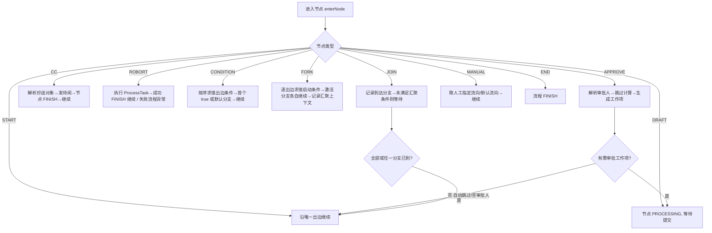

# 流程管理 v1_7 改造分析与方案设计

- **文档定位**：基于《功能实现方案-方案初稿.md》与《功能清单现状核对.md》（2026-11-11 现状调研），结合现有代码实况，产出的改造分析与实施方案设计；作为后续需求 / UI / API / 数据库正式设计文档与研发任务拆解的输入。
- **现状基线核对日**：2026-11-19（代码实况复核）
- **涉及代码基线**：`backend/.../sys/process/`（线性串行引擎）、`frontend/src/views/process/`（列表式模板编辑）、`sys/notify`（TODO/READ 双类型）

---

## 一、现状基线与差距摘要

### 1.1 引擎现状（代码实况）

| 项 | 现状 | 代码依据 |
| --- | --- | --- |
| 流转模型 | **线性串行链**：按 `field_node_no` 顺序取下一节点 | `SysProcessExampleService#nextNode` |
| 节点类型 | START / END / DRAFT / APPROVE / ROBORT（机器人节点运行期无消费方，直接 FINISH） | `SysProcessConstants#NODE_TYPE_*` |
| 节点配置 | `field_node_config` JSON（`SysProcessTemplateNodeConfigDo`）：审批来源/审批人/审批模式/节点触发/自动跳过/ops | 同上 |
| 审批方式 | 单签 single / 会签 countersign | `enterApproveNode`、`isNodePassed` |
| 驳回 | 固定驳回到起草节点，`resumeMode`（重新流转/转回本节点）存工作项 config | `reject` |
| 审批操作 | 通过/驳回/收回/废弃 + 管理员五类特权（跳转/终审/作废/暂停/恢复） | `computeOperations` |
| 图结构 | **无连线结构**，节点表无连线字段 | `SysProcessTemplateNode` |
| 流程变量 | 无 | 核对报告 3.1 |
| 抄送 | 无（通知仅 TODO/READ 两类） | `SysNotifyType` |
| 转办/催办/换人 | 无 | 核对报告 3.5 |
| 流程任务 | 无（ROBORT 仅模板保存校验） | 核对报告 3.1 |
| 统计/监控 | 无统计接口；监控依赖实例列表+详情 | 核对报告 3.6/3.8 |
| 前端设计器 | 节点列表 + 配置弹窗（无画布）；无 LogicFlow 依赖 | `TemplateFormView.vue`、`frontend/package.json` |

### 1.2 初稿能力项 → 差距归类

| 初稿能力 | 差距类型 |
| --- | --- |
| LogicFlow 画布设计器、10 类节点、连线/条件分支/并行分支/人工决策 | **引擎改造 + 前端重写** |
| 串行审批、抄送节点、机器人节点执行、@ProcessTask | **引擎改造 + 新表** |
| 转办/转办收回/已审批人收回/催办/管理员换人/抄送动作 | **新操作 + 留痕 + 通知** |
| 按配置驳回回已流经节点 | **引擎改造（驳回目标）** |
| 审批人/抄送对象公式解析、审批人解析方式（部门/岗位负责人/员工） | **解析服务扩展** |
| 流程监控/流程统计/审批一级菜单（我发起的/我参与的） | **新页面 + 新接口** |

---

## 二、已确认决策（与需求方对齐结论）

| # | 决策点 | 结论 |
| --- | --- | --- |
| D1 | 实施节奏 | **全量设计、分期实施**：按「引擎与数据结构 → 审批操作 → 设计器与页面 → 统计监控收尾」四期推进 |
| D2 | 起草人取消 vs 废弃 | **取消=废弃合并**：不新增 CANCEL 状态，`drafter_cancel` 沿用现有 ABANDON 状态与 `DRAFTER_ABANDON` 留痕 |
| D3 | 驳回目标 | **节点配置驳回目标**：审批节点可配置可驳回目标（起草节点 + 已流经审批节点），驳回时由操作人从允许目标中选择，保留「重新提交后流转方式」机制 |
| D4 | 抄送通知落地 | **复用待阅 READ**：不新增 CC 通知类型，通知中心不加新页签；抄送经 `NotifySendEvent` 发送待阅 |
| D5 | 串行审批语义 | **顺序依次生成工作项**：按审批人列表（含解析方式展开后）顺序，上一人通过后才生成下一人待办 |
| D6 | 人工决策流向 | 流向决策配置项选中「起草节点 + 该人工决策节点往前推的审批节点」；**被选中节点上的审批人在提交审批时可选择人工决策节点的流向，后提交覆盖先提交**；未产生人工指向时走【默认流向】（默认流向为该节点出边之一） |
| D7 | 任务执行留痕 | **新建任务执行日志表** `sys_process_task_log`，审批记录保持人工操作语义 |
| D8 | 流程变量 | **不引入**：条件/并行分支公式仍仅引用文档实体字段（现有 `process_template.${model}.fields` 机制） |

---

## 三、总体设计

### 3.1 目标架构

```text
┌────────────────────────── 前端 ──────────────────────────┐
│ 流程设计器(LogicFlow 画布)  审批面板  流程监控  审批中心  统计 │
└──────────────┬───────────────────────────────────────────┘
               │ /backend/sys/process/*
┌──────────────┴───────────────────────────────────────────┐
│ Controller(模板/实例/操作/统计/设置)                        │
│ Service:                                                  │
│  ├─ SysProcessTemplateService   模板+节点+连线(图)维护/校验  │
│  ├─ SysProcessExampleService    实例创建/快照/操作入口       │
│  ├─ ProcessFlowEngine(新)       图遍历流转引擎(节点进入/流出) │
│  ├─ ProcessHandlerResolver(新)  审批人/抄送对象解析(地址本/公式)│
│  ├─ ProcessTaskRegistry(新)     @ProcessTask 注册与调度      │
│  └─ 统计查询 Service             监控/统计只读聚合            │
├───────────────────────────────────────────────────────────┤
│ 表：template/template_node/template_line/history           │
│    example/example_node/example_line/workitem/audit_note    │
│    task_log(新)                     │
├───────────────────────────────────────────────────────────┤
│ 依赖：formula(公式沙箱)  notify(NotifySendEvent→READ/TODO)  │
│      org(组织对象解析)  quartz(预留超时催办)                  │
└───────────────────────────────────────────────────────────┘
```

### 3.2 图模型与节点键（node_key）

- 模板与实例均改为「节点 + 连线」图结构；连线为流转唯一依据，`field_no` 保留为展示序号、不再参与流转。
- 节点表新增 `field_node_key`（模板内唯一业务键）：固定节点 `N1`(开始) / `N2`(起草) / `N3`(结束)，与初稿一致；其余节点 `N4`、`N5`… 顺延生成。连线以 `from_key` / `to_key` 表达。
- 实例创建时节点与连线**全量快照复制**（含配置），保证按创建时版本执行（与现状「节点配置快照」语义一致）。
- 保存校验（模板 Service）：
  - 连线必须从 N1 起连通可达 N3；节点出边数符合类型约束（见 3.3）；
  - 无孤立节点；条件分支节点必须存在一条「默认分支」出边；并行开始/结束必须成对且分支必须汇聚到对应并行结束节点；
  - 人工决策节点默认流向必须是其实际出边目标之一。

### 3.3 节点类型全集（10 类）

| 类型 | node_type 值 | 图形 | 出边数 | 引擎语义 | 配置要点 |
| --- | --- | --- | --- | --- | --- |
| 开始节点 | START（沿用） | 圆角矩形 | 1（固定到 N2） | 直接沿出边流转 | 节点名称 |
| 起草节点 | DRAFT（沿用） | 直角矩形 | 1（默认到 N3） | PROCESSING，等待起草人提交 | 节点名称 |
| 结束节点 | END（沿用） | 圆角矩形 | 0 | 进入即流程办结 | 节点名称 |
| 审批节点 | APPROVE（沿用） | 直角矩形 | 1 | 解析审批人→串行/单签/会签→工作项 | 见 5.1 |
| 抄送节点 | CC（新增） | 直角矩形 | 1 | 解析抄送对象→发 READ 待阅→自动办结 | 见 5.2 |
| 条件分支 | CONDITION（新增） | 斜正方形 | N | 按序计算分支条件，**取第一个 true 的出边**；无 true 走默认分支 | 分支条件存连线 |
| 并行开始 | FORK（新增） | 上半圆 | N | 各出边按「分支启动条件」并行激活；无可流转分支按配置报错或继续 | 汇聚模式配置 |
| 并行结束 | JOIN（新增） | 下半圆 | 1 | 等待激活分支全部（或任一，按 FORK 配置）到达后流出 | — |
| 机器人节点 | ROBORT（沿用历史拼写） | 直角矩形 | 1 | 执行节点配置的 @ProcessTask 任务→办结；失败转流程异常 | 见 5.4 |
| 人工决策 | MANUAL（新增） | 斜正方形 | N | 到达时按「最近一次人工指定流向」流出，无指定走默认流向 | 见 5.3 |

> 兼容注：`ROBORT` 为存量历史值（正确拼写应为 ROBOT），为避免数据迁移与兼容负担，**沿用不改名**，文档中注明。

### 3.4 流转引擎设计（图遍历）

现状 `enterFlow`（按 `field_no` 顺延的 while 循环）重构为按连线的节点进入/流出引擎：



要点：

1. **审批节点完成流出**：单签（任一通过）/会签（全员通过）/串行（队列走完）后沿唯一出边继续；自动跳过（PASS）与空审批人按现有三段式配置 + 扩展语义（见 5.1）处理。
2. **并行汇聚**：FORK 进入时激活分支集合与 JOIN 到达进度记录在实例节点新增运行态字段 `field_runtime`（JSON，仅实例节点表）。分支末端节点完成流入 JOIN 时计数，满足 `joinMode`（全部/任一）后流出。**嵌套并行本期不支持**（保存校验拒绝）。
3. **人工决策流向指定**：配置为「流向决策节点」的审批节点，其审批人在 pass 时可附带 `flowChoice`（目标节点 key，可选），存入该工作项 `field_config`；流程到达 MANUAL 节点时按审批记录时间倒序取最近一个带 `flowChoice` 的通过记录，无则走默认流向出边。
4. **驳回（改造）**：驳回目标 = 节点配置 `rejectTargets`（起草节点 + 已流经审批节点，模板校验时限定）；操作人从允许目标中选择驳回目标节点，并选择「重新提交后流转方式」（resumeMode 沿用）；目标为非起草节点时流程仍转 RETURN，重新提交按 resumeMode 回到驳回节点或重新流转。
5. **流程异常**：公式解析失败（审批人/抄送对象解析不出合法组织对象且节点配置为「不跳过」）、机器人任务执行失败、并行无可流转分支且配置为「报错」→ 实例转 `PAUSE` 并生成 `ADMIN_PAUSE` 之外的专用留痕 `SYSTEM_ERROR`（新增审批记录类型，附错误摘要），由管理员经「换审批人/跳转/作废」人工干预。异常不回滚已完成的节点。
6. **管理员操作在图模型下的语义**：跳转=废弃在途工作项后从目标节点进入引擎（不变）；暂停/恢复/终审/作废不变；新增「更换审批人」（见 4.2）。

---

## 四、审批操作体系（14 类）

### 4.1 操作清单与现状映射

| 操作标识 | 名称 | 现状 | 改造内容 |
| --- | --- | --- | --- |
| drafter_submit | 起草人提交 | ✅ `submit` | 沿用；提交时支持人工决策流向指定（若 N2 配置为决策节点） |
| drafter_cancel | 起草人取消 | ✅ 合并 | **按 D2 并入废弃**：`abandonByDrafter`，状态 ABANDON，留痕 `DRAFTER_ABANDON`，不新增 CANCEL |
| drafter_retract | 起草人收回 | ✅ `back` | 沿用 |
| drafter_expedite | 起草人催办 | ❌ | 新增：向当前节点全部 PROCESSING 工作项处理人发催办待阅（READ） |
| handler_pass | 审批人通过 | ✅ `pass` | 扩展：可附带人工决策 `flowChoice`；串行模式下通过后生成下一顺序人工作项 |
| handler_reject | 审批人拒绝 | ✅ `reject` 改造 | 按 D3：从节点配置 `rejectTargets` 中选择驳回目标 + resumeMode；留痕新增 `HANDLER_REJECT`（沿用 `HANDLER_RETURN` 语义，保留旧值兼容历史数据） |
| handler_cc | 审批人抄送 | ❌ | 新增：审批人可抄送其他用户（地址本多选），发 READ 待阅 + 留痕 `HANDLER_CC` |
| handler_transfer | 审批人转办 | ❌ | 新增：当前工作项转 ABANDON，为被转办人生成新工作项（`field_from_workitem_id` 关联），留痕 `HANDLER_TRANSFER` |
| handler_transfer_retract | 转办收回 | ❌ | 新增：被转办工作项仍 PROCESSING 时，原审批人可收回：转办工作项 ABANDON，为原审批人生成新工作项，留痕 `HANDLER_TRANSFER_RETRACT` |
| processed_retract | 已审批人收回 | ❌ | 新增：已办结工作项且该节点仍 PROCESSING 时可收回：收回到本人（本人重新持 PROCESSING 工作项），流程只能正常流转（不得用于已流过的后续节点）；留痕 `PROCESSED_RETRACT` |
| processed_expedite | 已审批人催办 | ❌ | 新增：同起草人催办，发起人为已审批人 |
| admin_abandon | 管理员废弃 | ✅ `adminOperate(ABANDON)` | 沿用 |
| admin_jump | 管理员跳转 | ✅ `adminOperate(JUMP)` | 沿用；目标节点范围扩展为任意审批/起草/人工决策节点 |
| admin_change_handler | 管理员更换审批人 | ❌ | 新增：将当前节点指定 PROCESSING 工作项处理人替换为目标用户（仅本实例有效），留痕 `ADMIN_CHANGE_HANDLER` |

新增审批记录类型（`sys_process_audit_note.field_handle_type`，VARCHAR 不改列）：`DRAFTER_EXPEDITE`、`HANDLER_CC`、`HANDLER_TRANSFER`、`HANDLER_TRANSFER_RETRACT`、`PROCESSED_RETRACT`、`PROCESSED_EXPEDITE`、`ADMIN_CHANGE_HANDLER`、`SYSTEM_ERROR`；`HANDLER_RETURN` 保留兼容，新增 `HANDLER_REJECT` 与初稿标识对齐。

### 4.2 操作的鉴权与配置

- **统一操作入口**：新增 `POST /backend/sys/process/operation/operate`，请求体 `{ exampleId, operateType, workitemId, content, targetNodeId, rejectTargetKey, flowChoice, transferToIds, changeToId, resumeMode }`，内部转发引擎各方法（扩展现有 `operate()` 通道）；业务模块 `audit` 转发通道同步扩展操作类型。
- **节点级操作配置**（初稿「审批操作」明细表）：审批节点配置新增 `operations` 段，按「起草人 / 审批人 / 已处理人」三行配置可执行操作类型、操作名称（可编辑，默认操作类型名）、默认审批意见；**必须包含且仅包含一个 `handler_pass`**（保存校验）。前端审批面板按此配置渲染按钮。
- **权限兜底**：所有操作经 resolver `ACTION_PROCESS_EXAMPLE_OPERATE` 分支 + 引擎内操作人身份校验（起草人/当前处理人/已处理人/流程管理员）；面板展示仍走 `panel.operations` 计算（按节点 operations 配置 ∩ 用户身份）。
- **业务操作标识 ops 维持现有设计**（初稿「审批权限：维持现有设计，不做更改」）：`ops` 操作标识体系与 `resolveNodeOps` 不变。

---

## 五、节点配置设计

节点配置仍统一存 `sys_process_template_node.field_node_config`（实例侧快照），`SysProcessTemplateNodeConfigDo` 按节点类型扩展字段（统一 Do + 可空字段，向后兼容）。分支条件/分支序号/默认分支标记**存连线表**（见 6.1），不在节点配置中冗余。

### 5.1 审批节点

| 配置项 | 配置键 | 值域/说明 |
| --- | --- | --- |
| 节点名称 | `field_node_name` | — |
| 审批源 | `handlerSource` | `org`（地址本，默认）/ `field`（表单字段，沿用）/ `formula`（公式定义器，新增） |
| 审批人 | `handlerIds/handlerNames` | 地址本多选，扩为：机构、部门、人员、岗位、群组、角色（见 5.5 解析规则） |
| 审批人公式 | `handlerFormula` | 审批源=formula 时必填；解析规则见 5.6 |
| 审批人字段 | `handlerField` | 审批源=field 时沿用 |
| 审批人解析方式 | `handlerResolveMode` | 部门：`leader`（部门负责人）/`member`（部门员工）；岗位：`leader`（岗位负责人）/`member`（岗位员工）；默认 leader；仅对选中对象中的部门/岗位生效 |
| 审批方式 | `approveMode` | `single` 单签 / `serial` 串行（新增）/ `countersign` 会签；串行按审批人列表顺序依次生成工作项（D5） |
| 相同审批人是否跳过 | `skipMode` | `system` 同系统配置 / `none` 不跳过 / `prev` 上一审批节点审批人相同时跳过 / `any` 已审批人相同时跳过；兼容旧值 `yes`→`prev`、`no`→`none` |
| 无审批人时是否跳过 | `emptyHandlerMode` | `system`（同系统，默认跳过）/ `skip` 跳过该节点 / `error` 不跳过（转流程异常） |
| 驳回目标 | `rejectTargets` | 可驳回目标节点 key 列表（起草节点 + 本节点之前流经的审批节点，模板校验限定）；空=默认仅起草节点 |
| 审批操作 | `operations` | 三行（起草人/审批人/已处理人）× {操作类型, 操作名称, 默认审批意见}；必含 handler_pass |
| 审批权限 | `ops` | 维持现有设计不变 |
| 流程任务 | `tasks` | 明细表：{任务名称, 执行任务(@ProcessTask name), 执行步骤(ProcessTaskType), 任务参数} |

### 5.2 抄送节点

| 配置项 | 配置键 | 说明 |
| --- | --- | --- |
| 节点名称 | `field_node_name` | — |
| 抄送源 | `ccSource` | `org`（地址本）/ `formula`（公式定义器） |
| 抄送对象 | `ccIds/ccNames`、`ccFormula` | 地址本多选：机构、部门、人员、岗位、群组、角色；公式解析规则同 5.6 |
| 流程任务 | `tasks` | 同审批节点 |

引擎行为：进入抄送节点→解析抄送对象（空按「跳过」处理并留痕）→按对象逐人发 READ 待阅（`NotifySendEvent`，标题复用 `SETTING.notify.*` 模板体系，新增 `notify_cc_subject` 配置）→生成 `CC_AUTO` 审批留痕→节点 FINISH 继续流转。

### 5.3 人工决策节点

| 配置项 | 配置键 | 说明 |
| --- | --- | --- |
| 节点名称 | `field_node_name` | — |
| 流向决策 | `flowDecisions` | 节点 key 列表：起草节点 + 该节点往前（图上可达上游）的审批节点，多选；被选中节点的审批人提交审批时可指定本节点流向（D6） |
| 默认流向 | `defaultFlowKey` | 本节点出边目标之一（保存校验）；无人工指定时走默认流向 |

### 5.4 机器人节点

| 配置项 | 配置键 | 说明 |
| --- | --- | --- |
| 节点名称 | `field_node_name` | — |
| 执行任务 | `tasks` | 明细表：{任务名称, 执行任务, 执行步骤, 任务参数}；节点进入时按序执行，任一失败转流程异常 |

### 5.5 地址本对象解析规则（审批人/抄送对象通用）

| 选中对象 | 解析方式=负责人(leader) | 解析方式=成员(member) |
| --- | --- | --- |
| 人员 | 本人 | 本人 |
| 岗位 | `sys_org_post.field_leader_id` | 岗位关联用户 |
| 部门 | `sys_org_dept.field_leader_id` | 部门下员工 |
| 机构 | `sys_org_org.field_leader_id` | 机构下员工 |
| 群组 | 群组成员 | 群组成员 |
| 角色 | 持有该角色的用户（经权限体系反查） | 同左 |

组织模型已具备 `field_leader_id`（`SysOrgOrg/SysOrgDept/SysOrgPost`），解析服务落 `ProcessHandlerResolver`；解析结果去重保序（串行顺序=地址本选择顺序+解析展开顺序）。

### 5.6 公式定义器解析规则（审批源/抄送源 = formula）

- 公式经公式定义器（AviatorScript 沙箱）执行，占位符仅允许引用文档实体字段（`process_template.${model}.fields`，D8 不引入流程变量）；
- 结果解析：
  1. 文本 → 以文本值作为 `field_id` 查询组织架构对象；
  2. JSON/Map → 取其 `field_id` 值查询；
  3. List → 逐项按 1/2 解析后取合集（去重保序）；
  4. 其他类型或解析失败（对象不存在；**允许处于禁用状态**）→ 转流程异常（见 3.4 第 5 条）；
- 条件分支/并行分支条件公式：沿用现有触发条件机制（判断公式 + 文档字段占位符），执行经公式校验服务。

---

## 六、数据结构设计（表变更汇总）

表结构一律由实体注解（`@TableSource/@ColumnField/@TableIndex`）声明，经注解同步引擎同步（dev=APPLY、prod=VALIDATE）；**不新增迁移脚本**，存量回填用 `SourceDataMigration` SPI（code 格式 `DM-yyyyMMdd-nnn`）。

### 6.1 新增表

**`sys_process_template_line` 模板连线表**（继承 BaseModel，流水结构）：

| 列 | 类型 | 说明 |
| --- | --- | --- |
| field_template_id | VARCHAR(32) | 模板 id，索引 (template_id)、(template_id, from_key) |
| field_from_key | VARCHAR(50) | 起始节点键 |
| field_to_key | VARCHAR(50) | 目标节点键 |
| field_line_type | VARCHAR(20) | NORMAL / CONDITION / PARALLEL / MANUAL（由源节点类型决定，显式存储便于校验） |
| field_branch_order | INT | 分支序号（条件/并行分支的判断顺序，上移下移即改此值） |
| field_branch_name | VARCHAR(200) | 分支名称（可空） |
| field_condition | TEXT | 分支条件公式（条件分支/并行启动条件，可空） |
| field_is_default | BIT(1) | 是否默认分支（条件分支节点有且仅有一条 true） |

**`sys_process_example_line` 实例连线快照表**：同构，`field_example_id` 替代 `field_template_id`（快照复制）。

**`sys_process_task_log` 流程任务执行日志表**（流水类，只增不改，无 enable/update 列，对齐 `sys_task_history` 先例）：

| 列 | 类型 | 说明 |
| --- | --- | --- |
| field_example_id | VARCHAR(32) | 实例 id，索引 |
| field_node_id | VARCHAR(32) | 节点 id（可空：StartProcess/EndProcess 步骤） |
| field_workitem_id | VARCHAR(32) | 工作项 id（可空） |
| field_task_name | VARCHAR(200) | @ProcessTask name |
| field_task_bean | VARCHAR(200) | 任务实现类/bean 标识 |
| field_task_type | VARCHAR(50) | 执行步骤（ProcessTaskType） |
| field_params | JSON | 任务参数（可空） |
| field_result | JSON | 执行结果摘要（可空） |
| field_success | BIT(1) | 是否成功 |
| field_error_msg | TEXT | 失败信息（可空） |
| field_cost_ms | BIGINT | 耗时毫秒 |

### 6.2 存量表变更

| 表 | 变更 | 说明 |
| --- | --- | --- |
| sys_process_template_node | 新增 `field_node_key` VARCHAR(50) | 节点业务键（N1/N2/N3/…），模板内唯一 |
| sys_process_example_node | 新增 `field_node_key` VARCHAR(50)；新增 `field_runtime` JSON（可空） | 快照；运行态（并行汇聚进度等） |
| sys_process_example_workitem | 新增 `field_from_workitem_id` VARCHAR(32)（可空） | 转办/收回来源工作项追溯 |
| sys_process_example / sys_process_audit_note / sys_process_template / history | 无列变更 | 状态复用 ABANDON（D2）；记录类型为 VARCHAR 新增值即可 |

### 6.3 存量数据迁移（SourceDataMigration）

1. `DM-xxx-001`：为全部存量模板节点回填 `field_node_key`（按 field_no 顺序 N1..Nn）；
2. `DM-xxx-002`：为存量模板按 `field_no` 顺序生成线性连线（N1→N2→…→N3），并写入实例连线快照（含在途实例）——迁移后旧模板/在途实例全部按新引擎照常流转；
3. 存量节点配置 JSON 不改写（`skipMode` 兼容映射在引擎读取时做 `yes/no → prev/none` 归一）。

---

## 七、流程任务 @ProcessTask 设计

### 7.1 注解与接口（修正初稿语法）

```java
public @interface ProcessTask {
    String name();                                    // 任务名称（唯一，注册键）
    String[] processTemplate() default {};            // 可调用的流程模板分类（field_model_name），空=全部
    boolean isForce() default false;                  // 强制任务：所有流程实例创建/结束时执行
    ProcessTaskType forceTaskType() default ProcessTaskType.StartProcess;
    ProcessTaskType[] allowTaskType() default {};     // 非强制任务允许配置到的步骤，空=不限
}

public enum ProcessTaskType {
    CreateProcess,   // 创建实例（对应流转图"创建实例"）
    StartProcess,    // 流程发起
    StartNode,       // 节点进入
    StartWorkitem,   // 工作项开始
    SendTodo,        // 发送待办
    EndWorkitem,     // 工作项结束（审批操作后）
    EndNode,         // 节点结束
    EndProcess       // 流程结束
}

public interface ProcessTaskHandler {          // 初稿名为 ProcessTask，见下方命名说明
    void execute(ProcessTaskContext context);
}

public class ProcessTaskContext {
    private Object model;                       // 业务单据（经文档字段服务的 Mapper 读取）
    private SysProcessExample process;          // 流程实例
    private SysProcessExampleNode node;         // 当前节点（可空）
    private SysProcessExampleWorkitem workitem; // 当前工作项（可空）
    private Map<String, Object> params;         // 任务参数（节点配置 tasks[].params 原样透传，可空）
}
```

> 初稿中 `Enum<String> forceTaskType()` 为非法语法，修正为枚举类型；`isForce` 由 String 修正为 boolean。
>
> **接口命名落定（P17-BE-005 实现）**：初稿把注解与接口都写作 `ProcessTask`，Java 同包不允许注解与接口同名，
> 故接口按仓库先例 `sys/task/annotation/SysTask.java`（注解）+ `sys/task/annotation/SysTaskExecutor.java`（接口）
> 落定为 **`ProcessTaskHandler`**（注解保持 `@ProcessTask`）；实现类命名同先例，为
> `com.eric.base.sys.process.task.ProcessTaskExecutorImpl`。

### 7.2 注册与执行

- **注册**：启动期（`SysStartupTask#run` 流程初始化段内，第十四个启动任务）扫描容器中「类上同时标注 `@ProcessTask` 且实现 `ProcessTaskHandler`」的 bean，登记 `name → bean` 到 `ProcessTaskRegistry`；注解与接口缺一即启动报错（fail-fast）；`name` 重复报错；同一实现类重复扫描幂等跳过。
- **执行点**：引擎在流转图各 `ProcessTaskType` 步骤触发——强制任务（`isForce=true`，仅 StartProcess/EndProcess）对所有实例生效；节点配置任务按节点配置 `tasks` 执行（执行任务=登记的 name，执行步骤=ProcessTaskType，任务参数=JSON 存 task_log.params）。P17-BE-005 落地的触发点：
  - `StartProcess`：`ProcessFlowEngine#enterFlow` 每次进入流转（提交/重新提交）触发一次；同名强制任务同点执行。
  - `CreateProcess`：`enterStart` 进入 START 节点时触发，步骤任务从该节点 `field_node_config.tasks` 解析。
  - `StartNode`：`enterNode` 首次进入节点（节点状态 WAITING）触发一次，恢复/重复入队不重复触发。
  - `StartWorkitem` / `EndWorkitem`：生成工作项时按工作项状态触发（PROCESSING=开始、自动跳过直接 FINISH=结束）；请求对象携带工作项供任务上下文组装。
  - `EndNode`：统一由 `finishNode` 在节点办结处触发（机器人节点、审批节点、条件/并行/汇聚/抄送/人工决策节点等全部办结路径）。
  - `EndProcess`：`enterEnd` 进入 END 节点触发；同名强制任务同点执行。
  - `SendTodo`：未接线（待办发送由 P17-BE-014 通知收口后接入，本任务不触发）。
- **校验**：节点配置任务时校验 processTemplate 匹配（不配置=全模板可用）、allowTaskType 包含所选步骤；强制任务只允许落在 StartProcess/EndProcess。执行前同口径复校（`ProcessTaskRegistry#validateTask`）。
- **留痕**：每次执行写 `sys_process_task_log`（D7），成功与失败均留痕（taskName/taskBean/taskType/params/result/success/errorMsg/costMs/exampleId/nodeId/workitemId/createTime）；审批记录不承载任务留痕。
- **事务语义**：任务在当前流转事务内同步执行；抛异常→流程异常（PAUSE + SYSTEM_ERROR 留痕），任务日志记 failed；留痕写入失败不改变流转结果（记 WARN）。
- **机器人节点兼容**：`enterRobort` 仅兜底执行 `taskType` 无法解析的遗留明细；已声明合法 `ProcessTaskType` 的明细由上述步骤触发点统一执行，避免同一任务被「步骤触发」与「机器人节点」各执行一次。
- **实现落点**：`sys/process/task/`（`@ProcessTask`、`ProcessTaskHandler`、`ProcessTaskContext`、`ProcessTaskRegistry`、`ProcessTaskExecutorImpl`）+ 引擎窄接口扩展 `ProcessTaskForceExecutor`（引擎按 `instanceof` 探测，未实现时按无强制任务处理）。

---

## 八、API 设计（清单级，正式契约另出 API 分册）

路径规则 `/backend/sys/process/{次级}/{方法}`；全部补 `ACTION_*` 常量 + resolver 分支 + `@Operation` 文档注解（同批更新）。

### 8.1 模板（改造）

| 接口 | 方法 | 变更 |
| --- | --- | --- |
| /backend/sys/process/module/load | GET | 响应扩展：nodes（含 node_key、node_config）+ lines |
| /backend/sys/process/module/save、/update | POST | 请求体扩展 nodes + lines；服务端做图校验（3.2） |

### 8.2 实例与操作（新增/改造）

| 接口 | 方法 | 说明 |
| --- | --- | --- |
| /backend/sys/process/example/list | POST | 扩展 `scope`：`admin`(默认，现列表) / `myCreated` / `myJoined`（作为审批人/已审批人）；scope=my* 限本人数据 |
| /backend/sys/process/example/load、/panel | GET | panel 响应扩展：节点 operations 配置渲染所需数据、连线（图渲染用） |
| /backend/sys/process/operation/operate | POST | **新增统一操作接口**（4.2 请求体）；鉴权 ACTION_PROCESS_EXAMPLE_OPERATE |
| /backend/sys/process/example/monitorList | POST | 流程监控列表（管理员，全部在途/全部实例 + 异常状态筛选） |

### 8.3 统计（新增）

| 接口 | 方法 | 说明 |
| --- | --- | --- |
| /backend/sys/process/statistic/admin | POST | 管理员统计：按模块/模板/状态/时间区间的数量、效率（平均耗时）、人员工作量聚合 |
| /backend/sys/process/statistic/my | POST | 我的统计：今日发起、我的未办结、待审、今日已审、平均耗时 |

统计为只读查询，新增统计专用 Mapper XML，不侵入流转 SQL（对齐现状核对报告建议 4）。

---

## 九、前端设计（清单级，正式契约另出 UI 分册）

### 9.1 流程设计器（LogicFlow）

- 新增依赖：`@logicflow/core`、`@logicflow/extension`（版本随实施时最新稳定版，落 `frontend/package.json`）。
- `TemplateFormView.vue` 重写为画布式：左侧节点物料面板（10 类节点按 3.3 图形自定义 LogicFlow 节点样式）、中部画布（节点拖拽/连线/删除，固定 N1/N2/N3 不可删）、右侧属性抽屉（节点配置弹窗，多标签：基本/审批操作/审批权限/流程任务，按节点类型渲染）。
- 连线交互：从节点锚点拉出；条件分支/并行分支连线弹出分支配置（名称/序号/条件公式/默认分支标记）；条件公式编辑复用现有公式编辑弹窗形态。
- 数据结构：画布 LogicFlow graph ⇄ `nodes[] + lines[]` 双向转换；保存时整体提交。
- 实例详情：流程图渲染（只读，节点状态着色：WAITING/PROCESSING/FINISH/PASS/REJECT）替代现有线性节点列表（保留列表作为辅助）。

### 9.2 页面与菜单

| 页面 | 路由 | 菜单 | 权限 |
| --- | --- | --- | --- |
| 流程监控 | /process/monitor | 流程管理 → 流程监控 | SYS_PROCESS_EXAMPLE_ADMIN（管理员级） |
| 流程统计 | /process/statistic | 流程管理 → 流程统计 | SYS_PROCESS_EXAMPLE_ADMIN |
| 我发起的 | /approval/created | 审批（新一级菜单）→ 我发起的 | 登录用户（全员） |
| 我参与的 | /approval/joined | 审批 → 我参与的 | 登录用户（全员） |
| 我的流程统计 | /approval/statistic | 审批 → 我的流程统计 | 登录用户（全员） |

- `HomeView.vue` 补「审批」一级菜单与 `activeMenu` 前缀归约（`/approval`、`/process`）；
- 审批面板 `ProcessApprovalPanel.vue`：按节点 `operations` 配置渲染操作按钮（通过/拒绝[选择驳回目标+resumeMode]/转办/收回/抄送/催办），人工决策流向选择控件，抄送人选择地址本组件；
- 通知待办页不加新页签（D4），催办/抄送均以 READ 待阅呈现。

---

## 十、权限设计

| 项 | 值 |
| --- | --- |
| 新增 ACTION_* | `sys.process.example.operate`、`sys.process.example.monitorList`、`sys.process.statistic.admin`、`sys.process.statistic.my` |
| 权限码 | 新增 `SYS_PROCESS_MY_VIEWER`（我的发起/参与/统计，**roles.yml 默认全员授予**）；监控/统计复用 `SYS_PROCESS_EXAMPLE_ADMIN` |
| roles.yml | 同批补 `ROLE_LIST` + `ROLE_MAP`（库与 yml 两处同批提交） |
| resolver | ProcessResolver 补上述 switch 分支；`SYS_ADMIN` 由 BaseResolver 自动放行 |
| 操作身份校验 | 起草人/当前处理人/已处理人/流程管理员四类身份在引擎方法内校验（沿用现有模式） |

---

## 十一、实施分期（D1：全量设计、分期实施）

| 期 | 范围 | 关键产出 | 验收 |
| --- | --- | --- | --- |
| **M1 引擎与数据结构** | 连线表/快照表/任务日志表、node_key、引擎图遍历（条件/并行/串行/抄送节点/机器人/MANUAL）、审批人解析扩展（地址本全类型+解析方式+公式）、@ProcessTask 体系、存量迁移（6.3） | 引擎单测（各节点类型流转矩阵）、迁移幂等验证 | 旧模板经迁移后在新引擎下流转等价；dev 库 VALIDATE 零 diff |
| **M2 审批操作与通知** | 14 类操作、统一 operate 接口、节点 operations 配置、转办/收回/催办/换人、驳回目标改造、通知收口（READ 待阅 + `notify_cc_subject`/催办标题配置消费） | 操作矩阵单测、通知联调 | 全部操作留痕正确；催办/抄送待阅可达 |
| **M3 设计器与页面** | LogicFlow 设计器、节点配置弹窗重构、实例流程图渲染、审批面板改造、监控页、审批一级菜单（我发起的/我参与的）、HomeView 菜单 | `npm run build` 通过、页面走查 | 设计器保存→发起→审批全链路走通 |
| **M4 统计与收尾** | 流程统计/我的流程统计、统计 Mapper、API 文档注解全量核对、`docs/系统模块/` 与 `docs/设计文档/sys/process/` 文档同步 | 统计接口+页面 | ApiDocsTest 通过；文档三处一致（代码/注解/文档） |

---

## 十二、风险与对策

| 风险 | 对策 |
| --- | --- |
| 引擎 DAG 化回归（并行汇聚死等、条件全 false 等） | M1 先行 + 流转矩阵单测覆盖全节点类型；并行限一层嵌套；JOIN 超时/异常可经管理员跳转兜底 |
| 在途实例兼容 | 迁移为在途实例生成连线快照（6.3-2）；`skipMode` 旧值读取时归一，不改写存量 JSON |
| LogicFlow 与 Element Plus 集成/包体积 | 按需引入；设计器路由懒加载 |
| 串行+自动跳过、转办收回+自动跳过的组合语义 | 组合规则在 M1 设计定稿并补测试用例（跳过者不占串行序位；被转办人视为该序位实际处理人） |
| 公式解析审批人失败率（配置错误） | 模板保存时试算校验（公式定义器模拟执行能力已有 `SysFormulaSimulateService`）；运行期失败转流程异常可人工干预 |
| 操作面扩大带来的越权风险 | 统一 operate 接口 + 引擎身份校验双保险；resolver 分支覆盖全部新 ACTION |

---

## 十三、后续文档同步清单（实施时同批更新）

1. `docs/系统模块/系统模块API接口设计文档.md`（新增 operation/monitorList/statistic 分组与 3.5 在线文档说明）；
2. `docs/系统模块/系统模块UI设计文档.md`（设计器、监控、审批菜单、统计页面）；
3. `docs/系统模块/系统模块数据库设计.md` + `docs/设计文档/sys/process/流程表结构.md`（新增 3 表、4 列变更）；
4. `docs/设计文档/sys/process/流程核心业务.md`（节点类型全集、图模型、操作矩阵、@ProcessTask、人工决策语义）；
5. `docs/迁移说明.md`（如涉及配置键变更：新增 `notify_cc_subject` 等 SETTING 项）；
6. `properties/sys/process/roles.yml`（SYS_PROCESS_MY_VIEWER）与 `application.yml`（SETTING 段新增催办/抄送标题模板）。
