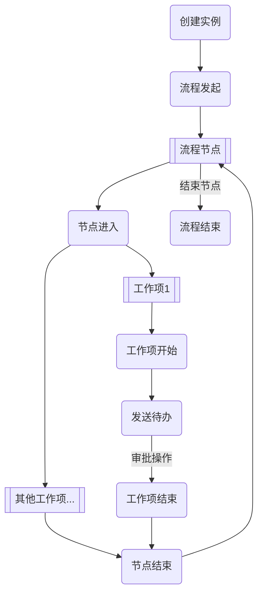

# 一、流程引擎改造

## 流程图形面板、节点、操作等流程升级项

接入 LogicFlow 插件

### 所有节点类型

| 类型名称 | 描述                         | 图形样式 | 流出 | 配置信息             |
| --- |----------------------------|------|----|------------------|
| 开始节点 | 固定 'N1' 节点，不可删除，固定流出到 N2   | 圆角矩形 | 1  | 节点名称             |
| 起草节点 | 固定 'N2' 节点，不可删除，初始默认流出到 N3 | 直角矩形 | 1  | 节点名称             |
| 结束节点 | 固定 'N3' 节点，不可删除            | 圆角矩形 | 0  | 节点名称             |
| 审批节点 | 可编辑添加的审批节点 | 直角矩形 | 1  | 节点名称，审批人，审批方式等   |
| 抄送节点 | 可编辑添加的抄送节点 | 直角矩形 | 1  | 节点名称，抄送人等        |
| 条件分支节点 | 可编辑添加的条件分支节点 | 斜正方形 | N  | 节点名称，各流出条件分支条件等  |
| 并行节点（开始）| 可编辑添加的并行节点（开始） | 上半圆  | N  | 节点名称，各并行分支的启动条件等 |
| 并行节点（结束）| 可编辑添加的并行节点（结束） | 下半圆  | 1  | 节点名称，并行结束条件等     |
| 机器人节点 | 可编辑添加的机器人节点 | 直角矩形 | 1  | 节点名称，执行任务等       |
| 人工决策 | 可选择流向的条件分支节点 | 斜正方形 | N | 节点名称，流向决策节点 |

### 所有审批操作

| 操作标识              | 名称     | 描述                                                  |
|-------------------|--------|-----------------------------------------------------|
| drafter_submit    | 起草人提交  | 从起草节点提交到审批节点                                        |
| drafter_cancel    | 起草人取消  | 起草人取消流程，文档和流程状态转入 'CANCEL'                          |
| drafter_retract   | 起草人收回  | 起草人在流程中节点可执行的操作，流程转回起草节点，流程和文档状态转入 'DRAFT'          |
| drafter_expedite   | 起草人催办  | 起草人在审批节点可执行的操作，给当前审批人发送催办消息                         |                                     
| handler_pass      | 审批人通过  | 当前审批人可执行操作，当前审批人通过                                  |
| handler_reject    | 审批人拒绝  | 当前审批人可执行操作，当前审批人拒绝，根据配置可拒绝回已流经节点，并配置后续正常流转还是直接跳回本节点 |
| handler_cc        | 审批人抄送  | 当前审批人可执行操作，抄送给其他用户                                  |
| handler_transfer  | 审批人转办  | 当前审批人可执行操作，转办给其他用户审批，此时自己不会作为该节点的已审批人               |
| handler_transfer_retract | 审批人转办收回 | 当前审批人转办后且未被审批前可执行操作，转办收回                            |
| processed_retract | 已审批人收回 | 已审批人可执行操作，文档收回到已审批人的节点，收回流程只能正常流转                   |
| processed_expedite | 已审批人催办 | 已审批人可执行操作，给当前审批人发送催办消息                              |
| admin_abandon     | 管理员废弃  | 管理员可执行操作，流程废弃，流程状态转入 'ABANDON'                      |
| admin_jump        | 管理员跳转  | 管理员可执行操作，流程跳转到指定节点                                  |
| admin_change_handler | 管理员更换审批人 | 管理员直接更换当前节点审批人，只对该流程实例有效                            |

### 所有节点配置信息

- 审批节点

1. 基本配置

| 属性名称 | 描述                                          |
| --- |---------------------------------------------|
| 节点名称 | 节点名称                                        |
| 审批源 | 地址本、公式定义器                                   |
| 审批人 | 地址本，多选，包含部门、人员、岗位、群组；公式定义器，填写公式             |
| 审批人解析方式 | 区分部门、岗位的解析方式；部门（部门领导人/部门员工）；岗位（岗位负责人/岗位员工）； |
| 审批方式 | 串行、单签、会签                                    |
| 相同审批人是否跳过 | 同系统配置、不跳过、上一审批节点审批人相同时跳过、已审批人相同时跳过          |
| 无审批人时是否跳过 | 同系统配置、跳过该节点、不跳过该节点（系统报错）                    |

2. 审批操作

配置每个节点上的起草人、审批人、已处理人 的可执行操作，必须有一个 handler_pass 操作；人员为固定起草人、审批人、已处理人的三行，行内再补充操作类型的明细表；

```
|-------------------------------------|
| 人员 | 操作类型 | 操作名称（可编辑，默认操作类型名称） | 默认审批意见（可编辑） |
|-------------------------------------|
| 起草人 | drafter_expedite | 催办 | 催办 |
|       | drafter_cancel | 取消 | 取消 |
|-------------------------------------|
| 审批人 | handler_pass | 通过 | 通过 |
|       | handler_transfer | 转办 | 转办 |
|       | handler_cc | 抄送给别人 | 给你看看 |
|-------------------------------------|
| 已处理人 |                          |
|-------------------------------------|
```

3. 审批权限

4. 流程任务（明细表）

| 属性名称 | 描述                      |
|------|-------------------------|
| 任务名称 | 填写                      |
| 执行任务 | 执行任务选择，结合后续章节 "流程任务" 实现 |
| 执行步骤 | `ProcessTaskType`       |
| 任务参数 | 该任务类的全局变量               |

- 抄送节点

1. 基本配置

| 属性名称 | 描述                             |
|------|--------------------------------|
| 节点名称 | 节点名称                           |
| 抄送源  | 地址本、公式定义器                                   |
| 抄送对象 | 地址本，多选，包含机构、部门、人员、岗位、群组、角色；公式定义器，填写公式 |

2. 流程任务（明细表）

- 机器人节点

1. 基本配置

| 属性名称 | 描述                      |
|------|-------------------------|
| 节点名称 | 节点名称                    |
| 执行任务（明细表） | 执行任务选择，结合后续章节 "流程任务" 实现 |
| 任务参数（明细表） | 任务参数，结合后续章节 "流程任务" 实现 |

- 条件分支节点（取第一个条件判断为 true 的分支）

| 属性名称      | 描述                           |
|-----------|------------------------------|
| 节点名称      | 人工决策节点名称，可编辑                 |
| 默认条件分支    | 选择默认条件分支，必选                  |
| 条件分支明细表   | 条件分支明细表                      |
| 条件分支1     | 包含连线名称、流向节点、条件分支判断公式；上移、下移   |
| 条件分支2     | 包含连线名称、流向节点、条件分支判断公式；上移、下移   |
| ... ...   |
| 条件分支明细表结束 | ---                          |
| --------- | ---------------------------- |

- 并行节点（开始）

| 属性名称          | 描述                            |
|---------------|-------------------------------|
| 并行分支1         | 并行分支判断公式                      |
| 并行分支1         | 并行分支判断公式                      |
| ... ...       |
| 是否需全部通过       | 全部进入流转的分支通过后才继续流转、任一分支通过即继续流转 |
| 无可流转分支时是否继续流转 | 是、否（流程报错）                     |

- 人工决策

| 属性名称 | 描述                                            |
|------|-----------------------------------------------|
| 节点名称 | 节点名称                                          |
| 流向决策 | 起草节点和该节点往前计算的所有可流经审批节点，多选；选中的节点在提交审批的时候需要指定该节点的流程流向 |
| 默认流向 | 初始默认流向                                        |


## 流程监控页面和管理员流程控制

1. 在【流程管理】中增加【流程监控】菜单，属于管理员级权限，管理员访问可见所有在途流程实例；
2. 在流程实例详情页面显示流程实例的相关信息和审批状态信息；可以通过管理员权限进行流程特批操作；

## 待办通知页面的查询类型，和用户用流程页面

1. 增加一级菜单栏【审批】，增加二级菜单【我发起的】，用户访问可见自己发起的流程实例；
2. 增加二级菜单【我参与的】，用户访问可见自己作为审批人/已审批人的流程实例；

## 流程统计

1. 在【流程管理】中增加【流程统计】菜单，属于管理员级权限，管理员访问可见所有流程实例的统计信息；
2. 在【审批】中增加【我的流程统计】菜单，用户访问可见自己参与的各类流程的统计信息，当前预设：今日发起流程数、我的未办结流程、待审流程、今日已审、平均耗时等

## 审批人和抄送对象在公式定义器上的解析方式

- 传入文本，以文本值作为 field_id 查询组织架构对象
- 传入 json/map 对象，取其 field_id 值作为 field_id 查询组织架构对象
- 传入 list，对每一项进行上面的文本和 json/map 解析，取合集；
- 其他类型的传入和解析组织架构对象失败（对象不存在，但允许处于禁用状态）时转为流程异常；

## 流程、节点、工作项流转图



```mermaid
flowchart LR
```

```mermaid
flowchart LR
```

## 流程任务

增加注解 @ProcessTask，配置在类上；
增加接口类 ProcessTask，实现接口方法 execute(ProcessTaskContext context)，注解和接口类需要同时存在；
在流程流转中，根据配置执行对应的任务类的 execute 方法

### 注解格式

```java
public @interface  ProcessTask {
    String name();
    String[] processTemplate();
    String isForce() default false;
    Enum<String> forceTaskType() default ProcessTaskType.StartProcess;
    Enum<String>[] allowTaskType() default ProcessTaskType.StartProcess;
}
public enum ProcessTaskType {
    StartProcess,
    EndProcess,
    StartNode, 
    //...... 参照 流程、节点、工作项流转图 中"()"补充
}

public interface ProcessTask {
    void execute(ProcessTaskContext context);
}

public class ProcessTaskContext {
    // 业务单据
    Object model;
    // 流程实例
    SysProcessExample process;
    // 当前流程节点
    SysProcessExampleNode node;
    // 当前流程节点工作项
    SysProcessExampleWorkItem workItem;
}
```

name: 任务名称
processTemplate: 可调用该任务的流程模板类型，不配置则所有流程模板都可以调用该任务
isForce: 是否强制任务，强制任务会在所有流程中强制执行
forceTaskType: 强制任务时执行任务步骤，只限 'StartProcess' 和 'EndProcess'
allowTaskType: 非强制任务时使用，允许配置到的任务步骤

### 强制任务和非强制任务

isForce = true 时，会在流程实例创建或结束时强制执行该任务

### 配置方式

在节点信息中，配置各节点的【流程任务】页签或机器人节点；

## 审批权限

- 维持现有设计，不做更改