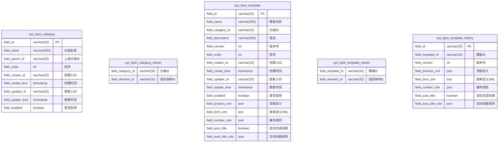
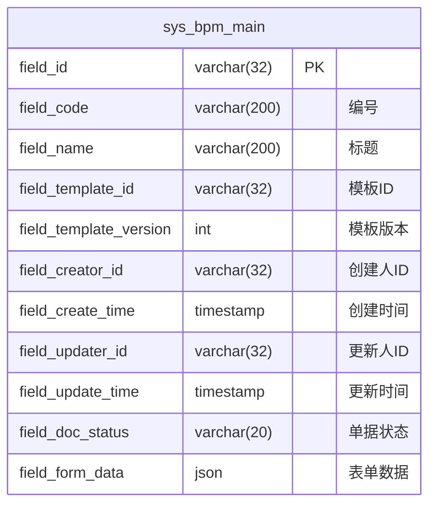

# 二、BPM（Business Process Management，业务流程管理）系统

## 包路径

com.eric.base.sys.bpm

## 前置基础功能

- 流程管理改造 v1.7
- 编号机制 v1.6
- 自定义表单 v1.5
- 公式定义器 v1.4

## 基本功能描述

由管理员维护的 流程分类 + 流程模板（如【考勤管理-请假、销假】）；
用户创建流程实例进行审批；触发相关业务逻辑

## 基本表结构

### 流程分类和流程模板

### 流程实例

