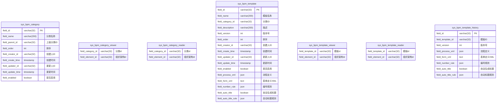
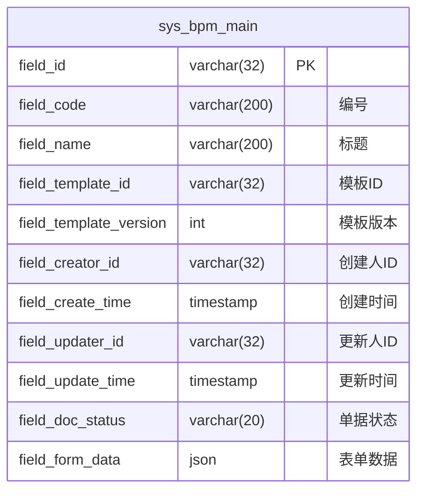

# 二、BPM（Business Process Management，业务流程管理）系统

## 包路径

com.eric.base.sys.bpm

## 前置基础功能

- 流程管理改造 v1.7
- 编号机制 v1.6
- 自定义表单 v1.5
- 公式定义器 v1.4

## 1. 基本功能描述

由维护人员维护的 流程分类 + 流程模板（如【人事招聘（父分类）-总公司（子分类）-入职审批（模板）】）；
用户创建流程实例进行审批；根据流程实例触发相关业务逻辑

## 2. 基本表结构

> 落地方式：表结构由实体注解（`@TableSource` / `@ColumnField` / `@TableIndex`）声明，启动期经注解同步引擎建表与比对（口径见 `docs/v1_3-数据源/1_3_2-注解维护表结构替换flyway/注解维护表结构设计方案.md`），不新增 SQL 迁移脚本；流水/历史类表继承 `BaseModel`、主档表继承 `MainModel`（内建 `field_id` 主键与审计列）。

### 流程分类和流程模板



### 流程实例



## 3.流程实例权限表现

列表可见性：由各个页面业务决定，具体见 $4.页面；
文档可创建：从分类到模板的路径上，所有的可使用者为空时表示不限制可使用者；任意可使用者不为空时取彼此之间的交集；权限用户；
文档可阅读：从分类到模板的路径上，所有的可阅读者取并集（即向下叠加）；文档审批人、被抄送人等；权限用户；
例：
```
组织架构：
总公司（机构）
  L 人事部（部门）
    L 招聘专员（岗位）
      L 张三
    L 薪酬管理（岗位）
      L 李四
    L 张三（人员）
    L 李四（人员）
    L 王五（人员）
  L 领导部门（部门）
    L 领导1
    L 领导2
    
模板：
总公司
  L 人事管理
    L 入职审批
    L 薪酬调整

总公司：
可使用者：总公司
可阅读者：无

人事管理：
可使用者：总公司-人事部
可阅读者：总公司-人事部

入职审批：
可使用者：总公司-人事部-招聘专员、王五
可阅读者：总公司-领导部门

薪酬调整：
可使用者：总公司-人事部-薪酬管理
可阅读者：领导2
```
则在以上模板中，
入职审批的可创建者为：张三、王五（取【总公司】、【人事部】、【招聘专员、王五】的交集）
薪酬调整的可创建者为：李四（取总公司、人事部和薪酬管理的交集）
入职审批的可阅读者为：人事部、领导部门
薪酬调整的可阅读者为：人事部、领导2

## 4.页面

### 后台管理

1. 后台管理-业务流程管理-分类维护

树形列表展示当前分类，可添加、修改、移动、删除（要求无子分类、模板）分类；

2. 后台管理-业务流程管理-模板维护

列表页面上，左侧分类树，右侧当前选中分类下的模板列表，可添加、修改、启停用模板；

编辑页面上，按页签区分：基本信息、填写表单（自定义表单）、流程、编号规则；

3. 业务流程管理

列表页面上：
筛选区：文档来源（我发起的、我已审的、我待审的、所有（仅限我可阅读的））、分类（树形选择器选择分类或模板，选择范围不限，选择分类时查询范围包括分类和其子分类、模板）、标题、状态、创建时间；
当筛选区的分类选择模板时，【创建流程】跳转到新建页面时自动传参该模板；

创建页面上：
进入创建页面时，判断传参模板用户是否可创建，可创建则自动填入该模板；不可创建或未传参则先弹窗选择模板，选择后不可修改；
弹窗选择模板按照可创建权限自动筛选，左侧分类树，右侧当前选中分类下的模板列表；
