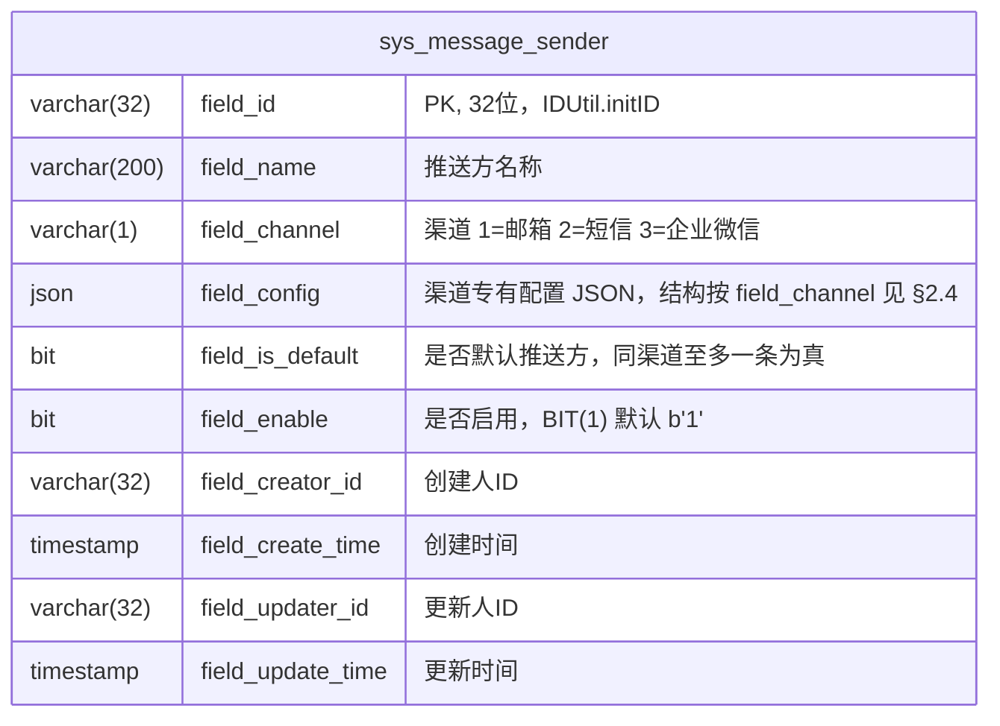
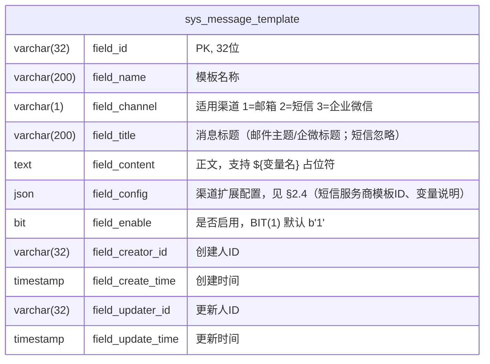
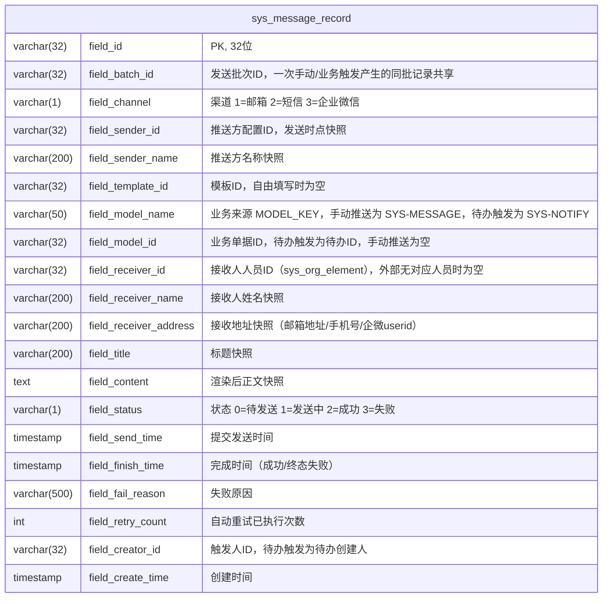

# 统一消息中心设计方案（v1.9）

- 依据：[1-推送外部消息通知.md](1-推送外部消息通知.md)（业务需求）、[1-外部消息通知的前置准备.md](1-外部消息通知的前置准备.md)（渠道资料与架构建议）；
- 模块 key 为 `message`，包路径 `com.eric.base.sys.message`，接口根路径 `/backend/sys/message/**`；
- 与既有功能的关系：站内实时推送（SSE 待办/待阅）已由 notify 模块实现，本模块只负责**外部渠道**（邮箱、手机短信、企业微信）的消息推送；站内通知不经过本模块；
- 前置现状核对：`0-消息通知功能现状清单.md` 第 6 节第 12 项「邮件 / 短信 / 企微钉钉等外部推送通道 ❌ 未实现」即本方案范围。

## 0. 命名裁决与文档同步

### 0.1 命名裁决

| 原草案 | 定稿 | 说明 |
| --- | --- | --- |
| 统一消息中心 / 统一信息中心（需求原文两种写法混用） | **统一消息中心** | 中文业务名统一为「统一消息中心」（2026-11-17 评审确认，W1 推翻本文原默认「统一信息中心」），菜单组、页面名、文档名均以此为准；模块 key 仍为 `message`（`sys/message`），不受中文名影响 |
| 【统一信息中心-公共配置】等页面引用 | 【统一消息中心-公共配置】等 | 同上，正文引用一律替换 |
| ——（需求未定） | 推送方 = 发送方账号配置 | 「邮箱配置 / 手机短信配置 / 企业微信配置」三页维护的是推送方信息，统一表 `sys_message_sender` 按 `field_channel` 区分 |

### 0.2 既有文档修订清单（实现时同批更新）

| 文档 | 需修订内容 |
| --- | --- |
| `AGENTS.md` | §2 模块列表补 `message`；§3 权限码列表补 `SYS_MESSAGE_ADMIN` / `SYS_MESSAGE_SEND`；§4 迁移序号说明更新 |
| `docs/系统模块/系统模块需求文档.md` | 新增「消息通知（v1.9）」章节：统一消息中心定位、渠道开关、待办外部推送规则 |
| `docs/系统模块/系统模块API接口设计文档.md` | 新增 message 模块章节（接口分组以本文 §3 为准，含 3.5 在线文档说明） |
| `docs/系统模块/系统模块数据库设计.md` | 新增 `sys_message_sender` / `sys_message_template` / `sys_message_record` 三表与 `sys_org_user.field_wecom_userid` 增列 |
| `docs/系统模块/系统模块UI设计文档.md` | 新增统一消息中心 7 页面 + 待办公共配置页的布局与菜单描述 |
| `docs/设计文档/sys/message/` | 落地时创建「统一消息中心核心业务 / 表结构 / 接口清单」三册，从本方案拆分 |
| `docs/设计文档/sys/org/组织架构表结构.md` | 补 `sys_org_user.field_wecom_userid`（W6 裁决后） |

## 1. 模块定位与总体架构

### 1.1 架构

按前置准备文档「三、建议采用的系统架构」，不在业务代码里写死任何渠道，统一收敛到 message 模块：

```text
业务系统（notify 待办 / 其他模块内部服务 / 手动页面）
        │  统一入口：SysMessagePushService.push(...)（内部） / POST /backend/sys/message/push/send（页面）
        ▼
┌─ 统一消息中心 com.eric.base.sys.message ────────────────────────┐
│  消息模板 sys_message_template   推送方配置 sys_message_sender   │
│  渠道路由（按 field_channel 选适配器 + 默认推送方）              │
│  发送队列（记录先行落库 status=0 → 事务提交后异步投递）          │
│  日志与重试（sys_message_record + SysMessageRetryTask 定时任务） │
└─────────────────────────────────────────────────────────────────┘
        │                │                    │
        ▼                ▼                    ▼
     邮箱 SMTP      短信服务商 API        企业微信应用消息 API
```

### 1.2 职责边界

| 归属 | 内容 |
| --- | --- |
| message 模块 | 渠道开关、推送方配置、消息模板、发送队列与状态机、失败重试、发送记录、待办触发的外部推送（消费 NotifySendEvent） |
| notify 模块 | **零改动**：待办触发复用其已发布的 `NotifySendEvent`（已携带 todoId/标题/类型/接收人列表），message 模块以事件监听方式接入，依赖方向 message → notify（只依赖 event 类） |
| org 模块 | 接收人资料来源：`sys_org_user.field_email` / `field_phone` / `field_wecom_userid`（W6 新增列） |
| 各业务模块 | 经 message 内部服务 `SysMessagePushService` 发送，不感知具体渠道 |

### 1.3 包结构

```text
com.eric.base.sys.message
├─ controller   # SysMessageSenderController / SysMessageTemplateController / SysMessageConfigController / SysMessagePushController / SysMessageRecordController
├─ service      # SysMessageSenderService / SysMessageTemplateService / SysMessageConfigService / SysMessagePushService / SysMessageRecordService
│  └─ channel   # MessageChannelSender 接口 + MailChannelSender / SmsChannelSender / WeComChannelSender
├─ listeners    # SysMessageNotifyEventListener（消费 NotifySendEvent）
├─ task         # SysMessageRetryTask（定时重试与积压扫描，形态对齐 SysCalendarAutoDeleteTask）
├─ dao / mapper # 与 resources/mappers/sys/message 下 XML 一对一
├─ model        # SysMessageSender / SysMessageTemplate / SysMessageRecord，继承 BaseModel
├─ enums        # SysMessageChannel / SysMessageStatus
├─ properties   # SysMessageConstants（ACTION_* 与 ROLE_* 常量）
├─ request / response
├─ resolver     # MessageResolver，继承 BaseResolver
└─ support      # MessageCryptoUtil（AES-256-GCM）、MessageRenderer（${变量} 渲染）
```

- `field_config` / `field_config`（推送方与模板的渠道专有配置）为固定结构 POJO（`SysMessageSenderMailDo` / `SysMessageSenderSmsDo` / `SysMessageSenderWeComDo` / `SysMessageTemplateConfigDo`），Jackson 序列化，禁止手工拼串（先例 `SysProcessTemplateNodeConfigDo`）；
- 不建 `moduleGroup.yml`（对齐编号机制 W3 决议：无既有先例的模块组开关不做，维持默认开启语义）。

## 2. 核心表和字段

### 2.1 推送方配置



- 索引：`KEY idx_message_sender_channel (field_channel)`；
- 「同渠道默认唯一」由 Service 维护：save/update/setDefault 置默认时，同事务自动取消同渠道原默认（切换式，先例编号规则启用切换）；
- 停用/删除默认推送方不阻止，但该渠道发送时记失败「渠道未配置」（见 §4.4）。

### 2.2 消息模板



- 索引：`KEY idx_message_template_channel (field_channel)`；
- 同渠道允许多套模板并存（无「唯一启用」约束），发送时按模板 id 指定；
- 模板删除允许：信息记录已快照标题/正文，不受断链影响。

### 2.3 信息记录



- 索引：`KEY idx_message_record_batch (field_batch_id)`、`KEY idx_message_record_channel (field_channel)`、`KEY idx_message_record_status (field_status)`、`KEY idx_message_record_receiver (field_receiver_id)`、`KEY idx_message_record_model (field_model_name, field_model_id)`、`KEY idx_message_record_create (field_create_time)`；
- **流水类表**：不设 `field_enable` / `field_update_time` / `field_updater_id`（先例 `sys_log_operation` / `sys_task_history`）；
- **例外更新**（对齐 `sys_number_record_detail` 作废例外）：仅 `field_status` / `field_finish_time` / `field_fail_reason` / `field_retry_count` / `field_send_time` 允许由发送状态机与重试任务更新，其余字段只增不改；无删除入口，保留审计，归档策略为后续非目标。

### 2.4 渠道专有配置 JSON 结构

| field_channel | 固定结构 POJO | 字段 |
| --- | --- | --- |
| 1 邮箱 | `SysMessageSenderMailDo` | `smtpHost`、`smtpPort`（常见 465/587）、`sslMode`（`NONE`/`SSL`/`TLS`，TLS 即 STARTTLS）、`username`、`password`（**加密存储**）、`fromAddress`、`fromName` |
| 2 短信 | `SysMessageSenderSmsDo` | `provider`（`ALIYUN`/`TENCENT`，v1.9 默认实现 ALIYUN，见 W3）、`accessKeyId`、`accessKeySecret`（**加密存储**）、`signature`（短信签名）、`region` |
| 3 企业微信 | `SysMessageSenderWeComDo` | `corpId`、`agentId`、`corpSecret`（**加密存储**） |

模板 `field_config`（`SysMessageTemplateConfigDo`）：

```json
{
  "providerTemplateId": "SMS_465000001",
  "variables": [ { "key": "userName", "name": "接收人姓名", "required": true } ]
}
```

- `providerTemplateId` 仅短信渠道使用（服务商侧备案模板 ID，与系统模板为一对一关系）；
- `variables` 供信息推送页渲染变量录入项；正文渲染规则见 §4.3。

### 2.5 公共配置项（common_setting）

登记在 `properties/sys/message/application.yml` 的 `SETTING` 段（`field_type = message`），启动时增量同步 `common_setting`，页面经 config 接口读写：

| field_key | 默认值 | 说明 |
| --- | --- | --- |
| `email_enable` | `false` | 邮箱推送总开关 |
| `sms_enable` | `false` | 短信推送总开关 |
| `wechat_enable` | `false` | 企业微信推送总开关 |
| `notify_email_enable` | `false` | 待办触发-发送邮件 |
| `notify_sms_enable` | `false` | 待办触发-发送短信 |
| `notify_wechat_enable` | `false` | 待办触发-发送企业微信 |
| `notify_send_types` | `"1"` | 待办触发-发送的待办类型，逗号分隔（1=待办 2=待阅），默认仅待办 |
| `base_url` | （空） | 系统访问地址，待办推送的邮件/企微正文拼接链接用；为空则正文不带链接 |
| `max_retry_count` | `3` | 失败自动重试次数上限 |
| `retry_interval_seconds` | `300` | 自动重试间隔（秒） |

- `application.yml` 同时登记 `MODEL_KEY: "SYS-MESSAGE"`、`MODEL_NAME: "统一消息中心"`；
- 主密钥 `CS_MESSAGE_SECRET_KEY` 为**部署运行参数**（对齐 `CS_API_DOCS_ENABLED` 先例）：不入 `common_setting`、无 SETTING 默认值，规则见 §8。

### 2.6 跨模块变更：org 人员表

- `sys_org_user` 新增 `field_wecom_userid varchar(64) NULL`（企业微信通讯录 userid，企业微信应用消息的收件人标识），迁移脚本见 §9；
- 组织架构人员编辑/详情表单补该字段（org 模块前端随批实现）；个人微信 openid 复用既有 `sys_org_user.field_openid`（公众号绑定，与本模块企微通道互不替代，见 W6）。

## 3. 接口设计

基础路径 `/backend/sys/message/**`；响应统一 `BaseResponse`，列表总数经 `metadata.total`；`SYS_ADMIN` 经 `BaseResolver` 自动放行。接口标识常量定义于 `SysMessageConstants`。

### 3.1 推送方配置（sys.message.sender）

服务于【统一消息中心-邮箱配置/手机短信配置/企业微信配置】三页（同组件按渠道过滤）。

| 接口标识 | 方法 | 路径 | 说明 | 鉴权 |
| --- | --- | --- | --- | --- |
| `sys.message.sender.list` | POST | `/backend/sys/message/sender/list` | 请求体 `{ body: { fieldName, fieldChannel, enable }, pages: { pageNo, pageSize, needPage }, sortField, sortOrder }`；`sortField` 白名单 `createTime`/`updateTime`/`name`（默认创建时间降序）；**响应中 `fieldConfig` 敏感字段一律脱敏为 null** | SYS_MESSAGE_ADMIN |
| `sys.message.sender.load` | GET | `/backend/sys/message/sender/load?fieldId=` | 读取单条（敏感字段同样脱敏） | SYS_MESSAGE_ADMIN |
| `sys.message.sender.save` | POST | `/backend/sys/message/sender/save` | 新增：名称/渠道/配置必填；`fieldIsDefault=true` 时同事务取消同渠道原默认；敏感字段有值则 AES-GCM 加密入库 | SYS_MESSAGE_ADMIN |
| `sys.message.sender.update` | PATCH | `/backend/sys/message/sender/update` | 编辑：必须携带 `fieldId`；`fieldConfig` 敏感字段为 null/空串 = 保留原值，非空 = 加密覆盖；默认切换同 save | SYS_MESSAGE_ADMIN |
| `sys.message.sender.enable` | PATCH | `/backend/sys/message/sender/enable` | 请求体 `{ fieldId, fieldEnable }`，仅更新启用状态 | SYS_MESSAGE_ADMIN |
| `sys.message.sender.setDefault` | PATCH | `/backend/sys/message/sender/setDefault?fieldId=` | 设为同渠道唯一默认（须启用状态）；切换式取消原默认 | SYS_MESSAGE_ADMIN |
| `sys.message.sender.delete` | DELETE | `/backend/sys/message/sender/delete?fieldId=` | 物理删除；默认推送方不可删（须先取消默认，`BAD_REQUEST`「默认推送方不可删除」）；历史记录已快照不受影响 | SYS_MESSAGE_ADMIN |

### 3.2 消息模板（sys.message.template）

服务于【统一消息中心-消息模板】列表页与新建/编辑页。

| 接口标识 | 方法 | 路径 | 说明 | 鉴权 |
| --- | --- | --- | --- | --- |
| `sys.message.template.list` | POST | `/backend/sys/message/template/list` | 请求体 `{ body: { fieldName, fieldChannel, enable }, pages, sortField, sortOrder }`，白名单同 sender | SYS_MESSAGE_ADMIN / SYS_MESSAGE_SEND（推送页选模板） |
| `sys.message.template.load` | GET | `/backend/sys/message/template/load?fieldId=` | 读取单条（含 `field_config.variables`，供推送页渲染变量录入） | SYS_MESSAGE_ADMIN / SYS_MESSAGE_SEND |
| `sys.message.template.save` | POST | `/backend/sys/message/template/save` | 新增：名称/渠道/正文必填；短信渠道校验 `providerTemplateId` 必填 | SYS_MESSAGE_ADMIN |
| `sys.message.template.update` | PATCH | `/backend/sys/message/template/update` | 编辑：必须携带 `fieldId` | SYS_MESSAGE_ADMIN |
| `sys.message.template.enable` | PATCH | `/backend/sys/message/template/enable` | 请求体 `{ fieldId, fieldEnable }` | SYS_MESSAGE_ADMIN |
| `sys.message.template.delete` | DELETE | `/backend/sys/message/template/delete?fieldId=` | 物理删除（记录快照不受影响） | SYS_MESSAGE_ADMIN |

### 3.3 公共配置（sys.message.config）

服务于【统一消息中心-公共配置】与【待办管理-公共配置】两页。

| 接口标识 | 方法 | 路径 | 说明 | 鉴权 |
| --- | --- | --- | --- | --- |
| `sys.message.config.load` | GET | `/backend/sys/message/config/load` | 返回 `{ channels: { email/sms/wechat: { enable, ready } }, notify: { emailEnable, smsEnable, wechatEnable, sendTypes }, baseUrl }`；`ready` = 该渠道存在启用且配置完整的默认推送方（凭证齐全），供页面做「就绪检查」提示；不含任何敏感值 | SYS_MESSAGE_ADMIN / SYS_MESSAGE_SEND（推送页展示渠道可用性） |
| `sys.message.config.update` | PATCH | `/backend/sys/message/config/update` | 请求体为上述结构的可写子集；仅接受 §2.5 白名单键，逐键写 `common_setting`（经 `CommonSettingService`）；未知键拒绝 | SYS_MESSAGE_ADMIN |

### 3.4 信息推送（sys.message.push）

服务于【统一消息中心-信息推送】页（手动发送）。

| 接口标识 | 方法 | 路径 | 说明 | 鉴权 |
| --- | --- | --- | --- | --- |
| `sys.message.push.send` | POST | `/backend/sys/message/push/send` | 请求体 `{ fieldChannel, fieldSenderId?, fieldTemplateId?, receiverIds[], fieldTitle?, fieldContent?, params: {} }`；校验与拆分规则见 §4.2；响应 `metadata` 返回 `{ batchId, total, queued }` | SYS_MESSAGE_ADMIN / SYS_MESSAGE_SEND |

### 3.5 信息记录（sys.message.record）

服务于【统一消息中心-信息记录】列表与详情；流水只读，无编辑/删除入口。

| 接口标识 | 方法 | 路径 | 说明 | 鉴权 |
| --- | --- | --- | --- | --- |
| `sys.message.record.list` | POST | `/backend/sys/message/record/list` | 请求体 `{ body: { fieldChannel, fieldStatus, receiverName, title, beginTime, endTime }, pages, sortField, sortOrder }`；`sortField` 白名单 `createTime`/`sendTime`/`finishTime`（默认创建时间降序） | SYS_MESSAGE_ADMIN / SYS_MESSAGE_SEND |
| `sys.message.record.load` | GET | `/backend/sys/message/record/load?fieldId=` | 详情：渲染后标题/正文全文、失败原因、重试次数、批次内同源记录 | SYS_MESSAGE_ADMIN / SYS_MESSAGE_SEND |
| `sys.message.record.retry` | PATCH | `/backend/sys/message/record/retry?fieldId=` | 人工重试：仅 `field_status=3` 可重试；置回待发送并立即异步投递，不受自动重试上限约束（管理员明确操作） | SYS_MESSAGE_ADMIN |

### 3.6 内部服务（无 REST 接口）

| 服务 | 说明 |
| --- | --- |
| `SysMessagePushService.push(SysMessagePushInternalRequest)` | 供各业务模块后端内部调用：按业务指定渠道集合（空=取所有「总开关开且已就绪」渠道）、接收人、内容（或模板+变量）、来源 `model_name/model_id`；不做权限校验（内部调用方自带语境） |
| `SysMessageNotifyEventListener` | 监听 notify 模块 `NotifySendEvent`（`@TransactionalEventListener(AFTER_COMMIT)` + `@Async("messageSendExecutor")`）：按 §2.5 的 `notify_*_enable` 与 `notify_send_types` 过滤后组装内部请求投递；notify 模块零改动 |

参数约定与全仓一致：列表请求体 `{ body, pages }`；单 `id` 或无参用 `GET`；更新只用 `PATCH`（禁 `PUT`）；删除用 `DELETE`。新增/修改接口必须同批补 `@Tag` / `@Operation`（description 以「鉴权动作 <ACTION 常量值>；」开头）/ `@Parameter` / `@Schema`，校验 `cd backend && ./mvnw -Dtest=ApiDocsTest test`。

## 4. 发送链路与渠道适配

### 4.1 状态机

```text
0 待发送 ──投递(CAS 0→1)──▶ 1 发送中 ──成功──▶ 2 成功
   ▲                          │
   │                          └──失败──▶ 3 失败（fail_reason、retry_count+1）
   │                                        │
   └──────── 自动重试（RetryTask）◀─────────┘  retry_count < max_retry_count
   └──────── 人工重试（record/retry）◀───────┘  不限次数
```

### 4.2 入口校验与记录拆分（push.send / 内部 push 共用）

1. `fieldChannel` 必填且为合法枚举；渠道总开关关闭 → `BAD_REQUEST`「该渠道未启用」；
2. `fieldSenderId` 空 → 取该渠道**默认推送方**；不存在启用默认推送方 → `BAD_REQUEST`「该渠道未配置推送方」（待办触发场景不报错，逐条记失败，见 §5）；
3. `fieldTemplateId` 有值 → 模板须存在、启用且渠道匹配，标题/正文由模板渲染（`params` 提供变量）；为空 → `fieldTitle`/`fieldContent` 必填（自由内容，短信渠道忽略标题）；
4. `receiverIds` 去重跳空、≤ 200 人（超限 `BAD_REQUEST`「单次推送接收人不能超过 200 人」）；人员须存在且启用；
5. 按渠道解析接收地址：邮箱取 `sys_org_user.field_email`、短信取 `field_phone`、企微取 `field_wecom_userid`；缺失 → **该接收人该渠道记录直接落库置失败**（`fail_reason` =「接收地址缺失」），不阻断其余接收人；
6. 每渠道 × 每接收人一条 `sys_message_record`（`field_batch_id` 同批共享，`field_status=0`），与业务事务同库写入；敏感信息（密钥）绝不入记录。

### 4.3 渲染规则

- 占位符 `${key}`：命中 `params`/人员上下文则替换；未提供变量替换为空串并记 WARN 日志，不阻断发送；
- 人员上下文内置变量：`userName`（姓名）、`todoName`/`todoUrl`（待办触发时）；
- 邮箱正文按 HTML 发送；企微应用消息 `msgtype=text`（换行转义）；短信为纯文本，超长由服务商按计费条数拆分。

### 4.4 投递

- 事务提交后由 `MessageDispatchEvent` 监听器（`AFTER_COMMIT` + `@Async("messageSendExecutor")`）逐条投递；线程池在 `common/config/AsyncConfig` 注册（core 2 / max 4 / queue 1000，对齐 `notifySseExecutor` 先例）；
- 投递前 `UPDATE ... SET status=1 WHERE id=? AND status=0`（CAS 防重），发送时**再校验**渠道开关与推送方启用状态，已关闭/停用 → 记失败「渠道已停用」/「推送方已停用」；
- 渠道适配器接口 `MessageChannelSender.send(record, senderConfig) → SendResult`，按 `field_channel` 路由：
  - **邮箱**：`spring-boot-starter-mail`（新依赖，见 §9），按推送方配置动态构建 `JavaMailSender`（不绑全局实例），`sslMode` 映射 SSL/STARTTLS；
  - **短信**：阿里云 Dysmsapi `SendSms` HTTP + 自实现 RPC 签名（HMAC-SHA1，经 `RestClient`，spring-web 6.1+ 自带，无新依赖）；`providerTemplateId` 取模板 `field_config`；
  - **企微**：`/gettoken` 换 `access_token`（内存缓存至过期前 5 分钟，配置变更即失效）→ `/cgi-bin/message/send`（`touser=field_wecom_userid`，多人拆分逐条记录）；
- 失败：置 `status=3` + `fail_reason`（截断 500）+ `retry_count` 语义 = 自动重试已执行次数；网络类异常与业务类异常（如签名错误）均先记失败，由重试策略区分终态（连续达到上限后不再自动重试，人工重试仍可用）。

### 4.5 重试与积压（SysMessageRetryTask）

接入 sys/task 定时任务模块（对齐 `SysCalendarAutoDeleteTask` 形态），默认每 5 分钟：

1. `status=3` 且 `retry_count < max_retry_count` 且 `finish_time` 早于 `now - retry_interval_seconds` → 置回 0 并投递（`retry_count` +1 在置 3 时已累计）；
2. 兜底积压扫描：`status IN (0,1)` 且 `send_time`（1 为投递时间）滞后超过 10 分钟（服务重启/中断遗留）→ 重新投递；
3. v1.9 单实例假设成立（与 SSE 同一约束）；多实例部署需先做任务分片或 Redis 锁，列入非目标。

### 4.6 待办触发规则（SysMessageNotifyEventListener）

消费 `NotifySendEvent` 后：

1. 过滤：`notifyType` 不在 `notify_send_types` 内 → 忽略；
2. 渠道集合：`notify_email_enable` / `notify_sms_enable` / `notify_wechat_enable` 为 true 的渠道 ∩ 总开关开启的渠道；渠道总开关关闭但 notify 级开关开启 → 不发（总开关优先）；
3. 内容：**内置默认文案**（模块常量，不走消息模板）：邮件主题=待办标题、正文=待办内容+详情链接（`base_url + field_url`）；短信/企微=标题+链接；
4. 就绪校验降级为逐条记失败：默认推送方缺失、人员地址缺失等不报错、不回滚待办事务，仅落失败记录（`fail_reason` 注明原因），在信息记录页可排查；
5. `model_name = SYS-NOTIFY`、`model_id = todoId`，`field_creator_id` = 待办创建人。

## 5. 权限模型

`properties/sys/message/roles.yml`（实现时同批新增，启动增量同步 `sys_org_auth`）：

| 名称 | 中文名 | 描述 |
| --- | --- | --- |
| `SYS_MESSAGE_ADMIN` | 消息中心管理员 | 统一消息中心全部功能：渠道配置、推送方、模板、公共配置、信息记录、信息推送 |
| `SYS_MESSAGE_SEND` | 消息推送员 | 仅信息推送页（手动发送）与信息记录查看；模板/推送方只读（供选择）；不含任何配置写权限 |

- 菜单「统一消息中心」组绑定 `SYS_MESSAGE_ADMIN`；「信息推送」页同时绑定 `SYS_MESSAGE_SEND`（可见即用，`BaseResolver` 按权限码判定）；
- 【待办管理-公共配置】页（notify 菜单组内）读写的是 message 模块配置，绑定 `SYS_MESSAGE_ADMIN`（W2 可议）；
- 未知 action 默认拒绝；`SYS_ADMIN` 超管短路。

## 6. 安全设计（对应前置准备「安全管理」）

| 项 | 方案 |
| --- | --- |
| 密钥加密存储 | SMTP 授权码 / 短信 Secret / 企微 Secret 以 AES-256-GCM 加密入库；主密钥取环境变量 `CS_MESSAGE_SECRET_KEY`（Base64 的 32 字节），未配置时**明文入库 + 启动 WARN**（开发态可用，生产必须配置，W4） |
| 接口脱敏 | sender 的 list/load 响应中敏感字段一律 null；update 留空 = 保留原值 |
| 权限控制 | §5 双权限码；配置写操作仅 ADMIN；记录详情不含密钥 |
| 操作日志 | 配置变更与手动推送走 log 模块既有操作日志通道（模块名 SYS-MESSAGE） |
| 合规（退订/频率限制/隐私） | v1.9 非目标，见 §11；单次 200 人上限与人工触发属最小防误操作约束 |

## 7. 前端页面设计

新增菜单组「统一消息中心」（系统管理下，绑定 `SYS_MESSAGE_ADMIN`）+「通知待办」组内新增一页。全部复用 `list-page.css` / `form-page.css` 与三段式规范（`OrgManageView.vue` / `TaskManageView.vue` 基准），接口经 `src/api/message.js` 具名函数导出。

| 菜单 | 路由 | 页面组件 | 布局要点 |
| --- | --- | --- | --- |
| 公共配置 | `/messageConfig` | `MessageConfigView.vue` | 表单页：三渠道开关卡片（含 `ready` 就绪检查提示：未配置默认推送方时开关旁警示）+ 待办推送规则（三开关 + 待办类型多选）+ 系统访问地址；保存二次确认 |
| 邮箱配置 | `/messageSenderEmail` | `SenderManageView.vue`（`meta.channel='1'`） | 列表页：筛选（名称/启用），列：名称、SMTP 地址、发件人、默认、启用、操作（编辑/设为默认/启停/删除）；新建/编辑为独立路由 `/messageSender/form`（弹层表单，敏感字段显示「已配置，留空不修改」） |
| 手机短信配置 | `/messageSenderSms` | 同上（`meta.channel='2'`） | 列同上，渠道专有列：服务商、签名 |
| 企业微信配置 | `/messageSenderWechat` | 同上（`meta.channel='3'`） | 列同上，渠道专有列：corpId、agentId；三路由 `meta.tab` 复用单标签 |
| 消息模板 | `/messageTemplate` | `MessageTemplateManageView.vue` | 列表页：筛选（名称/渠道/启用）；操作列编辑/启停/删除；新建/编辑 `/messageTemplate/create`、`/messageTemplate/edit/:id`（`MessageTemplateFormView.vue`，正文多行整行 + 变量说明子表） |
| 信息记录 | `/messageRecord` | `MessageRecordListView.vue` | 列表页：筛选（渠道/状态/接收人/标题 2 栅栏/提交时间范围 2 栅栏）；列：渠道、推送方、接收人、标题、状态、提交时间、完成时间、操作（详情/重试[仅失败]）；详情弹窗显示正文全文与失败原因；无批量操作、无复选框列、不展示主键 |
| 信息推送 | `/messagePush` | `MessagePushView.vue` | 表单页：渠道（单选，禁用未开启渠道）、推送方（默认=默认推送方）、模板（可选，选中后按 `variables` 渲染变量输入；不选则填标题/正文）、接收人（地址本多选）、预览（按首接收人渲染）；提交成功提示批次号 |
| 待办公共配置 | `/notifyConfig` | `NotifyConfigView.vue` | 表单页：三渠道开关 + 待办类型多选 + 保存；挂「通知待办」菜单组下，调用 message config 接口 |

- `HomeView.vue`：`activeMenu` 补 `/message` 前缀归约；菜单配置补上述项与 `meta.title`；动态路由 `meta.tab: 'name'`；
- 新页面布局、交互细节落地时同步 `docs/系统模块/系统模块UI设计文档.md`。

## 8. 依赖与迁移脚本

| 项 | 内容 |
| --- | --- |
| 新增依赖 | `org.springframework.boot:spring-boot-starter-mail`（邮箱；短信/企微经 `RestClient` 无新依赖） |
| 新增线程池 | `messageSendExecutor`（`common/config/AsyncConfig`） |
| 迁移脚本 | `V1_01_047__sys_message_schema.sql`（§2.1–2.3 三表 + 索引）、`V1_01_048__sys_org_user_wecom_userid.sql`（§2.6）；当前库内最新为 `V1_01_046`（数据源），落地时以 `db/migration` 实际最大序号顺延，不得复用或跳回 |
| 配置文件 | `properties/sys/message/application.yml`（MODEL_KEY/MODEL_NAME/SETTING）、`roles.yml`（§5）、`dict.yml`（`message_channel` 1/2/3、`message_status` 0/1/2/3，导入后 `field_system=true`） |

## 9. 评审结论（待确认项已收口）

2026-11-17 评审确认：W1 / W2 / W5 / W8 按下表「评审结论」执行（W1 推翻默认，其余维持默认）；W3 / W4 / W6 / W7 未提出异议，按默认结论执行。研发任务拆解见 [00-研发任务清单.md](00-研发任务清单.md)。

| # | 待确认项 | 默认结论 | 评审结论（2026-11-17） |
| --- | --- | --- | --- |
| W1 | 中文业务名（需求原文「统一消息中心/统一信息中心」混用） | 统一「统一信息中心」，模块 key 保持 `message`（§0.1） | **统一消息中心**（推翻默认；本文正文、页面引用、`MODEL_NAME`、角色中文名与文档名已同批改齐） |
| W2 | 权限粒度：单码 ADMIN 还是 ADMIN+SEND 双码 | 双码（§5）；若评审认为 v1.9 无手动推送细分需求，则 SEND 并入 ADMIN、【待办管理-公共配置】改挂 message 菜单组 | **双码**（`SYS_MESSAGE_ADMIN` + `SYS_MESSAGE_SEND`，§5 原设计维持；【待办管理-公共配置】仍挂通知待办菜单组） |
| W3 | 短信服务商默认实现 | 阿里云（HTTP + 自实现签名，不引 SDK）；`provider` 字段预留 TENCENT，接入顺序评审后可调 | 按默认执行（阿里云） |
| W4 | 加密主密钥未配置时的行为 | 明文入库 + 启动 WARN（开发态可用）；生产部署必须配置 `CS_MESSAGE_SECRET_KEY`，部署清单补该项 | 按默认执行 |
| W5 | 定时发送（前置准备「发送规则」之一） | v1.9 仅「立即发送 + 待办事件触发」，定时发送列入后续版本（记录表 `field_status=0` 语义可平滑扩展为「定时待发」） | **不拓展定时发送功能**（v1.9 仅「立即发送 + 待办事件触发」，与默认一致） |
| W6 | 企微收件人标识来源 | `sys_org_user` 新增 `field_wecom_userid`（§2.6，跨模块变更，org 表单随批）；否决「登录名=企微 userid」约定；公众号 openid 不用于本模块（关注关系/模板消息限制，见前置准备 §1.3） | 按默认执行 |
| W7 | 退信 / 短信状态回执 / 企微已读回调 | v1.9 不实现（非目标）；后续版本补 `field_receipt` 列与回调端点，当前以 `field_status` + `fail_reason` 表达同步发送结果 | 按默认执行（不实现） |
| W8 | SEND 角色的信息记录可见范围 | 全部记录只读（v1.9 无按人过滤）；如需「仅本人发送」再收敛 | **全部记录只读**（与默认一致，无按人过滤） |

## 10. 边界与非目标

以下不在 v1.9 范围，设计已留扩展点但不落库、不建接口：

- 站内 IM / 点对点消息（现状清单第 13 项，维持不做）；
- 消息撤回、已读回执、定时发送（W5/W7）；
- 退订机制、发送频率限制、营销类批量触达等合规能力（§6 最小化）；
- 外部收件人（非组织架构人员的手工地址）；
- 多实例部署下的队列抢占与任务分片（§4.5，与多实例 SSE 同批改造）；
- 记录归档清理策略；
- 钉钉 / WhatsApp 等新渠道：新增 `MessageChannelSender` 实现与 `SysMessageChannel` 枚举值即可，不动业务调用方（前置准备 §三的架构目标）。
