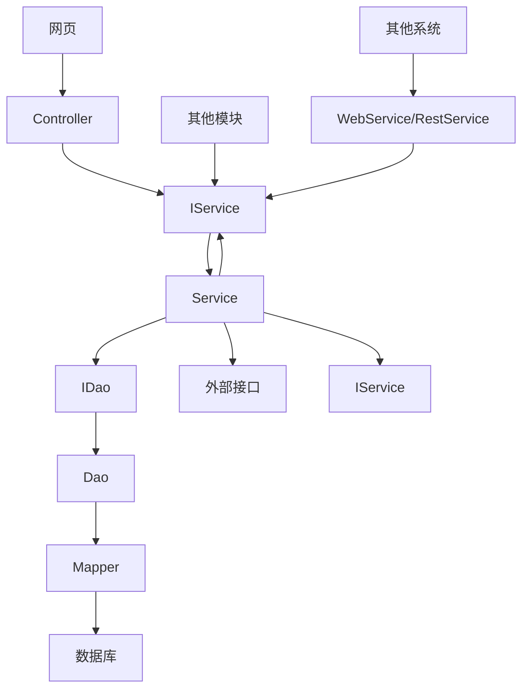

# 一：模块设计

## 系统模块

com.project.backend.sys

| 中文名   | 包名       | 备注                                 |
| -------- | ---------- | ------------------------------------ |
| 组织架构 | org        | 包含组织架构、岗位、权限、角色等信息 |
| 附件     | attachment |                                      |
| 流程审批 | process    | 审批流程                             |
| 编号规则 | number     | 文档编号让系统自行生产               |
| 码值字典 | dict       |                                      |
| 通知待办 | notify     |                                      |
| 审计     | audit      |                                      |

## ERP模块

com.project.backend.erp

| 中文名 | 包名         | 备注                   |
| --- | ---------- | -------------------- |
| 客户  | customer   | 不与组织架构关联             |
| 供应商 | supplier   | 不与组织架构关联             |
| 物料  | material   | 包含原材料、中间件、成品件；均算入物料中 |
| 仓储  | warehouse  | 包含仓库、库存、流水等信息        |
| 订单  | order      | 包含采购单、销售单            |
| 生产  | production | 生产记录                 |


# 二：后端业务流程

1. 方法调用流向规范



2. 代码业务规范
   Controller类：接收、返回接口请求；请求IService接口方法；只实现对request, response校验；不实现业务逻辑
   CRPService类：接收、返回其他模块的接口请求；请求本模块的IService；只实现对request, response校验；不实现业务逻辑
   WebService/RestService：接收、返回其他系统的外部请求；请求本模块IService；只实现对request, response校验；不实现业务逻辑
   IService/ Service类：接收返回Controller，CRPService，WebService/RestService的请求；实现业务逻辑，复杂的业务逻辑应拆分子方法；可复用的小业务逻辑可写入Util工具类；
   IDao/ Dao类：接收Service发来的对数据库操作的请求；不实现业务逻辑，只负责与Mapper进行一对一方法对接

# 三：系统统一规范

1.前端路径前缀：

```
/
```

2.后端接口路径：

```
/backend/{根模块}/{模块}/{次级模块}/{请求方法}[?{请求参数}]
```

3.后端代码统一包路径：

```
com.project.backend
```

4.所有模块通用型接口统一命名：

| 接口                      | 接口名    | 接口类型   | 说明                          |
| ----------------------- | ------ | ------ | --------------------------- |
| /init                   | 初始化    | GET    |                             |
| /load?fieldId=${id}     | 读取单条数据 | GET    |                             |
| /list                   | 列表查询   | POST   | 为保证查询参数长度超长时正常完成请求，统一采用POST |
| /save                   | 新增     | POST   |                             |
| /update                 | 更新     | PATCH  |                             |
| /delete?fieldId=${id}   | 删除     | DELETE |                             |
| /import                 | 导入     | POST   |                             |
| /export                 | 导出     | POST   | 同/list接口                    |
| /template               | 下载导入模板 | POST   | 导出模板文件流（仅标题行），如 `/backend/sys/dict/template` |
| /download?fieldId=${id} | 下载     | GET    |                             |

其他业务场景下的接口也统一遵循以下规则：

单id传参/无传参用GET，包含非id传参用POST，更新只用PATCH不用PUT，删除用DELETE；

5.数据库字段统一使用 "field_" 作为前置名

6.数据库公共级字段规范：

| 字段名                     | 中文名    | 字段类型     | 说明                                           |
| -------------------------- | --------- | ------------ | ---------------------------------------------- |
| field_id                   | ID        | varchar(32)  | 主键ID；由毫秒级时间戳 + UUID v4生成补位至32位 |
| field_code                 | 编号      | varchat(50)  | 由编号规则生成                                 |
| field_name / field_subject | 名称/标题 | varchar(200) |                                                |
| field_creator_id           | 创建人    | varchar(32)  | 创建人组织架构ID                               |
| field_create_time          | 创建时间  | timestamp    |                                                |
| field_updator_id           | 更新人    | varchar(32)  | 更新人组织架构ID                               |
| field_update_time          | 更新时间  | timestamp    |                                                |
| field_enable               | 有效性    | bit          |                                                |

7.枚举规范

7.1 所有枚举码值采用大写字母 + 下划线组合；部分少数枚举才有1位大写字母直接表示

7.2 所有公共类码值的枚举项、映射文本保存在 /resource/common 下；各自模块的独立枚举项、映射文本保存在 /resource/${模块名} 下；

7.3 所有枚举码值长度应在50字符以内；对应字段数据库字段长度应为 varchar(50)；

8.模块包统一目录结构

```
com.project.backend.sys.xxx(模块).yyy(次级模块)
    ├ controller (controller类包)
    └ service (service接口类包)
        ├ imp (service实现类包)
        ├ listeners (流程监听类包)
        ├ webservice (restService, webService类包等)
        ├ jobs (定时任务类包)
        └  ...
    └ dao (dao层接口类包)
        └ imp (dao实现类包)
    └ model
        ├ vos (vo类包)
        ├ dos (do类包)
        └ mappers (mybatis mapper接口类和Mapper.xml文件)
    └ utils (工具类包)
    └ resolver (鉴权类包)
```

8.授权规范

- 鉴权统一以“接口 + 文档ID”为核心参数，不以页面、按钮或前端路由作为最终鉴权依据。
- 文档ID指具体业务单据、业务文档或业务实体主键；所有涉及单据访问、编辑、删除、提交流程等操作的接口，均必须传入对应文档ID参与鉴权。
- 每个接口必须定义自身对应的 `resolver`，禁止多个接口直接复用无差别的通用判断逻辑；若存在复用，也应复用基础能力后在接口级 `resolver` 中补充本接口的操作语义判断。
- `resolver` 的输入至少包含：当前用户、接口标识、文档ID；必要时可补充组织、角色、流程状态、数据归属等上下文信息。
- `resolver` 内必须明确判断“该用户是否对该文档拥有对应操作权限”，操作类型至少覆盖：查看、创建、编辑、删除、提交、审核、导出等实际业务动作。
- `resolver` 返回结果必须为明确的允许/拒绝结论；拒绝时应返回可追踪的拒绝原因或权限码，便于前端提示和后端审计。
- Controller 或 Service 在执行核心业务逻辑前必须先调用对应 `resolver` 完成鉴权，鉴权失败时禁止继续执行后续数据读写、流程流转和外部调用。
- 系统需提供一个独立的“批量鉴权接口”，统一接收多组鉴权数据并返回逐项鉴权结果，用于列表页按钮态控制、批量操作预校验等场景。
- 批量鉴权接口的入参中，每一项数据至少包含：接口标识、文档ID；出参中每一项结果至少包含：是否有权限、操作类型、失败原因或权限码。
- 批量鉴权接口仅负责权限判断，不执行业务操作；业务实际提交时，目标接口仍必须再次调用自身 `resolver` 做最终鉴权，禁止以前端或批量鉴权结果代替最终校验。

9.前端新建页/弹窗 fieldId 初始化规范

所有新建弹窗和新建页面在打开时，必须先调用 `GET /backend/common/initID` 获取一个 32 位 ID，并将返回值赋值到表单对象的 `fieldId` 字段上，后续 `save` 请求将该 ID 提交给后端。

实现方式：

- `api/common.js` 中统一导出 `getInitID()` 方法
- `composables/useInitID.js` 中统一导出 `useInitID()` 组合式函数，提供 `initFieldId(target, field = 'id')` 方法
- 新建页面在 `onMounted` 中调用 `initFieldId(form.value)`；新建弹窗在打开回调（如 `handleAdd`）中调用
- 编辑模式（已有数据）无需调用，编辑的 `onMounted` 通过 `load` 接口回填表单

# 四：技术规范

4.1: 前端技术规范

| 层级   | 组件           | 版本     | 备注                                     |
| ---- | ------------ | ------ | -------------------------------------- |
| 开发语言 | Vue          | 3.5.32 | 前端核心框架，采用前后端分离模式                       |
| 构建工具 | Vite         | 5.4.21 | 前端构建工具                                 |
| 路由管理 | Vue Router   | 4.6.4  | 前端路由管理                                 |
| 状态管理 | Pinia        | 2.3.1  | 前端状态管理                                 |
| UI管理 | Element Plus | 2.13.7 | Vue 3 UI组件库，对应 Element UI 的 Vue 3 版本体系 |
| 接口管理 | Axios        | 1.15.0 | 前后端接口调用组件                              |

4.2: 后端技术规范

| 层级                | 组件            | 版本    | 备注                                           |
| ------------------- | --------------- | ------- | ---------------------------------------------- |
| 开发语言            | JDK             | 21      | Java 运行环境版本                              |
| 框架                | Spring Boot     | 3.5.13  | 后端核心框架，提供 RESTful API                 |
| 服务调用            | Spring MVC      | 6.2.17  | Web 层接口开发                                 |
| ORM框架             | MyBatis         | 3.5.19  | 由 mybatis-spring-boot-starter 3.0.5 引入      |
| 数据服务            | Flyway          | 10.22.0 | 数据库迁移工具，统一管理表结构与初始化脚本版本 |
| 数据库              | MySQL           | 8.4.8   | 关系型数据库                                   |
| 项目管理            | Maven           | 3.9.14  | 项目依赖管理与构建工具                         |
| 缓存                | Redis           | 7.x     |                                                |
| 定时任务            | Spring Quartz   |         |                                                |
| 授权认证            | Spring Security |         |                                                |
| Excel文件处理       | EasyExcel       |         |                                                |
| 除Excel以外文件处理 | Apache POI      |         |                                                |

4.3: 服务器技术规范

| 服务          | 版本         | 备注                               |
| ------------- | ------------ | ---------------------------------- |
| 操作系统      | CentOS 8.9   | 服务器部署操作系统                 |
| Web 服务器    | Nginx 1.28.3 | 前端静态资源部署、反向代理后端服务 |
| Java 运行环境 | JDK 21.0.8_9 | 后端服务运行环境                   |
| 数据库服务    | MySQL 8.4.8  | 业务数据存储                       |

# 五：文档规范

1. 每个功能模块应至少包含以下文档：需求文档、UI设计文档、API设计文档、数据库设计文档。

2. 每个文档应明确以下内容：
   需求文档：业务流程、角色权限鉴权、异常处理
   UI设计文档：路由和菜单及其显示权限、页面布局、页面操作业务
   API设计文档：接口规则、约束、接口内业务流程
   数据库设计文档：表字段、索引、外键约束

3. 不同文档描述存在冲突时，根据冲突项，以下文档在冲突项上拥有最高标准优先级：
   需求文档：业务流程、角色权限鉴权、异常处理
   UI设计文档：路由和菜单、页面布局
   API设计文档：接口规则、约束
   数据库设计文档：表结构
