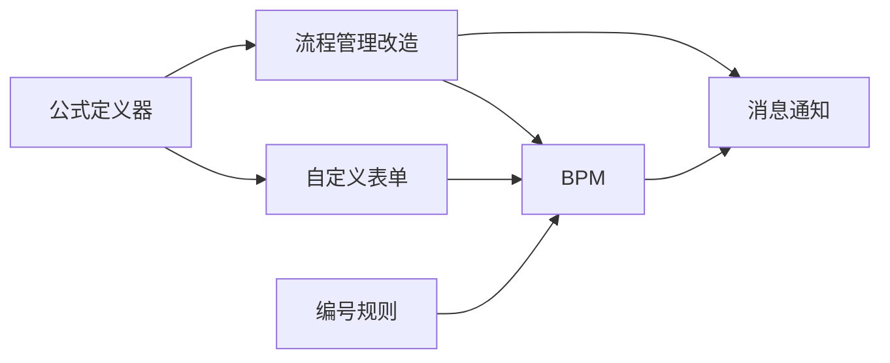

## 开发项目

- 接口开关功能（1.1.05）
- 编号功能（1.5）
- 流程引擎改造（1.3.01）
- 业务流程管理BPM（1.3.02）
- 消息通知（包括对内、对外：邮件、短信）（1.4）
- 集成接口中心（1.6）
- 数据源（1.8）：可复用取数配置元数据——默认数据源（Provider 代码注册）+ 自定义数据源（`sys_datasource` 单表配置）+ 统一执行入口 `POST /backend/sys/datasource/query`，模块 key `datasource`，详见 [数据源功能设计方案](v1_3-数据源/数据源功能设计方案.md) 与 [数据源开发任务清单](v1_3-数据源/数据源开发任务清单.md)

## 开发情况

- [x] 角色、群组纳入组织架构
- [x] 多语言功能
- [x] 请求格式规范
- [x] 导入导出请求模板
- [x] 集成接口中心
- [x] 个人资料页面、头像
- [x] 第三方账号绑定（微信、QQ）
- [x] 数据源
- 公式定义器
- 自定义表单
- [x] 编号规则
- LogicFlow 流程图集成和流程改造
- 自定义业务流程管理 BPM
- 消息通知

## 开发项依赖

