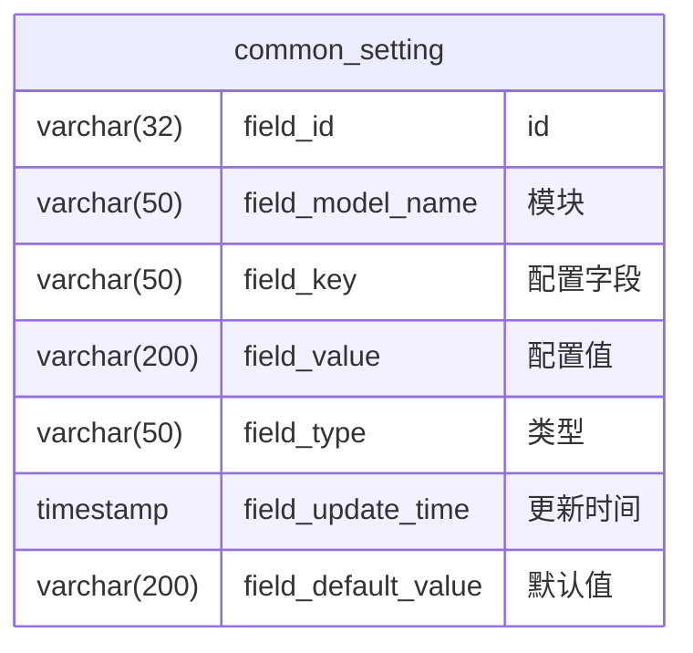

# common_setting

## 表结构

## 功能业务

不提供对外调用的接口，只实现后端内部调用的 Service 接口及后续代码；

表单保存的是系统配置级信息，包含从公共配置到各模块专有配置信息在内的所有内容。

配置信息填写在各模块的 `application.yml` 文件的 `SETTING` 下，具体配置向层级为 `SETTING.${field_type}.${field_key}: ${field_default_value}`；

系统启动时增量读取配置信息，保存到配置表中，配置信息读取时若值相比 `field_default_value` 发生了变更，如果 `field_value != field_default_value`，则只更新 `field_default_value`、如果 `field_value = field_default_value`，则同时更新这两个字段；

前端不提供配置信息访问功能，由各个模块自行负责配置页面的维护和权限管理；

## COMMON 配置信息

当前系统维护以下配置信息：

| field_type | field_key          | field_default_value | 说明   |
| ---------- |--------------------|---------------------|------|
| database | db_type            | mysql               | 数据库类型 |
| database | db_host            | localhost           | 数据库地址 |
| database | db_port            | 3306                | 数据库端口 |
| database | db_name            | erp                 | 数据库名称 |
| database | db_login_name      | root                | 登录用户名 |
| database | db_password        | root                | 登录密码 |
| database | db_driver          | com.mysql.cj.jdbc.Driver | 数据库驱动类 |
| redis | redis_host          | localhost           | Redis 地址 |
| redis | redis_port          | 6379                | Redis 端口 |
| redis | redis_password      | （空）              | Redis 密码 |
| redis | redis_database      | 0                   | Redis 库序号 |
| redis | redis_timeout       | 5s                  | Redis 连接超时 |
| system | login_unusing_time | 3600                | 登录后无操作自动登出时间（秒） |
| system | login_lock_time | 5 | 登录失败达到锁定账号的阈值次数 |
| system | login_locking_time | 300 | 登录失败达到锁定账号的锁定时间（秒） |
| system | login_open_lock | true | 是否开启登录失败锁定账号功能 |

公共配置（database / redis / system）的默认值统一登记在 `properties/common/application.yml` 的 `SETTING` 段，
其中数据库与 Redis 连接参数经 `application.properties` 的 `spring.config.import` 引用为 Spring 启动配置的默认值，
其他模块配置项的读取与维护通过 `CommonSettingService` 内部调用完成。
