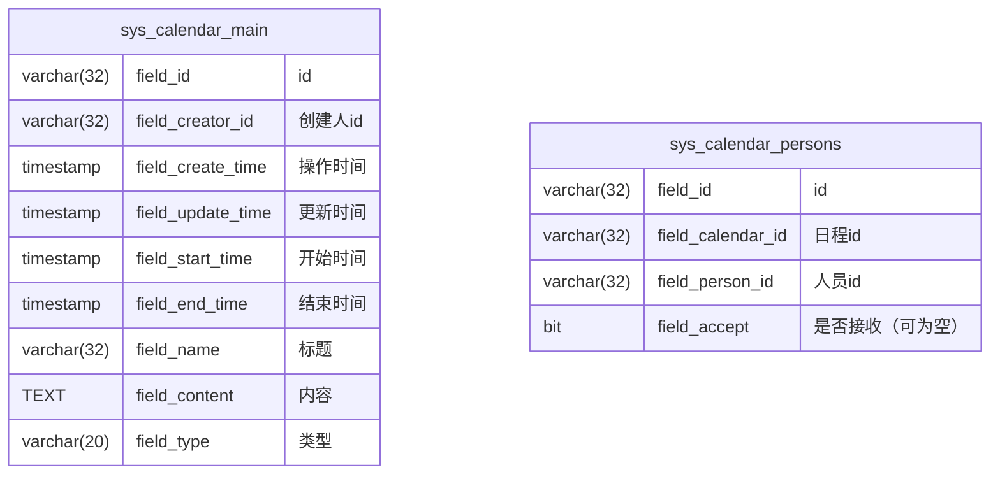

# 日程功能

## 表结构



## 码值

```text
sys_calendar_main.field_type:
    PERSONAL: 个人日程
    TEAM: 团队日程
```

## 权限

| 权限名 | 中文名 | 描述 |
| ------ | ------ | ---- |
| SYS_CALENDAR_SENDLEADER | 日程选择上级 | 创建团队日程可选中上级人员 |

## 公共配置项

| field_field_type | field_key | field_default_value | 描述                     |
| ---------------- | --------- | ------------------- |------------------------|
| calendar | AUTO_DELETE | 0 | 自动删除期限（为0则不自动删除）（非负整数） |

## 页面

### HomeView.vue

在顶部信息栏，右侧 通知 图标后，添加一个 日程 图标；

### CalendarView.vue 日程首页

页面分上下两个区：日历区，列表区

日历区：显示日历组件，默认显示当前月，并查询用户当月日程，显示在日历组件中；

列表区：按以下内容正常显示一个查询列表：

0. 固定查询条件为自己创建的日程或自己作为接收人的日程；
1. 筛选条件：标题、类型、是否接收（当类型选择团队日程时，显示该筛选；是/否/未确认）、日程开始时间（默认的开始时间为当前天）
2. 排序区：创建时间、日程开始时间
3. 按键区：添加日程
4. 列表：标题、类型、日程开始时间、日程结束时间、操作（详情，删除（仅限自己创建的日程））

### CalendarEdit, CalendarView

页面显示：

```
| ----- 基本信息 ----- |
| 标题 ----- |
| 类型 ----- |
| 日程开始时间 | 日程结束时间 |
| 接收人（类型为团队日程时，可多选） ----- |
| 内容 |
| ----- 接收情况（View页面，且类型为团队日程时，显示） ----- |
| 接收人 | 接收状态 |
| ----------|
```

## 业务逻辑

### 首页和页面跳转

1. 仅限顶部信息栏的日程图标可跳转；悬停不提示信息，点击后显示弹出框（Popover）显示用户当日的日程，并在底部显示"跳转日程"的按钮，点击后访问到日程页面；弹窗中每条日程显示时间段、标题与类型标签：当开始时间与结束时间不在同一天（跨天日程）时，时间段以"MM-DD HH:mm - MM-DD HH:mm"格式展示起止日期，同一天日程仅展示"HH:mm - HH:mm"；
2. 在日程页面的日历中，在右上角提供一个"创建日程"按钮；在日历内也可以通过点击日历日期，弹出框显示"创建日程"按钮进入日程创建，此时会将选中日期自动带入日程开始时间；

### 添加日程

1. 日程开始时间和日程结束时间的填写内容包括年月日、时、分；
2. 接收人的可选择范围是本人和本人所在机构、岗位的所有人员；`SYS_CALENDAR_SENDLEADER` 权限用户的可选择范围不受限制；
3. 个人日程创建后，接收人即为自己且接收状态固定为是；
4. 团队日程创建/修改后，为所有接收人发送 `待阅` 类型待办，标题为 "${创建人}向您发起了一个新日程，请确认。"，跳转链接为日程的详情页面；
5. 在团队日程详情页面上，接收情况将当前接收人排在第一个，其他接收人按id排序，接收状态列为当前接收人提供"接收"和"拒绝"按钮，可重新选择提交；

### 删除日程

1. 用户可删除自己创建的日程，团队日程删除后，接收人的待阅统一转入已阅；
2. 每日执行定时任务，如果配置项 `AUTO_DELETE` 配置不为0，则按照对应天数，删除结束时间超过当前时间对应天数的日程；同时日程相关待阅转已阅；