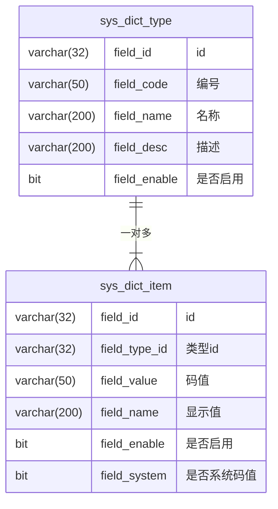

# 码值功能

## 表结构



## 权限

| 权限名 | 中文名 | 描述 |
| --- | --- | --- |
| SYS_DICT_ADMIN | 码值管理员 | 可编辑维护所有非系统码值 |

## 核心业务

### 页面

在 `后台管理` 中增加 `码值管理` 二级菜单，点击即可访问页面，全员可见；

页面左侧为 `sys_dict_type` 列表，按 `field_code` 排序，顶部有过滤文本框可快速筛选出对应 `field_name` 或 `field_code` 的码值类型；码值类型不可进行维护操作；

页面右侧为在选中的 `sys_dict_type` 下的 `sys_dict_item` 结果列表，无筛选区，无排序区，固定按 `field_value` 排序；

### 维护操作

在 `sys_dict_item` 结果列表区中，仅 `SYS_DICT_ADMIN` 级用户可见 `编辑` 和 `新增` 按钮；

1. `field_system = true` 的码值不可进行维护操作；

2. 人工新增的码值固定 `field_system = false`；

### 部署和系统码值

启动时，在 `/resources/properties/${MODEL}/` 下，读取 `dict.yml` 文件，文件统一填写格式为：

```yaml
dict:
    ${type.field_code_1}:
        name: ${type.field_name}
        desc: ${type.field_desc}
        ${item.field_value_1}: ${item.field_name_1}
        ${item.field_value_2}: ${item.field_name_2}
        #...
    ${type.field_code_2}:
        name: ${type.field_name}
        desc: ${type.field_desc}
        ${item.field_value_1}: ${item.field_name_1}
        ${item.field_value_2}: ${item.field_name_2}
        #...
```

启动时，会自动将 `dict.yml` 文件中的内容增量导入到数据库中，并设置 `field_system = true`

### 使用

后端提供接口供前端和其他模块服务快速通过 `type.field_code` 获取所有的码值项，具体使用由各页面和模块自行操作
