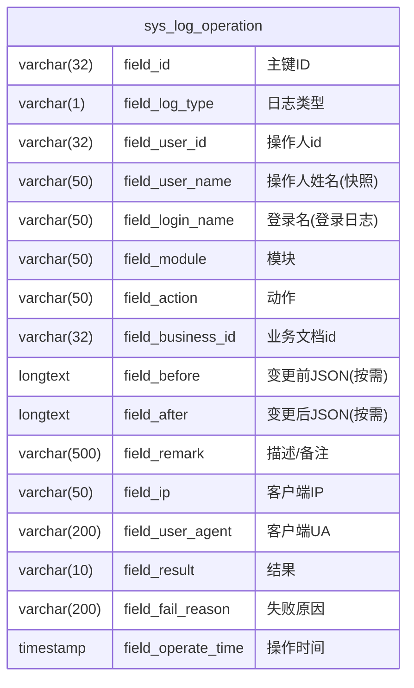

# 日志表结构

## 表字段

通用日志表 `sys_log_operation`：操作日志与登录日志共用一张表，通过 `field_log_type` 区分；流水表只增不改，不设 `field_enable`、`field_update_time`、`field_updator_id` 等变更类公共字段。

## 表结构说明

- 操作日志：`field_user_id` / `field_user_name` 记录操作人；`field_module` / `field_action` / `field_business_id` 定位动作与单据；
- 登录日志：`field_login_name` 记录登录主体（登录失败时 `field_user_id` 为空，仅保留登录名）；`field_ip` / `field_user_agent` 记录登录环境；
- `field_before` / `field_after` 为变更级审计预留，仅写入脱敏后的字段级变更 JSON，默认动作级审计可不填；
- 日志表与其他业务表**不建外键**（历史快照设计，不依赖业务表数据完整性），操作人姓名冗余快照；
- 公共字段由 Service 写入（参照附件模块 `buildOperation` 模式：`initFieldId()` + 手动 set 操作时间），不依赖公共字段自动填充。

## 索引

| 索引名 | 字段 | 用途 |
| --- | --- | --- |
| PRIMARY | field_id | 主键 |
| idx_log_type_time | field_log_type, field_operate_time | 列表主查询与时间范围清理 |
| idx_log_user_time | field_user_id, field_operate_time | 按操作人追溯 |
| idx_log_business | field_module, field_business_id | 按单据追溯 |

## 枚举值

### sys_log_operation.field_log_type

| 保存值 | 实际值 |
| --- | --- |
| 1 | 操作日志 |
| 2 | 登录日志 |

### sys_log_operation.field_result

| 保存值 | 实际值 |
| --- | --- |
| SUCCESS | 成功 |
| FAILED | 失败 |

### sys_log_operation.field_module 取值约定

取值来自 redis 缓存的各application.yml 配置文件上的 `MODEL_KEY` 字段，缓存键为 `erp:model:map`

| 保存值        | 实际值                     |
|------------|-------------------------|
| SYS-ORG    | 组织架构                    |
| SYS-ATT    | 附件                      |
| SYS-NOTIFY | 通知待办                    |
| SYS-LOG    | 日志                      |
| ERP-*      | ERP 各业务模块（按模块约定随后续开发扩展） |

### sys_log_operation.field_action 取值约定

| 保存值 | 实际值 |
| --- | --- |
| save | 保存/新增 |
| update | 更新 |
| delete | 删除 |
| submit | 提交 |
| import | 导入 |
| export | 导出 |
| download | 下载 |
| changePwd | 修改密码 |
| login | 登录 |
| logout | 登出 |
| forbidden | 鉴权拒绝 |
