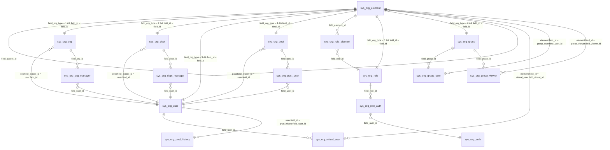

# 组织架构表结构

> 本文档描述组织架构（org）模块的数据库表结构，依据迁移脚本
> `backend/src/main/resources/db/migration/V1_01_001__sys_org_schema.sql`（sys_org 基础 14 张表）与
> `V1_01_039__sys_org_group_schema.sql`（v1.1 群组 3 张表）以及各 Mapper XML 回写。
> 字段统一 `field_` 前缀；公共字段 `field_id`（VARCHAR(32)，`IDUtil.initID()` 毫秒时间戳 + UUID v4）、
> `field_code`、`field_name` / `field_subject`、`field_creator_id`、`field_create_time`、`field_updater_id`、
> `field_update_time`、`field_enable`（BIT(1) 默认 b'1'）。

## 1. 表清单

| 表名 | 用途 | 形态 |
| --- | --- | --- |
| sys_org_element | 组织架构元素主表（机构/部门/人员/岗位共用，树形层级字段在此） | 主表 |
| sys_org_org | 机构扩展表（field_org_type = 1） | 主从扩展 |
| sys_org_dept | 部门扩展表（field_org_type = 2） | 主从扩展 |
| sys_org_user | 人员扩展表（field_org_type = 3，含登录/密码/账号状态） | 主从扩展 |
| sys_org_post | 岗位扩展表（field_org_type = 4） | 主从扩展 |
| sys_org_role | 角色表（另在 `sys_org_element` 维护 `field_org_type = 5` 镜像行） | 主表 |
| sys_org_auth | 权限表 | 主表 |
| sys_org_role_auth | 角色-权限关联表 | 关联表 |
| sys_org_role_element | 角色-组织元素关联表（角色权限计算四来源之一） | 关联表 |
| sys_org_post_user | 岗位-人员关联表 | 关联表 |
| sys_org_virtual_user | 虚拟组织-人员关联表 | 关联表 |
| sys_org_pwd_history | 密码历史表（流水表：只增不改，无 field_enable / field_update_time / field_updater_id） | 流水表 |
| sys_org_org_manager | 机构管理员表 | 关联表 |
| sys_org_dept_manager | 部门管理员表 | 关联表 |
| sys_org_group | 群组扩展表（`field_org_type = 6`） | 主从扩展 |
| sys_org_group_user | 群组-成员关联表 | 关联表（复合主键） |
| sys_org_group_viewer | 群组-可见范围关联表 | 关联表（复合主键） |

## 2. 表字段结构

```mermaid
erDiagram
    sys_org_element {
        string field_id
        string field_name
        string field_code
        string field_creator_id
        date field_create_time
        string field_updater_id
        date field_update_time
        bit field_enable
        int field_org_type
        string field_parent_id
        string field_hierarchy
        int field_level
        bit field_is_virtual
    }

    sys_org_org {
        string field_id
        string field_leader_id
        string field_phone
        string field_email
        string field_address
    }

    sys_org_dept {
        string field_id
        string field_leader_id
        string field_phone
        string field_address
    }

    sys_org_user {
        string field_id
        string field_phone
        string field_email
        string field_address
        int field_gender
        date field_birthday
        string field_login_name
        string field_password
        int field_job_status
        int field_account_status
        date field_last_login_time
        date field_last_chg_pwd_time
    }

    sys_org_post {
        string field_id
        string field_leader_id
    }

    sys_org_role {
        string field_id
        string field_name
        string field_code
        string field_creator_id
        date field_create_time
        string field_updater_id
        date field_update_time
        bit field_enable
    }

    sys_org_auth {
        string field_id
        string field_name
        string field_code
        string field_model
        string field_description
    }

    sys_org_role_auth {
        string field_auth_id
        string field_role_id
    }

    sys_org_role_element {
        string field_element_id
        string field_role_id
    }

    sys_org_post_user {
        string field_user_id
        string field_post_id
    }

    sys_org_virtual_user {
        string field_virtual_id
        string field_user_id
    }

    sys_org_pwd_history {
        string field_id
        string field_user_id
        string field_pwd
        int field_version
    }

    sys_org_org_manager {
        string field_org_id
        string field_user_id
        string field_description
    }

    sys_org_dept_manager {
        string field_dept_id
        string field_user_id
        string field_description
    }

    sys_org_group {
        string field_id
        string field_type
        string field_owner_id
        bit field_is_all_viewer
    }

    sys_org_group_user {
        string field_group_id
        string field_user_id
    }

    sys_org_group_viewer {
        string field_group_id
        string field_viewer_id
    }
```

## 3. 表关联关系

## 4. 字段详情与索引

### 4.1 sys_org_element（组织架构元素主表，树形表）

| 字段 | 类型 | 约束 | 说明 |
| --- | --- | --- | --- |
| field_id | VARCHAR(32) | PRIMARY KEY | 主键 |
| field_name | VARCHAR(200) | NOT NULL | 名称 |
| field_code | VARCHAR(50) | NOT NULL | 编码（人员作工号显示） |
| field_creator_id / field_updater_id | VARCHAR(32) | DEFAULT NULL | 创建者/修改者 ID |
| field_create_time | TIMESTAMP | NOT NULL DEFAULT CURRENT_TIMESTAMP | 创建时间 |
| field_update_time | TIMESTAMP | NULL DEFAULT CURRENT_TIMESTAMP ON UPDATE | 修改时间 |
| field_enable | BIT(1) | NOT NULL DEFAULT b'1' | 是否启用 |
| field_org_type | INT | NOT NULL | 组织类型：1=机构 2=部门 3=人员 4=岗位 5=角色 6=群组 |
| field_parent_id | VARCHAR(32) | DEFAULT NULL | 父级元素 ID（根级 NULL） |
| field_hierarchy | VARCHAR(500) | DEFAULT NULL | 层级路径，形如 `/id1/id2/`（含自身 id） |
| field_level | INT | NOT NULL DEFAULT 1 | 层级（根级为 1，向下递增） |
| field_is_virtual | BIT(1) | NOT NULL DEFAULT b'0' | 是否虚拟组织 |

索引：`idx_org_element_parent(field_parent_id)`、`idx_org_element_hierarchy(field_hierarchy)`、`idx_org_element_type(field_org_type)`。

### 4.2 类型扩展表（field_id 与主表一对一，同值关联）

| 表 | 字段（除 PK 外） | 说明 |
| --- | --- | --- |
| sys_org_org | field_leader_id VARCHAR(32)、field_phone VARCHAR(50)、field_email VARCHAR(200)、field_address VARCHAR(500) | 机构：负责人 + 三项联系信息 |
| sys_org_dept | field_leader_id VARCHAR(32)、field_phone VARCHAR(50)、field_address VARCHAR(500) | 部门：负责人 + 两项联系信息（无邮箱） |
| sys_org_user | 见 4.3 | 人员：登录与联系信息 |
| sys_org_post | field_leader_id VARCHAR(32) | 岗位：仅负责人 |

> 角色与群组无独立扩展表：角色（`field_org_type = 5`）以 `sys_org_role` 为主表、同事务维护 `sys_org_element` 镜像行（见 4.4），
> 群组（`field_org_type = 6`）扩展表 `sys_org_group` 见 4.7。

### 4.3 sys_org_user（人员扩展表）

| 字段 | 类型 | 约束 | 说明 |
| --- | --- | --- | --- |
| field_id | VARCHAR(32) | PRIMARY KEY | 与 sys_org_element.field_id 一致 |
| field_phone | VARCHAR(50) | DEFAULT NULL | 联系电话（人员间唯一，应用层校验） |
| field_email | VARCHAR(200) | DEFAULT NULL | 联系邮箱（人员间唯一，应用层校验） |
| field_address | VARCHAR(500) | DEFAULT NULL | 联系地址 |
| field_gender | INT | NOT NULL DEFAULT 0 | 性别：0=其他 1=男 2=女（表单默认选「男」） |
| field_birthday | DATE | DEFAULT NULL | 生日 |
| field_login_name | VARCHAR(50) | DEFAULT NULL | 登录名（不可为邮箱格式、11 位纯手机号） |
| field_password | VARCHAR(255) | DEFAULT NULL | 密码（BCrypt 哈希 60 字符，明文不落库） |
| field_job_status | INT | NOT NULL DEFAULT 1 | 在岗状态：1=在职 0=离职 2=停职 3=休假 |
| field_account_status | INT | NOT NULL DEFAULT 1 | 账号状态：1=正常 2=锁定 3=密码过期 0=禁用 4=注销（仅 1 可登录） |
| field_last_login_time | TIMESTAMP | NULL | 最后登录时间（登录成功时更新） |
| field_last_chg_pwd_time | TIMESTAMP | NULL | 最后修改密码时间（定期改密周期起点） |

索引：`UNIQUE KEY uk_org_user_login_name(field_login_name)`（登录名唯一，库级兜底）。

### 4.4 sys_org_role / sys_org_auth（角色 / 权限）

| 表 | 字段（除公共字段外） | 索引 |
| --- | --- | --- |
| sys_org_role | field_name VARCHAR(200) NOT NULL、field_code VARCHAR(50)（权限码，前端 hasAuth 判定依据，可空可清空） | PRIMARY KEY |
| sys_org_auth | field_name VARCHAR(200)、field_code VARCHAR(50)、field_model VARCHAR(50)（所属模块）、field_description VARCHAR(500)；无公共流水字段（由 roles.yml 增量同步） | `UNIQUE KEY uk_org_auth_code(field_code)` |

> 角色主表写入时同事务维护 `sys_org_element` 镜像行（`field_org_type = 5`，`field_parent_id` / `field_hierarchy` 为 NULL、
> `field_level = 1`）：`SysOrgRoleService#syncElementMirror`（`saveRole` / `updateRole` / `ensureSystemAdminRole` 均调用），
> 已存在时经专用 SQL `updateRoleMirror`（`SysOrgElementMapper.xml`）仅同步名称/编码/启用与审计字段，
> 不复用通用 update（其对 `field_level` / `field_org_type` / `field_is_virtual` 无条件赋值，禁止用于镜像行）；
> 镜像行 `field_code` 存角色编码（角色编码可空，同步时允许为 NULL / 清空）。
> 存量角色不做迁移（明确决策），镜像行仅由写路径增量维护。

### 4.5 关联表（复合主键）

| 表 | 主键 | 二级索引 |
| --- | --- | --- |
| sys_org_role_auth | (field_auth_id, field_role_id) | idx_role_auth_role(field_role_id) |
| sys_org_role_element | (field_element_id, field_role_id) | idx_role_element_role(field_role_id) |
| sys_org_post_user | (field_user_id, field_post_id) | idx_post_user_post(field_post_id) |
| sys_org_virtual_user | (field_virtual_id, field_user_id) | idx_virtual_user_user(field_user_id) |
| sys_org_org_manager | (field_org_id, field_user_id)，含 field_description | idx_org_manager_user(field_user_id) |
| sys_org_dept_manager | (field_dept_id, field_user_id)，含 field_description | idx_dept_manager_user(field_user_id) |
| sys_org_group_user | (field_group_id, field_user_id) | idx_org_group_user_user(field_user_id) |
| sys_org_group_viewer | (field_group_id, field_viewer_id) | idx_org_group_viewer_viewer(field_viewer_id) |

> `sys_org_group_user` / `sys_org_group_viewer` 为明细表，只增不改（无 `field_enable` / 审计字段），
> 保存时全量替换（先删后插），与 `sys_org_role_element` 风格一致。

### 4.6 sys_org_pwd_history（密码历史表，流水表）

| 字段 | 类型 | 约束 | 说明 |
| --- | --- | --- | --- |
| field_id | VARCHAR(32) | PRIMARY KEY | 主键 |
| field_user_id | VARCHAR(32) | NOT NULL | 用户 ID |
| field_pwd | VARCHAR(255) | NOT NULL | 历史密码（BCrypt 哈希） |
| field_version | INT | NOT NULL DEFAULT 1 | 密码版本（写入时取 max(version)+1） |

索引：`idx_pwd_history_user(field_user_id)`。
流水表只增不改：不设 `field_enable` / `field_update_time` / `field_updater_id`（先例 `sys_log_operation`、`sys_task_history`）。
保留策略：`changePwd` 写入后按 `KEY_PWD_REPEAT_LIMIT` 配置执行 `deleteExcess`，仅保留最近 N 条（LIMIT 大数 + OFFSET 写法）。

### 4.7 sys_org_group（群组扩展表，`field_org_type = 6`）

| 字段 | 类型 | 约束 | 说明 |
| --- | --- | --- | --- |
| field_id | VARCHAR(32) | PRIMARY KEY | 与 sys_org_element.field_id 一致（群组不参与树：`field_parent_id` / `field_hierarchy` 为 NULL，`field_level = 1`） |
| field_type | VARCHAR(20) | NOT NULL DEFAULT 'PERSONAL' | 群组类型：`COMMON` 公共 / `PERSONAL` 个人 |
| field_owner_id | VARCHAR(32) | DEFAULT NULL | 所有人（`PERSONAL` 必填；`COMMON` 记录创建人，归属判定唯一依据） |
| field_is_all_viewer | BIT(1) | NOT NULL DEFAULT b'1' | 是否全员可见（派生字段：可见范围明细为空 ⇒ 1；仅 `COMMON` 有意义） |

索引：`idx_org_group_type(field_type)`、`idx_org_group_owner(field_owner_id)`。

> 建表脚本：`V1_01_039__sys_org_group_schema.sql`（utf8mb4、无外键、`IF NOT EXISTS`，约束由 `SysOrgGroupService` 应用层保证）。
> 群组在 `sys_org_element` 同样有镜像行（`field_org_type = 6`，树字段同角色镜像行固定），
> 但镜像行 `field_code` 恒写空串（列 `NOT NULL`，禁止写 NULL；角色镜像行则存角色编码），
> 维护约定见核心业务设计「群组管理」与后端业务设计。

## 5. 枚举值与系统码值（dict.yml 增量导入）

| 字段 | 字典键 | 取值 |
| --- | --- | --- |
| sys_org_element.field_org_type | org_element_type | 1 机构 / 2 部门 / 3 人员 / 4 岗位 / 5 角色 / 6 群组 |
| sys_org_group.field_type | org_group_type | COMMON 公共 / PERSONAL 个人 |
| sys_org_user.field_account_status | org_account_status | 0 禁用 / 1 正常 / 2 锁定 / 3 密码过期 / 4 注销 |
| sys_org_user.field_job_status | org_job_status | 0 离职 / 1 在职 / 2 停职 / 3 休假 |
| sys_org_user.field_gender | gender（common/dict.yml） | 0 其他 / 1 男 / 2 女 |
| field_enable 等布尔 | yes_no（common/dict.yml） | 布尔值是/否 |

## 6. 密码存储说明

- `sys_org_user.field_password` 以 **BCrypt 单向加密**（自带随机盐、不可逆，`PasswordUtil.encode/matches`）存储，明文不落库，长度上限 255（BCrypt 哈希 60 字符，空间充足）；
- 所有查询（load / list / 导出）的列集合均不返回密码字段（模型 `@JsonProperty(WRITE_ONLY)`，响应永不回显）；
- 密码仅通过两个入口写入：创建用户（`save` 设置初始密码）、`changePwd` 接口修改；**编辑接口（update）一律忽略请求中携带的密码字段**；任何密码写入前必须经 `PasswordUtil` 加密；
- 修改密码时同步刷新 `field_last_chg_pwd_time`，并写入 `sys_org_pwd_history`（防止与最近 N 次重复）。
