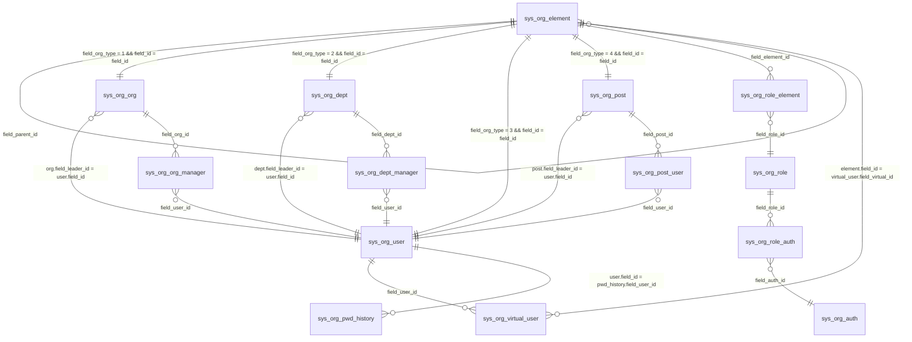

 # 组织架构表结构
 
## 表字段结构

```mermaid
erDiagram
    sys_org_element {
        string field_id
        string field_name
        string field_code
        string field_creator_id
        date field_create_time
        string field_updater_id
        date field_update_time
        bit field_enable
        int field_org_type
        string field_parent_id
        string field_hierarchy
        int field_level
        bit field_is_virtual
    }
    
    sys_org_org {
        string field_id
        string field_leader_id
        string field_phone
        string field_email
        string field_address
    }

    sys_org_dept {
        string field_id
        string field_leader_id
        string field_phone
        string field_address
    }

    sys_org_user {
        string field_id
        string field_phone
        string field_email
        string field_address
        int field_gender
        date field_birthday
        string field_login_name
        string field_password
        int field_job_status
        int field_account_status
        date field_last_login_time
        date field_last_chg_pwd_time
    }

    sys_org_post {
        string field_id
        string field_leader_id
    }

    sys_org_role {
        string field_id
        string field_name
        string field_code
        string field_creator_id
        date field_create_time
        string field_updater_id
        date field_update_time
        bit field_enable
    }

    sys_org_auth {
        string field_id
        string field_name
        string field_code
        string field_model
        string field_description
    }
    
    sys_org_role_auth {
        string field_auth_id
        string field_role_id
    }
    
    sys_org_role_element {
        string field_element_id
        string field_role_id
    }
    
    sys_org_post_user {
        string field_user_id
        string field_post_id
    }
    
    sys_org_virtual_user {
        string field_virtual_id
        string field_user_id
    }
    
    sys_org_pwd_history {
        string field_id
        string field_user_id
        string field_pwd
        int field_version
    }

    sys_org_org_manager {
        string field_org_id
        string field_user_id
        string field_description
    }
    
    sys_org_dept_manager {
        string field_dept_id
        string field_user_id
        string field_description
    }
```
 

## 表关联关系

## 密码存储说明

- `sys_org_user.field_password` 以 **BCrypt 单向加密**（自带随机盐、不可逆）存储，明文不落库，长度上限 255（BCrypt 哈希 60 字符，空间充足）；
- 所有查询（load / list / 导出）的列集合均不返回密码字段；
- 密码仅通过创建用户（save）、编辑用户（update 携带密码）、`changePwd` 接口写入，写入前必须经 `PasswordUtil` 加密；
- 修改密码时同步刷新 `field_last_chg_pwd_time`。