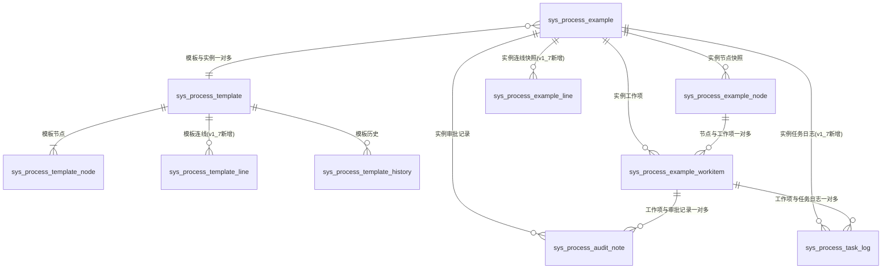

# 流程 v1_7 数据库设计分册

## 1. 文档信息

| 项目 | 内容 |
| --- | --- |
| 文档定位 | 流程管理 v1_7 改造（线性串行引擎 → 连线 DAG 图引擎）的**数据库设计冻结稿**；下游 Wave 1 的 P17-DB-001~005 按本分册实现 |
| 输入依据 | 《功能实现方案-改造分析与方案设计.md》§3.2 / §6.1 / §6.2 / §6.3；《流程管理v1_7研发任务清单.md》任务卡片 4.3、4.6~4.10；《流程核心业务.md》（P17-DOC-001 产出）；《注解维护表结构设计方案.md》（引擎口径）；现状代码逐列核对 |
| 适用版本 | v1_7 流程管理（引擎 DAG 化 + 14 类审批操作 + @ProcessTask + 监控统计） |
| 创建日期 | 2026-11-19 |
| 文档版本 | V1.0 |
| 文档状态 | 已确认（Wave 0 / P17-DOC-003 产出） |
| 表结构维护口径 | 表结构由实体注解（`@TableSource` / `@ColumnField` / `@TableIndex`）声明，启动期经注解同步引擎比对 `information_schema` 同步（dev=APPLY、test/prod=VALIDATE）；**改表=改实体注解，不新增 SQL 迁移脚本**；存量数据回填走 `SourceDataMigration` SPI（code 格式 `DM-yyyyMMdd-nnn`） |

### 1.1 范围声明

- **本批新增 3 张表**：`sys_process_template_line`（模板连线表）、`sys_process_example_line`（实例连线快照表）、`sys_process_task_log`（流程任务执行日志表）。
- **本批存量表列变更 4 处**：`sys_process_template_node.field_node_key`、`sys_process_example_node.field_node_key`、`sys_process_example_node.field_runtime`、`sys_process_example_workitem.field_from_workitem_id`。
- **本批存量数据迁移 3 个**：`DM-20261119-001` / `DM-20261119-002` / `DM-20261119-003`。
- **本批不涉及**：`sys_process_template` / `sys_process_template_history` / `sys_process_example` / `sys_process_audit_note` 无列变更（状态与审批记录类型均为 VARCHAR 存量列新增枚举值）；不新增表；不新增索引到存量表（除列变更随注解同步的新增对象外无索引调整）。
- 字段命名、公共字段、流水表裁剪规则以 `AGENTS.md` 第 4 节与本分册第 6 章为准；接口契约见 v1_7 API 接口设计分册（P17-DOC-002，待产出）、页面契约见《流程v1_7前端UI设计分册.md》。

### 版本变更记录

| 版本 | 日期 | 变更说明 |
| --- | --- | --- |
| V1.0 | 2026-11-19 | 初版（Wave 0 / P17-DOC-003）：冻结 3 张新表逐列定义、索引、实体注解片段、Dao/Mapper/XML 规划；冻结 4 处存量列变更（均为可空新增列）；冻结 3 个 SourceDataMigration 的 code / order / 幂等与阻断语义；给出 ER 图、枚举值全集、节点配置 JSON v2 结构、注解同步与验证口径；同步更新《流程表结构.md》与《系统模块数据库设计.md》§4.3 |

---

## 2. 表变更总览

### 2.1 变更汇总

| # | 表名 | 中文名 | 变更类型 | 继承基类 | 变更内容 | 关联任务 |
| --- | --- | --- | --- | --- | --- | --- |
| 1 | `sys_process_template_line` | 流程模板连线表 | **新增表** | `BaseModel`（流水结构） | 8 业务列 + 2 索引 | P17-DB-001 |
| 2 | `sys_process_example_line` | 流程实例连线快照表 | **新增表** | `BaseModel`（流水结构） | 8 业务列 + 2 索引 | P17-DB-002 |
| 3 | `sys_process_task_log` | 流程任务执行日志表 | **新增表** | `BaseModel`（流水结构，只增不改） | 12 业务列 + 1 索引 | P17-DB-003 |
| 4 | `sys_process_template_node` | 流程模板节点表 | 列变更 | `BaseModel` | 新增 `field_node_key` VARCHAR(50) **可空** | P17-DB-004 |
| 5 | `sys_process_example_node` | 流程实例节点表 | 列变更 | `BaseModel` | 新增 `field_node_key` VARCHAR(50) **可空** | P17-DB-004 |
| 6 | `sys_process_example_node` | 流程实例节点表 | 列变更 | `BaseModel` | 新增 `field_runtime` JSON **可空** | P17-DB-004 |
| 7 | `sys_process_example_workitem` | 流程工作项表 | 列变更 | `BaseModel` | 新增 `field_from_workitem_id` VARCHAR(32) **可空** | P17-DB-004 |
| 8 | `sys_process_template` | 流程模板主表 | **无变更** | `MainModel` | — | — |
| 9 | `sys_process_template_history` | 流程模板历史版本表 | **无变更** | `BaseModel` | 归档 JSON 内容扩展为含连线（`field_content` 结构变化，列不变） | P17-BE-006 |
| 10 | `sys_process_example` | 流程实例主表 | **无变更** | `BaseModel` | 状态复用 ABANDON（D2），无新列 | — |
| 11 | `sys_process_example_workitem` | 流程工作项表 | **无变更**（除 #7） | `BaseModel` | `field_config` 新增 `flowChoice` 键（JSON 结构变化，列不变） | P17-BE-001 |
| 12 | `sys_process_audit_note` | 流程审批记录表 | **列扩长**（1 处，不新增列） | `BaseModel` | `field_handle_type` 新增 10 个枚举值 → 列宽 VARCHAR(20) → **VARCHAR(50)**（最长新值 `HANDLER_TRANSFER_RETRACT` 23 字符，20 不足）；列 COMMENT 同步补全集 | P17-DB-004 / P17-BE-008~013 |

> 存量表内 `field_node_config` / `field_config` 的 **JSON 内容变化不产生列变更**（列类型仍为 `JSON`），旧值由引擎读取时归一，**不改写存量 JSON**（见第 8 章）。

### 2.2 变更后的表清单（流程机制模块）

| 分组 | 表名 | 中文名 | 关系定位 |
| --- | --- | --- | --- |
| 模板侧 | `sys_process_template` | 流程模板主表 | 模板主表（`MainModel`） |
| 模板侧 | `sys_process_template_node` | 流程模板节点表 | 与模板一对多（`BaseModel`） |
| 模板侧 | `sys_process_template_line` | 流程模板连线表 | 与模板一对多（**v1_7 新增**） |
| 模板侧 | `sys_process_template_history` | 流程模板历史版本表 | 与模板一对多（归档流水） |
| 实例侧 | `sys_process_example` | 流程实例主表 | 实例主表 |
| 实例侧 | `sys_process_example_node` | 流程实例节点表 | 与实例一对多（模板节点快照） |
| 实例侧 | `sys_process_example_line` | 流程实例连线快照表 | 与实例一对多（**v1_7 新增**） |
| 实例侧 | `sys_process_example_workitem` | 流程工作项表 | 与实例/实例节点一对多 |
| 实例侧 | `sys_process_audit_note` | 流程审批记录表 | 与实例/工作项一对多 |
| 任务侧 | `sys_process_task_log` | 流程任务执行日志表 | 与实例一对多（**v1_7 新增**，只增不改） |

---

## 3. 新增表逐表设计

### 3.1 `sys_process_template_line` 流程模板连线表

#### 3.1.1 中文名与职责

- **中文名**：流程模板连线表。`@TableSource(comment = "流程模板连线表")`。
- **职责**：承载模板内节点之间的有向连线，是 v1_7 起**流转的唯一依据**（`field_from_key` → `field_to_key`）。分支名称、分支序号、分支条件公式、默认分支标记均落在本表（不在模板节点配置中冗余）；条件分支（CONDITION）的判断顺序按 `field_branch_order` 升序，并行开始（FORK）的「分支启动条件」同样落 `field_condition`。
- **结构性质**：与模板节点表同级从属表，模板保存时**按模板全量删除重建**（同现有节点「全量替换」模式）；模板更新时连同节点一并归档进 `sys_process_template_history.field_content`。

#### 3.1.2 继承基类与公共列说明

- **继承 `BaseModel`**：仅由引擎公共列模板**内建 `field_id`（VARCHAR(32) 主键）**；`primaryKeyColumns` 不声明（用默认行为）。
- **流水结构裁剪**：本表为模板从属定义表（随模板全量替换，不做启停用），**不设** `field_enable` / `field_update_time` / `field_updater_id`（对齐流水/日志类表口径，先例 `sys_process_template_history`、`sys_log_operation`、`sys_task_history`）。
- 不内建 `field_creator_id` / `field_create_time`：模板层面的创建人/创建时间落在 `sys_process_template`，连线不重复承载。

#### 3.1.3 逐列字段表

| 列名 | 逻辑类型 `ColumnType` | 物理类型与长度 | 可空 | 默认值 | 中文注释（列 COMMENT） |
| --- | --- | --- | --- | --- | --- |
| `field_id` | —（基类内建） | `VARCHAR(32)` | 否 | 无（应用侧 `IDUtil.initID()`） | 主键ID |
| `field_template_id` | `STRING` | `VARCHAR(32)` | 否 | 无 | 模板id |
| `field_from_key` | `STRING` | `VARCHAR(50)` | 否 | 无 | 起始节点键 |
| `field_to_key` | `STRING` | `VARCHAR(50)` | 否 | 无 | 目标节点键 |
| `field_line_type` | `STRING` | `VARCHAR(20)` | 否 | 无 | 连线类型: NORMAL=普通 CONDITION=条件分支 PARALLEL=并行分支 MANUAL=人工决策 |
| `field_branch_order` | `INT` | `INT` | 否 | 无（应用侧写 0 起序号） | 分支序号(条件/并行分支判断顺序,上移下移即改此值) |
| `field_branch_name` | `STRING` | `VARCHAR(200)` | 是 | `NULL` | 分支名称 |
| `field_condition` | `TEXT` | `TEXT` | 是 | 无（TEXT 禁止默认值） | 分支条件公式(条件分支/并行启动条件) |
| `field_is_default` | `BOOLEAN` | `BIT(1)` | 否 | 无（应用侧写 `b'0'`/`b'1'`） | 是否默认分支(条件分支节点有且仅有一条) |

> 取值约束（应用层/模板保存校验，非库级约束）：`field_line_type` ∈ {`NORMAL`, `CONDITION`, `PARALLEL`, `MANUAL`}（由源节点类型决定，显式存储便于校验）；条件分支节点的出边中**有且仅有一条** `field_is_default = b'1'`；`field_condition` 仅 `CONDITION`/`PARALLEL` 连线填写。

#### 3.1.4 索引清单

| 索引名 | 列 | 类型 | 用途 |
| --- | --- | --- | --- |
| `PRIMARY KEY` | `(field_id)` | 主键（引擎内建） | 主键 |
| `idx_template_line_template` | `(field_template_id)` | 普通 BTREE | 按模板加载/删除全部连线（`load` 响应组装、保存时全量删除重建） |
| `idx_template_line_from` | `(field_template_id, field_from_key)` | 普通 BTREE | 流转时按「模板 + 起始节点键」取候选出边（条件/并行分支按 `field_branch_order` 排序） |

#### 3.1.5 实体注解声明样例（逐列对应）

```java
package com.eric.base.sys.process.model;

import com.eric.base.common.base.model.BaseModel;
import com.eric.base.common.source.annotation.ColumnField;
import com.eric.base.common.source.annotation.TableIndex;
import com.eric.base.common.source.annotation.TableSource;
import com.eric.base.common.source.enums.ColumnType;
import lombok.Data;
import lombok.EqualsAndHashCode;

/**
 * 流程模板连线实体
 *
 * @description 对应 sys_process_template_line 表：模板内节点间有向连线，v1_7 起流转的唯一依据；
 *              流水结构（随模板全量替换），不设 field_enable / field_update_time / field_updater_id。
 *              公共列（field_id 主键）由引擎公共列模板内建，无需标注。
 */
@Data
@EqualsAndHashCode(callSuper = true)
@TableSource(name = "sys_process_template_line", comment = "流程模板连线表",
        indexes = {
                @TableIndex(name = "idx_template_line_template", columns = "field_template_id"),
                @TableIndex(name = "idx_template_line_from",
                        columns = {"field_template_id", "field_from_key"})})
public class SysProcessTemplateLine extends BaseModel {

    /** 模板id（sys_process_template.field_id） */
    @ColumnField(name = "field_template_id", comment = "模板id", type = ColumnType.STRING, length = 32)
    private String fieldTemplateId;

    /** 起始节点键（模板内节点业务键，如 N1） */
    @ColumnField(name = "field_from_key", comment = "起始节点键", type = ColumnType.STRING, length = 50)
    private String fieldFromKey;

    /** 目标节点键（模板内节点业务键，如 N2） */
    @ColumnField(name = "field_to_key", comment = "目标节点键", type = ColumnType.STRING, length = 50)
    private String fieldToKey;

    /** 连线类型：NORMAL / CONDITION / PARALLEL / MANUAL */
    @ColumnField(name = "field_line_type",
            comment = "连线类型: NORMAL=普通 CONDITION=条件分支 PARALLEL=并行分支 MANUAL=人工决策",
            type = ColumnType.STRING, length = 20)
    private String fieldLineType;

    /** 分支序号（条件/并行分支判断顺序，上移下移即改此值） */
    @ColumnField(name = "field_branch_order", comment = "分支序号(条件/并行分支判断顺序,上移下移即改此值)",
            type = ColumnType.INT)
    private Integer fieldBranchOrder;

    /** 分支名称（可空） */
    @ColumnField(name = "field_branch_name", comment = "分支名称",
            type = ColumnType.STRING, length = 200, nullable = true)
    private String fieldBranchName;

    /** 分支条件公式（条件分支判断条件 / 并行分支启动条件，可空） */
    @ColumnField(name = "field_condition", comment = "分支条件公式(条件分支/并行启动条件)",
            type = ColumnType.TEXT, nullable = true)
    private String fieldCondition;

    /** 是否默认分支（条件分支节点有且仅有一条） */
    @ColumnField(name = "field_is_default", comment = "是否默认分支(条件分支节点有且仅有一条)",
            type = ColumnType.BOOLEAN)
    private Boolean fieldIsDefault;
}
```

#### 3.1.6 下游 Dao / Mapper / XML 规划要点（P17-DB-001）

- 落点：`sys/process/dao/SysProcessTemplateLineDao.java`（无 `I` 前缀，与 Mapper 一对一）、`sys/process/mapper/SysProcessTemplateLineMapper.java`、`resources/mappers/sys/process/SysProcessTemplateLineMapper.xml`。
- XML 必备语句：①按模板查询（`field_template_id = #{}`，`ORDER BY field_from_key, field_branch_order`）；②按「模板 + 起始键」查询（组合索引 `idx_template_line_from`）；③按模板**批量插入**（保存时全量重建）；④按模板**全量删除**（`DELETE FROM sys_process_template_line WHERE field_template_id = #{fieldTemplateId}`），与③同事务。
- 复杂 SQL 一律写 XML（对齐仓库分层），Dao 不直连 JDBC；模板 Service 内「删旧插新」与节点替换同事务（P17-BE-006）。

### 3.2 `sys_process_example_line` 流程实例连线快照表

#### 3.2.1 中文名与职责

- **中文名**：流程实例连线快照表。`@TableSource(comment = "流程实例连线快照表")`。
- **职责**：流程实例创建时从模板连线表**全量快照复制**（与模板节点快照同语义），保证实例按创建时版本的图结构执行；流转引擎只读本表，不再回查模板。

#### 3.2.2 继承基类与公共列说明

- **继承 `BaseModel`**：引擎内建 `field_id` 主键；**流水结构**，不设 `field_enable` / `field_update_time` / `field_updater_id`（实例连线快照创建后不可变，实例结束亦不删除）。
- 实例级创建时间/创建人落在 `sys_process_example`（`field_creator_id` / `field_create_time`），本表不重复承载。

#### 3.2.3 逐列字段表

| 列名 | 逻辑类型 `ColumnType` | 物理类型与长度 | 可空 | 默认值 | 中文注释（列 COMMENT） |
| --- | --- | --- | --- | --- | --- |
| `field_id` | —（基类内建） | `VARCHAR(32)` | 否 | 无（`IDUtil.initID()`） | 主键ID |
| `field_example_id` | `STRING` | `VARCHAR(32)` | 否 | 无 | 流程实例id |
| `field_from_key` | `STRING` | `VARCHAR(50)` | 否 | 无 | 起始节点键 |
| `field_to_key` | `STRING` | `VARCHAR(50)` | 否 | 无 | 目标节点键 |
| `field_line_type` | `STRING` | `VARCHAR(20)` | 否 | 无 | 连线类型: NORMAL=普通 CONDITION=条件分支 PARALLEL=并行分支 MANUAL=人工决策 |
| `field_branch_order` | `INT` | `INT` | 否 | 无 | 分支序号(条件/并行分支判断顺序,上移下移即改此值) |
| `field_branch_name` | `STRING` | `VARCHAR(200)` | 是 | `NULL` | 分支名称 |
| `field_condition` | `TEXT` | `TEXT` | 是 | 无 | 分支条件公式(条件分支/并行启动条件) |
| `field_is_default` | `BOOLEAN` | `BIT(1)` | 否 | 无 | 是否默认分支(条件分支节点有且仅有一条) |

> **与表 1 同构声明**：除 `field_template_id` → `field_example_id` 与索引名外，列名、逻辑类型、长度、可空性、注释口径**逐列一致**；实现时可按同一模板复制。

#### 3.2.4 索引清单

| 索引名 | 列 | 类型 | 用途 |
| --- | --- | --- | --- |
| `PRIMARY KEY` | `(field_id)` | 主键（引擎内建） | 主键 |
| `idx_example_line_example` | `(field_example_id)` | 普通 BTREE | 按实例加载全部连线（实例详情图渲染、流转引擎取图） |
| `idx_example_line_from` | `(field_example_id, field_from_key)` | 普通 BTREE | 按「实例 + 起始节点键」取出边 |

#### 3.2.5 实体注解声明样例（逐列对应）

```java
package com.eric.base.sys.process.model;

import com.eric.base.common.base.model.BaseModel;
import com.eric.base.common.source.annotation.ColumnField;
import com.eric.base.common.source.annotation.TableIndex;
import com.eric.base.common.source.annotation.TableSource;
import com.eric.base.common.source.enums.ColumnType;
import lombok.Data;
import lombok.EqualsAndHashCode;

/**
 * 流程实例连线实体
 *
 * @description 对应 sys_process_example_line 表：实例创建时从模板连线全量快照复制，
 *              流转引擎只读本表；流水结构，不设 field_enable / field_update_time / field_updater_id。
 *              公共列（field_id 主键）由引擎公共列模板内建，无需标注。
 */
@Data
@EqualsAndHashCode(callSuper = true)
@TableSource(name = "sys_process_example_line", comment = "流程实例连线快照表",
        indexes = {
                @TableIndex(name = "idx_example_line_example", columns = "field_example_id"),
                @TableIndex(name = "idx_example_line_from",
                        columns = {"field_example_id", "field_from_key"})})
public class SysProcessExampleLine extends BaseModel {

    /** 流程实例id（sys_process_example.field_id） */
    @ColumnField(name = "field_example_id", comment = "流程实例id", type = ColumnType.STRING, length = 32)
    private String fieldExampleId;

    /** 起始节点键（实例内节点业务键快照） */
    @ColumnField(name = "field_from_key", comment = "起始节点键", type = ColumnType.STRING, length = 50)
    private String fieldFromKey;

    /** 目标节点键（实例内节点业务键快照） */
    @ColumnField(name = "field_to_key", comment = "目标节点键", type = ColumnType.STRING, length = 50)
    private String fieldToKey;

    /** 连线类型：NORMAL / CONDITION / PARALLEL / MANUAL */
    @ColumnField(name = "field_line_type",
            comment = "连线类型: NORMAL=普通 CONDITION=条件分支 PARALLEL=并行分支 MANUAL=人工决策",
            type = ColumnType.STRING, length = 20)
    private String fieldLineType;

    /** 分支序号（条件/并行分支判断顺序） */
    @ColumnField(name = "field_branch_order", comment = "分支序号(条件/并行分支判断顺序,上移下移即改此值)",
            type = ColumnType.INT)
    private Integer fieldBranchOrder;

    /** 分支名称（可空） */
    @ColumnField(name = "field_branch_name", comment = "分支名称",
            type = ColumnType.STRING, length = 200, nullable = true)
    private String fieldBranchName;

    /** 分支条件公式（条件分支判断条件 / 并行分支启动条件，可空） */
    @ColumnField(name = "field_condition", comment = "分支条件公式(条件分支/并行启动条件)",
            type = ColumnType.TEXT, nullable = true)
    private String fieldCondition;

    /** 是否默认分支（条件分支节点有且仅有一条） */
    @ColumnField(name = "field_is_default", comment = "是否默认分支(条件分支节点有且仅有一条)",
            type = ColumnType.BOOLEAN)
    private Boolean fieldIsDefault;
}
```

#### 3.2.6 下游 Dao / Mapper / XML 规划要点（P17-DB-002）

- 落点：`dao/SysProcessExampleLineDao.java`、`mapper/SysProcessExampleLineMapper.java`、`resources/mappers/sys/process/SysProcessExampleLineMapper.xml`。
- XML 必备语句：①按实例查询（`ORDER BY field_from_key, field_branch_order`）；②按「实例 + 起始键」查询；③**批量插入**（实例创建快照复制，与节点快照同事务）；④按实例删除（仅供实例重建/异常清理，正常流程不调用）。
- 实例创建（`SysProcessExampleService#createDraft`）内「节点快照 + 连线快照」同事务写入，保证图结构完整（P17-BE-007）。

### 3.3 `sys_process_task_log` 流程任务执行日志表

#### 3.3.1 中文名与职责

- **中文名**：流程任务执行日志表。`@TableSource(comment = "流程任务执行日志表")`。
- **职责**：承载 @ProcessTask 流程任务每次执行（`ProcessTaskType` 各步骤、节点配置 `tasks` 明细、强制任务）的留痕：任务名称/实现 bean/执行步骤/入参/结果摘要/成功标记/失败信息/耗时。**审批记录不承载任务留痕**（决策 D7）。

#### 3.3.2 继承基类与公共列说明

- **继承 `BaseModel`**：引擎内建 `field_id` 主键。
- **流水只增不改**：**不设** `field_enable` / `field_update_time` / `field_updater_id`（对齐先例 `sys_task_history`、`sys_process_audit_note`）。
- `field_create_time` **按业务列显式 `@ColumnField` 标注**（`BaseModel` 不内建审计列）：对齐先例 `sys_process_audit_note.field_create_time`、`sys_process_example_workitem.field_create_time`（同表族中 `field_create_time` 均以业务列标注 + `DefaultFunction.CURRENT_TIMESTAMP`）。

#### 3.3.3 逐列字段表

| 列名 | 逻辑类型 `ColumnType` | 物理类型与长度 | 可空 | 默认值 | 中文注释（列 COMMENT） |
| --- | --- | --- | --- | --- | --- |
| `field_id` | —（基类内建） | `VARCHAR(32)` | 否 | 无（`IDUtil.initID()`） | 主键ID |
| `field_example_id` | `STRING` | `VARCHAR(32)` | 否 | 无 | 流程实例id |
| `field_node_id` | `STRING` | `VARCHAR(32)` | 是 | `NULL` | 节点id(流程实例节点id,StartProcess/EndProcess 步骤可空) |
| `field_workitem_id` | `STRING` | `VARCHAR(32)` | 是 | `NULL` | 工作项id(工作项级任务留痕,节点/流程级可空) |
| `field_task_name` | `STRING` | `VARCHAR(200)` | 否 | 无 | 任务名称 |
| `field_task_bean` | `STRING` | `VARCHAR(200)` | 否 | 无 | 任务实现类/bean 标识 |
| `field_task_type` | `STRING` | `VARCHAR(50)` | 否 | 无 | 执行步骤(ProcessTaskType): CreateProcess/StartProcess/StartNode/StartWorkitem/SendTodo/EndWorkitem/EndNode/EndProcess |
| `field_params` | `JSON` | `JSON` | 是 | 无（JSON 禁止默认值） | 任务参数(JSON对象) |
| `field_result` | `JSON` | `JSON` | 是 | 无 | 执行结果摘要(JSON对象) |
| `field_success` | `BOOLEAN` | `BIT(1)` | 否 | 无（应用侧写 `b'0'`/`b'1'`） | 是否成功: 1=成功 0=失败 |
| `field_error_msg` | `TEXT` | `TEXT` | 是 | 无 | 失败信息 |
| `field_cost_ms` | `BIGINT` | `BIGINT` | 否 | 无 | 耗时毫秒 |
| `field_create_time` | `TIMESTAMP` | `TIMESTAMP` | 否 | `DEFAULT CURRENT_TIMESTAMP`（`DefaultFunction.CURRENT_TIMESTAMP`） | 创建时间 |

#### 3.3.4 索引清单

| 索引名 | 列 | 类型 | 用途 |
| --- | --- | --- | --- |
| `PRIMARY KEY` | `(field_id)` | 主键（引擎内建） | 主键 |
| `idx_task_log_example` | `(field_example_id)` | 普通 BTREE | 按实例检索任务执行留痕（实例详情/排障） |

> 本期不加 `field_task_name` / `field_success` 索引：查询主路径恒为「按实例」，单实例任务量级小；如后续出现「按任务名统计成功率」诉求再另行立项（不属本批）。

#### 3.3.5 实体注解声明样例（逐列对应）

```java
package com.eric.base.sys.process.model;

import com.eric.base.common.base.model.BaseModel;
import com.eric.base.common.source.annotation.ColumnField;
import com.eric.base.common.source.annotation.TableIndex;
import com.eric.base.common.source.annotation.TableSource;
import com.eric.base.common.source.enums.ColumnType;
import com.eric.base.common.source.enums.DefaultFunction;
import lombok.Data;
import lombok.EqualsAndHashCode;

import java.util.Date;

/**
 * 流程任务执行日志实体
 *
 * @description 对应 sys_process_task_log 表：@ProcessTask 每次执行的流水留痕，只增不改，
 *              不设 field_enable / field_update_time / field_updater_id（对齐 sys_task_history 先例）；
 *              field_create_time 按业务列显式标注（对齐 sys_process_audit_note 先例）；
 *              公共列（field_id 主键）由引擎公共列模板内建，无需标注。
 */
@Data
@EqualsAndHashCode(callSuper = true)
@TableSource(name = "sys_process_task_log", comment = "流程任务执行日志表",
        indexes = {
                @TableIndex(name = "idx_task_log_example", columns = "field_example_id")})
public class SysProcessTaskLog extends BaseModel {

    /** 流程实例id（sys_process_example.field_id） */
    @ColumnField(name = "field_example_id", comment = "流程实例id", type = ColumnType.STRING, length = 32)
    private String fieldExampleId;

    /** 节点id（可空：StartProcess/EndProcess 步骤无节点） */
    @ColumnField(name = "field_node_id", comment = "节点id(流程实例节点id,StartProcess/EndProcess 步骤可空)",
            type = ColumnType.STRING, length = 32, nullable = true)
    private String fieldNodeId;

    /** 工作项id（可空：节点级/流程级任务无工作项） */
    @ColumnField(name = "field_workitem_id", comment = "工作项id(工作项级任务留痕,节点/流程级可空)",
            type = ColumnType.STRING, length = 32, nullable = true)
    private String fieldWorkitemId;

    /** 任务名称（@ProcessTask name） */
    @ColumnField(name = "field_task_name", comment = "任务名称", type = ColumnType.STRING, length = 200)
    private String fieldTaskName;

    /** 任务实现类/bean 标识 */
    @ColumnField(name = "field_task_bean", comment = "任务实现类/bean 标识",
            type = ColumnType.STRING, length = 200)
    private String fieldTaskBean;

    /** 执行步骤（ProcessTaskType） */
    @ColumnField(name = "field_task_type",
            comment = "执行步骤(ProcessTaskType): CreateProcess/StartProcess/StartNode/StartWorkitem/SendTodo/EndWorkitem/EndNode/EndProcess",
            type = ColumnType.STRING, length = 50)
    private String fieldTaskType;

    /** 任务参数（JSON 对象字符串） */
    @ColumnField(name = "field_params", comment = "任务参数(JSON对象)", type = ColumnType.JSON, nullable = true)
    private String fieldParams;

    /** 执行结果摘要（JSON 对象字符串） */
    @ColumnField(name = "field_result", comment = "执行结果摘要(JSON对象)", type = ColumnType.JSON, nullable = true)
    private String fieldResult;

    /** 是否成功：1=成功 0=失败 */
    @ColumnField(name = "field_success", comment = "是否成功: 1=成功 0=失败", type = ColumnType.BOOLEAN)
    private Boolean fieldSuccess;

    /** 失败信息 */
    @ColumnField(name = "field_error_msg", comment = "失败信息", type = ColumnType.TEXT, nullable = true)
    private String fieldErrorMsg;

    /** 耗时毫秒 */
    @ColumnField(name = "field_cost_ms", comment = "耗时毫秒", type = ColumnType.BIGINT)
    private Long fieldCostMs;

    /** 创建时间（表中存在的部分审计列，按业务列标注） */
    @ColumnField(name = "field_create_time", comment = "创建时间",
            type = ColumnType.TIMESTAMP, defaultFunction = DefaultFunction.CURRENT_TIMESTAMP)
    private Date fieldCreateTime;
}
```

#### 3.3.6 下游 Dao / Mapper / XML 规划要点（P17-DB-003）

- 落点：`dao/SysProcessTaskLogDao.java`、`mapper/SysProcessTaskLogMapper.java`、`resources/mappers/sys/process/SysProcessTaskLogMapper.xml`。
- XML 必备语句：①单条插入（任务执行留痕，与流转同事务）；②按实例查询（`ORDER BY field_create_time, field_id`）；③可选：按实例 + 步骤查询。
- **禁止 UPDATE / DELETE 语句**：只增不改，与 `sys_task_history` 同口径；`field_params` / `field_result` 为固定结构 POJO（Jackson 序列化，禁止手工拼串）——入参用 Map/专用 Do，结果摘要用专用 Do，落到实体字段为 JSON 字符串。
- 任务留痕写入点：`ProcessTaskRegistry` 调度（P17-BE-005）；写失败不影响流转（记 WARN），任务自身失败则转流程异常（PAUSE + `SYSTEM_ERROR`）且本表记 `field_success = b'0'`。

---

## 4. 存量表列变更逐项设计

### 4.1 总原则

- **存量行一律允许 NULL**：4 处变更列全部 `nullable = true`（`@ColumnField(nullable = true)`）。理由：存量数据在迁移前无值，且引擎同步语义矩阵中「列可空放宽（NOT NULL → NULL）」为 L1、收紧为 L2 告警；本批一律放宽，dev 库 APPLY 不产生 L2 告警。
- 新增列由引擎 `ADD COLUMN` 追加表尾（不带 `AFTER`，列序不参与 diff 语义），**不新增任何 SQL 迁移脚本**。
- 应用层写入约束（非库级）：新模板保存时 `field_node_key` 必填且模板内唯一；实例快照随模板复制；存量回填由第 5 章迁移承接。

### 4.2 变更 1：`sys_process_template_node.field_node_key`

| 项 | 内容 |
| --- | --- |
| 表 / 中文名 | `sys_process_template_node` 流程模板节点表 |
| 列名 | `field_node_key` |
| 逻辑类型 | `ColumnType.STRING` |
| 物理类型 | `VARCHAR(50)` |
| 可空 | **是**（`nullable = true`） |
| 默认值 | 无 |
| 列 COMMENT | 节点业务键(模板内唯一,固定节点 N1=开始 N2=起草 N3=结束,其余顺延) |
| 存量行处置 | 允许 `NULL`；由 `DM-20261119-001` 按 `field_no` 顺序回填 `N1..Nn` |
| 注解写法 | `@ColumnField(name = "field_node_key", comment = "节点业务键(模板内唯一,固定节点 N1=开始 N2=起草 N3=结束,其余顺延)", type = ColumnType.STRING, length = 50, nullable = true)` |
| 追加到实体 | `SysProcessTemplateNode` 类（现有 `@TableSource` / `@TableIndex` 不变，**不新增索引**——当前按模板加载节点已由 `idx_template_node_template` 覆盖；模板内唯一性由模板 Service 保存校验保证，不建唯一索引：存量回填期间唯一索引会阻断启动） |
| VO/Request 透出 | `SysProcessTemplateNodeVo` 增 `nodeKey`（**接口契约字段名以《流程v1_7接口清单》§4.2 的 `nodeKey` 为准**；实体列仍为 `field_node_key`、实体属性仍 `fieldNodeKey`）；`save`/`update` 请求的 `nodes[]` 元素增 `nodeKey`（可空，服务端按固定节点规则归一：START=`N1`、DRAFT=`N2`、END=`N3`，中间节点自 `N4` 起按出现顺序顺延）；`load` 响应 nodes 增该字段（P17-BE-006 同批补 `@Schema`） |

### 4.3 变更 2：`sys_process_example_node.field_node_key`

| 项 | 内容 |
| --- | --- |
| 表 / 中文名 | `sys_process_example_node` 流程实例节点表 |
| 列名 | `field_node_key` |
| 逻辑类型 | `ColumnType.STRING` |
| 物理类型 | `VARCHAR(50)` |
| 可空 | **是**（`nullable = true`） |
| 默认值 | 无 |
| 列 COMMENT | 节点业务键(模板节点快照,模板内唯一) |
| 存量行处置 | 允许 `NULL`；由 `DM-20261119-003` 为存量实例（含在途）按实例内 `field_node_no` 顺序回填 |
| 注解写法 | `@ColumnField(name = "field_node_key", comment = "节点业务键(模板节点快照,模板内唯一)", type = ColumnType.STRING, length = 50, nullable = true)` |
| 追加到实体 | `SysProcessExampleNode` 类（现有索引不变，**不新增索引**；实例内唯一性由实例创建快照逻辑保证） |
| VO/Request 透出 | `SysProcessExampleNodeVo` 增 `fieldNodeKey`（供实例详情流程图渲染节点定位与连线端点匹配）；`load` 响应 nodes 增该字段（P17-BE-015 同批补 `@Schema`） |

### 4.4 变更 3：`sys_process_example_node.field_runtime`

| 项 | 内容 |
| --- | --- |
| 表 / 中文名 | `sys_process_example_node` 流程实例节点表 |
| 列名 | `field_runtime` |
| 逻辑类型 | `ColumnType.JSON` |
| 物理类型 | `JSON` |
| 可空 | **是**（`nullable = true`；JSON 列禁止默认值） |
| 默认值 | 无 |
| 列 COMMENT | 节点运行态(JSON对象,FORK激活分支集合/JOIN到达进度) |
| 存量行处置 | 允许 `NULL`（视为无运行态：线性实例不存在 FORK/JOIN 节点，读取时空值按空集合处理） |
| 注解写法 | `@ColumnField(name = "field_runtime", comment = "节点运行态(JSON对象,FORK激活分支集合/JOIN到达进度)", type = ColumnType.JSON, nullable = true)` |
| 追加到实体 | `SysProcessExampleNode` 类 |
| 结构（v1 冻结，固定结构 POJO） | `{ "activeBranchKeys": ["N5","N7"], "arrivedBranchKeys": ["N5"], "joinMode": "all" }`——仅 FORK/JOIN 节点有值；`activeBranchKeys` 为 FORK 激活的分支首节点键集合，`arrivedBranchKeys` 为 JOIN 已到达分支键集合，`joinMode` 冗余 FORK 配置的汇聚模式（`all`/`any`）便于 JOIN 判定不回溯上游 |
| VO/Request 透出 | **不透出**到 `SysProcessExampleNodeVo`（引擎内部运行态，非展示字段）；仅引擎读写（P17-BE-003）。如需排障可视化，另由 UI 分册决定，不在本批列变更范围内 |

### 4.5 变更 4：`sys_process_example_workitem.field_from_workitem_id`

| 项 | 内容 |
| --- | --- |
| 表 / 中文名 | `sys_process_example_workitem` 流程工作项表 |
| 列名 | `field_from_workitem_id` |
| 逻辑类型 | `ColumnType.STRING` |
| 物理类型 | `VARCHAR(32)` |
| 可空 | **是**（`nullable = true`） |
| 默认值 | 无 |
| 列 COMMENT | 来源工作项id(转办/转办收回/已审批人收回生成的新工作项追溯) |
| 存量行处置 | 允许 `NULL`（存量工作项无来源链路）；本列**无存量回填迁移**（历史数据无转办事实，编造链路将破坏留痕真实性） |
| 注解写法 | `@ColumnField(name = "field_from_workitem_id", comment = "来源工作项id(转办/转办收回/已审批人收回生成的新工作项追溯)", type = ColumnType.STRING, length = 32, nullable = true)` |
| 追加到实体 | `SysProcessExampleWorkitem` 类（现有索引不变，**不新增索引**：链路追溯按单条工作项主键回查，无按来源列检索的主路径） |
| 语义 | 转办：新工作项 `field_from_workitem_id` = 原工作项 id（原工作项转 `ABANDON`）；转办收回：新工作项指向被收回的转办工作项；已审批人收回：新工作项指向本人已办结工作项。链路可追溯 A→B→A（P17-BE-010） |
| VO/Request 透出 | `SysProcessExampleWorkitemVo` 增 `fieldFromWorkitemId`（可空）；转办相关操作请求 `transferToIds` 等在统一操作接口 `operation/operate`（P17-DOC-002 契约）中承载，不由本列承接 |

### 4.6 无变更表确认

| 表 | 结论 | 依据 |
| --- | --- | --- |
| `sys_process_template` | 无列变更 | 状态/版本/默认标记均已存在；连线全量替换不改变模板主表结构 |
| `sys_process_template_history` | 无列变更 | `field_content`（JSON）内容扩展为含连线（P17-BE-006），列类型不变 |
| `sys_process_example` | 无列变更 | D2 取消=废弃：复用 `ABANDON` 状态，不新增 CANCEL；异常复用 `PAUSE` |
| `sys_process_audit_note` | **列扩长（不新增列）** | `field_handle_type` 承载 10 个新枚举值；**列宽不足**：最长新值 `HANDLER_TRANSFER_RETRACT` 为 23 字符，超出 VARCHAR(20)，见下方处置项 |

> **处置项（归 P17-DB-004）**：`sys_process_audit_note.field_handle_type` 现为 `VARCHAR(20)`，v1_7 新增值中最长的 `HANDLER_TRANSFER_RETRACT`（23 字符）超宽（`ADMIN_CHANGE_HANDLER` 20 字符恰好、`PROCESSED_EXPEDITE` 18、`HANDLER_TRANSFER` 16）。处置方式：将注解 `length` 由 20 调整为 50（**注解 > 实际 = VARCHAR 扩长 = L1，APPLY 自动 `MODIFY`，dev 库零人工 SQL**），列 COMMENT 同步补全新值全集。本表在变更汇总 §2.1 第 12 行按「列扩长（不新增列）」登记，属 L1 安全变更。

---

## 5. SourceDataMigration 存量数据迁移方案

### 5.1 通用口径

| 项 | 约定 |
| --- | --- |
| SPI | `com.eric.base.common.source.spi.SourceDataMigration`（`code()` / `name()` / `order()` / `migrate()`） |
| 落点 | `com.eric.base.sys.process.migration`（随模块建 `migration` 子包，对齐首例 `SysProcessTemplateDefaultBackfillMigration`） |
| code 格式 | `DM-yyyyMMdd-nnn`（`DM-\d{8}-\d{3}` 全匹配，构造期 fail-fast 校验格式与全局唯一） |
| order 约定 | 首例 `DM-20261117-001` 占 100；**本批自 101 起递增**（101 / 102 / 103）；执行清单按 `order()` 升序、并列按 `code` 字典序 |
| 已占用编码 | `DM-20261117-001`＝「流程模板默认标记补录（默认模板 backfill）」（`order=100`）——**本批严禁复用该 code，也不得占用 order ≤ 100** |
| 幂等双重保险 | ①**执行器侧**：`CommonSourceMigrationService` 执行前查 `common_source_migration_log` 存在本 code 的 `field_status='SUCCESS'` 行即跳过（`existsSuccess(code)`）；②**SQL 自身幂等**：语句带守护条件（如仅处理 `field_node_key IS NULL` 的行、仅插入尚不存在的连线），重复执行结果不变 |
| 失败与阻断语义 | `migrate()` 抛异常 → 执行器落 `FAILED` 审计行（`field_error` 记异常链「类全名: 消息 \| caused by …」）后**原异常重新抛出，阻断启动**（对齐 Flyway 失败语义；RuntimeException 原样重抛、受检异常包装为 `IllegalStateException`）；FAILED 行保留供追溯，重跑产生新行（审计表无 code 唯一键） |
| 注入形态 | `JdbcTemplate` 经 `ObjectProvider` 惰性构造注入（对齐同包先例）；`migrate()` 入口判空 WARN 跳过（排除数据源的测试上下文），执行器侧同样判空（双保险） |
| SQL 承载 | 类内 `private static final String` 文本块常量（禁止手工拼串）；复杂回填（游标分批）对齐 `SysOrgElementService#backfillPinyin` 先例 |
| 验证方式 | dev 库 `CS_SOURCE_SYNC_MODE=APPLY` 启动完成迁移；**连续重启两次，第二次三个迁移全部输出「幂等跳过」**，`common_source_migration_log` 不新增成功行；再以 `VALIDATE` 模式复跑确认结构零 diff |

> **执行顺序依赖**：三个迁移依赖本批 3 张新表与 4 处新列已由表结构同步引擎建好——第 1 个启动任务（结构同步）先于第 2 个启动任务（数据迁移），「先结构后数据」为引擎既有顺序，无需额外处理。

### 5.2 `DM-20261119-001` 模板节点业务键回填

| 项 | 内容 |
| --- | --- |
| 迁移码 | `DM-20261119-001` |
| 中文名 | 流程模板节点业务键回填（node_key backfill） |
| 实现类 | `com.eric.base.sys.process.migration.SysProcessTemplateNodeKeyBackfillMigration` |
| `order()` | `101` |
| 触发条件 | 存量 `sys_process_template_node.field_node_key IS NULL` 的行（即所有未回填过的模板节点） |
| 处理逻辑 | 对每个模板（按 `field_template_id` 分组），按 `field_no` 升序、并列按 `field_id` 字典序，依次回填 `N1`、`N2`…`Nn`（与 v1_7 固定节点口径一致：`N1` 开始 / `N2` 起草 / `N3` 结束；存量线性模板的 `field_no` 顺序天然满足该口径） |
| 幂等论证 | ①执行器侧查 `DM-20261119-001` 存在 SUCCESS 行即跳过；②SQL 自身：语句恒带 `WHERE field_node_key IS NULL` 守护条件，回填后所有命中行该列为非空、条件不再命中任何行，重复执行命中 0 行、结果不变 |
| 失败与阻断 | 任一回填语句失败（如连接中断、目标列缺失）→ 抛异常 → FAILED 审计行 + 阻断启动，人工修复后重跑（重跑仅处理仍为 NULL 的行） |
| 与后续迁移的耦合 | `DM-20261119-002` 依赖本迁移已回填的 `field_node_key` 生成连线；两者按 order 顺序执行（101 → 102），若本迁移未 SUCCESS 则后一迁移在连线生成时因源节点键为空而失败阻断——**此即期望语义**（宁阻断不产错图） |

### 5.3 `DM-20261119-002` 模板线性连线生成

| 项 | 内容 |
| --- | --- |
| 迁移码 | `DM-20261119-002` |
| 中文名 | 流程模板线性连线生成（模板连线 backfill） |
| 实现类 | `com.eric.base.sys.process.migration.SysProcessTemplateLineBackfillMigration` |
| `order()` | `102` |
| 触发条件 | 存量模板（拥有节点但 `sys_process_template_line` 中无对应连线行） |
| 处理逻辑 | 对每个模板按 `field_no` 升序取节点序列 `N1, N2, …, Nn`，生成线性连线 `N1→N2`、`N2→N3`、…、`N(n-1)→Nn`，写入 `sys_process_template_line`：`field_line_type = 'NORMAL'`、`field_branch_order = 0`、`field_branch_name = NULL`、`field_condition = NULL`、`field_is_default = b'0'`、`field_id` 由应用侧 `IDUtil.initID()` 生成。语义等价于改造前「按 `field_no` 顺延取下一节点」的线性串行链（覆盖方案 §6.3-2 前半段） |
| 幂等论证 | ①执行器侧查 `DM-20261119-002` 存在 SUCCESS 行即跳过；②SQL 自身：仅插入「尚不存在的连线」——插入语句以 `NOT EXISTS (SELECT 1 FROM sys_process_template_line l WHERE l.field_template_id = ... AND l.field_from_key = ... AND l.field_to_key = ...)` 为守护条件（或以 `INSERT ... SELECT` 形式从节点序列直接派生），已生成过的连线不再插入，重复执行命中 0 行 |
| 失败与阻断 | 任一语句失败 → FAILED 审计行 + 阻断启动；修复后重跑仅补插缺失连线（不会重复插入已有连线） |
| 边界说明 | 单节点模板（仅 `N1`）不生成连线（无相邻对）；节点 `field_node_key` 为 NULL 的行应已由 001 处理完毕，若仍为 NULL 则本迁移 `JOIN` 不命中并**记录 WARN 计数**（不静默丢数据），由 001 修复后重跑补齐 |

### 5.4 `DM-20261119-003` 在途实例连线快照

| 项 | 内容 |
| --- | --- |
| 迁移码 | `DM-20261119-003` |
| 中文名 | 流程实例节点业务键回填与连线快照生成（在途实例兼容） |
| 实现类 | `com.eric.base.sys.process.migration.SysProcessExampleLineBackfillMigration` |
| `order()` | `103` |
| 触发条件 | 存量流程实例（**含在途**：`PROCESSING` / `PAUSE` / `RETURN`，也覆盖 `DRAFT` / `FINISH` / `ABANDON` 历史实例以保图数据完整）：①其流程实例节点 `field_node_key IS NULL`；②其在 `sys_process_example_line` 中无连线行 |
| 处理逻辑 | 分两步：**①实例节点键回填**——对每个实例按 `field_node_no` 升序、并列按 `field_id` 字典序回填实例节点 `field_node_key = N1..Nn`；**②实例连线快照生成**——按回填后的节点键序列生成线性连线写入 `sys_process_example_line`（字段口径同 5.3，`field_example_id` 替代 `field_template_id`） |
| 幂等论证 | ①执行器侧查 `DM-20261119-003` 存在 SUCCESS 行即跳过；②SQL 自身：节点键回填恒带 `WHERE field_node_key IS NULL`；连线插入以 `NOT EXISTS` 守护（同 5.3），重复执行两步均命中 0 行 |
| 失败与阻断 | 任一语句失败 → FAILED 审计行 + 阻断启动；在途实例图数据不全会导致流转中断，**宁阻断不半迁**（覆盖风险 R06） |
| 覆盖风险 | R06「在途实例迁移遗漏（连线快照不全导致流转中断）」：本迁移显式覆盖全部存量实例（不按状态过滤），并以「实例维度完整」为验收口径——迁移后逐实例校验「实例子节点键非空数 = 节点数」且「连线数 = 节点数 − 1」（单节点实例为 0） |

### 5.5 迁移登记表

| 迁移码 | 中文名 | `order()` | 目标对象 | SQL 自身幂等守护条件 | 关联任务 |
| --- | --- | --- | --- | --- | --- |
| `DM-20261117-001` | 流程模板默认标记补录（默认模板 backfill） | 100 | `sys_process_template.field_default` | 各分类 `default_cnt = 0` | 已在位（F19-BE-007） |
| `DM-20261119-001` | 流程模板节点业务键回填（node_key backfill） | 101 | `sys_process_template_node.field_node_key` | `field_node_key IS NULL` | P17-DB-005 |
| `DM-20261119-002` | 流程模板线性连线生成（模板连线 backfill） | 102 | `sys_process_template_line` | 连线 `NOT EXISTS` | P17-DB-005 |
| `DM-20261119-003` | 流程实例节点业务键回填与连线快照生成（在途实例兼容） | 103 | `sys_process_example_node.field_node_key` + `sys_process_example_line` | `field_node_key IS NULL` + 连线 `NOT EXISTS` | P17-DB-005 |

> **明确禁止**：本批不提出任何新增 Flyway / SQL 迁移脚本；`db/migration/` 为只读历史档案（21 脚本，禁新增）。存量节点配置 JSON **不改写**（`skipMode` 旧值 `yes`/`no` 由引擎读取时归一为 `prev`/`none`，见第 8 章）。

---

## 6. 注解同步与验证口径

### 6.1 环境门禁

| 环境 | `CS_SOURCE_SYNC_MODE` | 本批预期行为 |
| --- | --- | --- |
| 开发（dev） | `APPLY` | 3 张新表 `CREATE TABLE`（L1）；4 处新列 `ADD COLUMN`（L1）；`sys_process_audit_note.field_handle_type` 扩长 `MODIFY` VARCHAR(20)→VARCHAR(50)（L1）；随后 3 个迁移执行 |
| 测试（test）/ 生产（prod） | `VALIDATE`（默认兜底） | 仅比对出报告 + WARN 日志，**不执行任何 DDL**、不阻断启动；上线前由部署侧以 `INSTALL` 完成缺失对象新增（一次性），再回 `VALIDATE` |
| 全新库首次部署 | `INSTALL` | 仅执行「缺失对象新增」子集（建表 / 加列 / 加索引），扩长类 `MODIFY` 不执行——全新库按注解直接建出最终列宽，无扩长需求 |

### 6.2 本批 diff 分级预判

| 变更 | 级别 | 说明 |
| --- | --- | --- |
| 3 张新表缺失 | **L1** | APPLY/INSTALL 建表；VALIDATE 报告 |
| 4 处新列缺失 | **L1** | APPLY/INSTALL `ADD COLUMN`；VALIDATE 报告 |
| 4 处新列可空 | — | 新增列直接按注解建为 `NULL`，**不产生**「可空收紧」L2 |
| `sys_process_audit_note.field_handle_type` 枚举取值新增 | **L1（扩长）** | 列宽 VARCHAR(20) → VARCHAR(50)（最长新值 `HANDLER_TRANSFER_RETRACT` 23 字符，20 不足）；APPLY 执行 `MODIFY`，INSTALL/全新库按注解直接建为 VARCHAR(50) |
| `sys_process_template.field_default_unique` 生成列 / `uk_sys_process_template_default` 唯一索引 | **L2（已知豁免）** | 存量既有豁免项（注解不可表达），与本批无关，数量不变 |

**本批新增 L2 告警项：无**（4 处变更全为可空新增列；新表按注解直接建出，无孤儿列/多余索引）。VALIDATE 报告应维持既有 4 条已知豁免，不新增。

### 6.3 VALIDATE 零 diff 验收命令

```bash
# 结构同步零 diff（dev 库，APPLY 建表后切 VALIDATE 复跑）
cd backend && ./mvnw spring-boot:run        # 期望报告行：表结构注解同步完成（mode=VALIDATE，变更 L1=0 L2=4 L3=0）
```

- 期望日志行：`表结构注解同步完成（mode=VALIDATE，标注表 N 张，变更 L1=0 L2=4 L3=0）`——L1/L3 必须为 0，L2 为既有 4 条已知豁免（不得新增）。
- 迁移幂等：连续两次启动，第二次三个迁移全部输出「数据迁移幂等跳过: …(DM-20261119-00x)，审计表已存在 SUCCESS 记录」。
- 审计复核：`common_source_migration_log` 中 `DM-20261119-001/002/003` 各有且仅有 1 行 `SUCCESS`；`common_source_sync_log` 每次启动一行汇总。
- 单元测试口径：`./mvnw test`（`Code` 格式 / 中文名 / `order` 契约断言 + SQL 常量等价性断言 + JDBC 级守卫式幂等校验，连不上 MySQL 经 `assumeTrue` 自动 skip）。

---

## 7. 表关系与枚举值全集

### 7.1 ER 图（含新增表）



- 全部关联为**应用层逻辑关联，不建物理外键**（工程惯例）。
- 连线端点（`field_from_key` / `field_to_key`）指向同侧节点表的 `field_node_key`，为**业务键关联**（非主键），由模板 Service 图校验与实例快照逻辑保证一致性。

### 7.2 节点类型全集（10 类）

`sys_process_template_node.field_node_type` / `sys_process_example_node.field_node_type`（VARCHAR(20)，存量列，新增值不改变列定义）：

| 枚举值 | 描述 | 出边数 | 新增/沿用 |
| --- | --- | --- | --- |
| `START` | 开始节点 | 1（固定到 N2） | 沿用 |
| `DRAFT` | 起草节点 | 1（默认到 N3） | 沿用 |
| `END` | 结束节点 | 0 | 沿用 |
| `APPROVE` | 审批节点 | 1 | 沿用 |
| `CC` | 抄送节点 | 1 | **新增** |
| `CONDITION` | 条件分支 | N | **新增** |
| `FORK` | 并行开始 | N | **新增** |
| `JOIN` | 并行结束 | 1 | **新增** |
| `ROBORT` | 机器人节点 | 1 | 沿用 |
| `MANUAL` | 人工决策 | N | **新增** |

> **`ROBORT` 拼写沿用声明**：`ROBORT` 为存量历史值，**正确拼写应为 `ROBOT`**；为避免数据迁移与兼容负担，**沿用不改名**——代码常量、数据库存量值、文档与页面统一使用 `ROBORT`，新增文档不得书写为 `ROBOT`，也不得为其做 L3 级改名迁移。

### 7.3 连线类型（新增表枚举）

`sys_process_template_line.field_line_type` / `sys_process_example_line.field_line_type`（VARCHAR(20)）：

| 枚举值 | 描述 | 由源节点类型决定 |
| --- | --- | --- |
| `NORMAL` | 普通连线 | START / DRAFT / APPROVE / CC / ROBORT / JOIN / END 的出边 |
| `CONDITION` | 条件分支连线 | CONDITION 的出边（携带 `field_condition`） |
| `PARALLEL` | 并行分支连线 | FORK 的出边（携带 `field_condition` 作为分支启动条件） |
| `MANUAL` | 人工决策连线 | MANUAL 的出边（`field_is_default` 或人工 `flowChoice` 选中） |

### 7.4 流程实例状态（不变）

`sys_process_example.field_status`（VARCHAR(20)）：`ABANDON`（废弃）、`DRAFT`（草稿）、`PROCESSING`（审批中）、`PAUSE`（暂停）、`FINISH`（完成）、`RETURN`（驳回）。

> v1_7 **不新增** `CANCEL` 状态（决策 D2：取消=废弃合并，`drafter_cancel` 走 `ABANDON` + `DRAFTER_ABANDON` 留痕）。

### 7.5 流程实例节点状态（不变）

`sys_process_example_node.field_status`（VARCHAR(20)）：`WAITING`（等待处理）、`PROCESSING`（审批中）、`FINISH`（完成）、`PASS`（跳过）、`REJECT`（驳回）。

### 7.6 工作项状态（不变）

`sys_process_example_workitem.field_status`（VARCHAR(20)）：`PROCESSING`（审批中）、`FINISH`（完成）、`ABANDON`（废弃）、`PAUSE`（暂停）。

### 7.7 审批记录类型全集（21 值 = 既有 11 + 新增 10）

`sys_process_audit_note.field_handle_type`：

| # | 枚举值 | 描述 | 新增/沿用 |
| --- | --- | --- | --- |
| 1 | `DRAFTER_SUBMIT` | 起草人提交 | 沿用 |
| 2 | `DRAFTER_BACK` | 起草人收回 | 沿用 |
| 3 | `DRAFTER_ABANDON` | 起草人废弃 | 沿用 |
| 4 | `HANDLER_PASS` | 处理人通过 | 沿用 |
| 5 | `HANDLER_RETURN` | 处理人驳回 | 沿用（**保留兼容历史数据**，新操作统一用 `HANDLER_REJECT`） |
| 6 | `AUTO_PASS` | 自动跳过 | 沿用 |
| 7 | `ADMIN_PAUSE` | 管理员暂停 | 沿用 |
| 8 | `ADMIN_RESUME` | 管理员恢复 | 沿用 |
| 9 | `ADMIN_JUMP` | 管理员跳转 | 沿用 |
| 10 | `ADMIN_ABANDON` | 管理员作废 | 沿用 |
| 11 | `ADMIN_FINISH` | 管理员办结 | 沿用 |
| 12 | `HANDLER_REJECT` | 处理人驳回（新语义：可指定驳回目标 + `resumeMode`） | **新增** |
| 13 | `CC_AUTO` | 抄送节点自动办结留痕 | **新增** |
| 14 | `DRAFTER_EXPEDITE` | 起草人催办 | **新增** |
| 15 | `HANDLER_CC` | 审批人抄送 | **新增** |
| 16 | `HANDLER_TRANSFER` | 审批人转办 | **新增** |
| 17 | `HANDLER_TRANSFER_RETRACT` | 转办收回 | **新增** |
| 18 | `PROCESSED_RETRACT` | 已审批人收回 | **新增** |
| 19 | `PROCESSED_EXPEDITE` | 已审批人催办 | **新增** |
| 20 | `ADMIN_CHANGE_HANDLER` | 管理员更换审批人 | **新增** |
| 21 | `SYSTEM_ERROR` | 流程异常（附错误摘要） | **新增** |

> **列宽处置**：新增值最长 `HANDLER_TRANSFER_RETRACT`（23 字符）超出当前 `VARCHAR(20)`，`@ColumnField.length` 调整为 **50**（L1 扩长，APPLY 自动 `MODIFY`），列 COMMENT 同步更新为全集说明。详见 4.6 处置项。

### 7.8 任务执行步骤（新增表枚举）

`sys_process_task_log.field_task_type`（VARCHAR(50)，对应 `ProcessTaskType`）：`CreateProcess`（创建实例）、`StartProcess`（流程发起）、`StartNode`（节点进入）、`StartWorkitem`（工作项开始）、`SendTodo`（发送待办）、`EndWorkitem`（工作项结束）、`EndNode`（节点结束）、`EndProcess`（流程结束）。

---

## 8. 节点配置 JSON 结构 v2

`sys_process_template_node.field_node_config` 与 `sys_process_example_node.field_node_config`（JSON 字符串）映射 `SysProcessTemplateNodeConfigDo`。v1_7 在本 Do 上做**统一 Do + 可空字段**扩展（向后兼容，P17-BE-001），条件/分支序号/默认标记**存连线表**（不在节点配置中冗余）。

### 8.1 v2 全量字段

| 字段（配置键） | 类型 | 适用节点 | 值域 / 说明 | v1_7 变化 |
| --- | --- | --- | --- | --- |
| `field_node_name` | string | 全部可配置节点 | 节点名称（同时落 `field_node_name` 列） | 沿用 |
| `handlerSource` | string | APPROVE | `org`（地址本，默认）/ `field`（表单字段）/ `formula`（公式定义器） | **新增 `formula`** |
| `handlerIds` | string | APPROVE | 审批人 id 列表（`;` 分隔）；地址本多选扩为**机构/部门/人员/岗位/群组/角色**全类型 | 扩展取值类型 |
| `handlerNames` | string | APPROVE | 审批人名称列表（与 ids 一一对应，`;` 分隔） | 沿用 |
| `handlerField` | string | APPROVE | 审批人字段（文档实体字段属性名） | 沿用 |
| `handlerFormula` | string | APPROVE | 审批人公式（`handlerSource=formula` 必填） | **新增** |
| `handlerResolveMode` | string | APPROVE | `leader`（负责人，默认）/ `member`（成员）；仅对部门/岗位生效 | **新增** |
| `approveMode` | string | APPROVE | `single`（单签，默认）/ `serial`（串行，新增）/ `countersign`（会签） | **新增 `serial`** |
| `skipMode` | string | APPROVE | `system`（同系统配置）/ `none`（不跳过）/ `prev`（上一审批节点审批人相同则跳过）/ `any`（已审批人相同则跳过） | **新增字段**（替代 `autoSkip` 语义） |
| `autoContinueSkip` | string | APPROVE | `system` / `yes` / `no`（是否允许连续跳过） | 沿用 |
| `emptyHandlerMode` | string | APPROVE | `system`（同系统，默认跳过）/ `skip`（跳过该节点）/ `error`（不跳过，转流程异常） | **新增** |
| `rejectTargets` | array | APPROVE | 可驳回目标节点 key 列表（起草节点 + 图上游审批节点）；空 = 默认仅起草节点 | **新增** |
| `operations` | array | APPROVE | 三行明细（起草人 / 审批人 / 已处理人）× { 操作类型, 操作名称, 默认审批意见 }；**必须包含且仅包含一个 `handler_pass`**（保存校验） | **新增** |
| `ops` | object | APPROVE | 操作标识开关（key 定义于 `process_template.${fieldModelName}.ops`）；未配置视为不允许 | 沿用（**不变**） |
| `tasks` | array | APPROVE / CC / ROBORT | 明细：{ 任务名称, 执行任务（@ProcessTask name）, 执行步骤（ProcessTaskType）, 任务参数 } | **新增** |
| `triggerType` | string | APPROVE | `fixed` / `condition`（**保留原值，不再参与流转判定**） | 存量字段降级 |
| `condition` | string | APPROVE | 触发条件公式（**保留原值，不再参与流转判定**） | 存量字段降级 |
| `autoSkip` | string | APPROVE | `system` / `yes` / `no`（**存量字段，读取时归一**，见 8.2） | 存量字段归一 |
| `ccSource` | string | CC | `org`（地址本）/ `formula`（公式定义器） | **新增** |
| `ccIds` | string | CC | 抄送对象 id 列表（`;` 分隔，地址本全类型） | **新增** |
| `ccNames` | string | CC | 抄送对象名称列表（`;` 分隔） | **新增** |
| `ccFormula` | string | CC | 抄送对象公式（`ccSource=formula` 时必填） | **新增** |
| `flowDecisions` | array | MANUAL | 流向决策来源节点 key 列表（起草节点 + 图上游审批节点，多选） | **新增** |
| `defaultFlowKey` | string | MANUAL | 默认流向（本节点出边目标之一，保存校验） | **新增** |
| `joinMode` | string | FORK | `all`（全部激活分支到达后流出，默认）/ `any`（任一激活分支到达即流出） | **新增** |
| `noBranchMode` | string | FORK | 无可流转分支时行为：`error`（转流程异常）/ `continue`（全部出边激活）；具体键名以 P17-BE-003 实施定稿为准 | **新增（键名待定）** |

### 8.2 旧值兼容归一（读取时归一，**不改写存量 JSON**）

| 旧字段 / 旧值 | 归一目标 | 归一位置 | 说明 |
| --- | --- | --- | --- |
| `autoSkip = yes` | `skipMode = prev` | 引擎读取 `SysProcessTemplateNodeConfigDo` 时（getter 归一层） | 「允许自动跳过」旧语义 = 上一审批节点审批人相同时跳过 |
| `autoSkip = no` | `skipMode = none` | 同上 | 「不允许自动跳过」旧语义 |
| `autoSkip = system` | `skipMode = system` | 同上 | 跟随系统配置 |
| `autoSkip` 缺失 | `skipMode = system` | 同上 | 旧模板无该键，按默认跟随系统 |
| `triggerType` / `condition` | 保留原值、**不参与流转判定** | 引擎不再读取该两键做路由 | 条件路由改由 CONDITION 节点 + 连线 `field_condition` 表达 |
| `handlerSource` 缺失 | `org` | 同上 | 兼容旧模板 |
| `approveMode` 缺失 | `single` | 同上 | 兼容旧模板 |
| `autoContinueSkip` 缺失 | `system` | 同上 | 兼容旧模板 |

- **归一策略**：在 Do 的读取入口（getter 或专用归一方法）做值映射，**禁止反序列化即改写后回写数据库**；`sys_process_template_node` / `sys_process_example_node` 的存量 `field_node_config` 文本保持原样（模板编辑保存时才按 v2 结构重新序列化）。
- **实例侧一致性**：实例节点配置为创建时的模板节点配置快照，旧实例的快照同样是旧结构，引擎按同一归一口径读取，保证在途实例不因配置结构差异而行为变化。

### 8.3 工作项配置 JSON（`sys_process_example_workitem.field_config`）扩展

映射 `SysProcessExampleWorkitemConfigDo`（无列变更，仅 JSON 结构扩展）：

| 字段 | 类型 | 说明 | v1_7 变化 |
| --- | --- | --- | --- |
| `resumeMode` | string | `restart`（重新流转）/ `backToNode`（转回驳回节点） | 沿用 |
| `flowChoice` | string | 人工决策流向：目标节点 key（该审批人通过/提交时指定，D6「后提交覆盖先提交」） | **新增** |

### 8.4 实例节点运行态 JSON（`sys_process_example_node.field_runtime`）

见 4.4：`{ "activeBranchKeys": [...], "arrivedBranchKeys": [...], "joinMode": "all" }`（仅 FORK/JOIN 节点有值；固定结构 POJO，Jackson 序列化，禁止手工拼串）。

**`flowChoice` 键（P17-BE-008 追加）**：人工决策流向（目标节点 key，可空）——P17-BE-008 起起草人提交（`drafter_submit`）可指定人工决策节点流向时写入**起草节点运行态**（对应 `SysProcessExampleNodeRuntimeDo.flowChoice`，后提交覆盖先提交）；引擎 MANUAL 节点解析流向时按审批记录时间与 HANDLER_PASS 工作项携带的 flowChoice 取较晚者。结构示例：`{ "activeBranchKeys": [...], "arrivedBranchKeys": [...], "joinMode": "all", "flowChoice": "N8" }`。

---

## 9. 兼容与迁移要点、待确认事项

### 9.1 兼容与迁移要点

1. **连线为流转唯一依据**：`field_no` / `field_node_no` 保留为展示序号，不再参与流转判定；迁移后旧模板与在途实例按连线（线性链）流转，语义与改造前等价。
2. **实例全量快照**：实例创建时复制节点 + 连线（含配置），流转只读实例侧表；模板后续变更不影响在途实例（沿用现状「节点配置快照」语义并扩展到连线）。
3. **存量迁移三件套**：`DM-20261119-001/002/003` 按 101/102/103 顺序执行，幂等双重保险，失败阻断启动；不新增 SQL 迁移脚本（`db/migration/` 为只读历史档案）。
4. **存量 JSON 不改写**：`skipMode` 旧值 `yes`/`no` 读取时归一为 `prev`/`none`；`triggerType`/`condition` 保留原值但不再参与路由。
5. **流水表只增不改**：`sys_process_task_log`（本批）与 `sys_process_template_history`、`sys_process_audit_note`、`sys_process_example_workitem`（存量）同口径——不设 `field_enable` / `field_update_time` / `field_updater_id`；仅 `field_create_time` 按业务列显式标注。
6. **`ROBORT` 拼写沿用**：存量历史值，正确拼写 `ROBOT`，改名成本高（存量数据 + 代码常量 + 文档 + 页面），**沿用不改名**；任何迁移都不得对其做改名处置。
7. **`HANDLER_RETURN` 保留**：历史驳回留痕保留兼容，新操作统一写 `HANDLER_REJECT`；`field_handle_type` 列宽 20 → 50（L1 扩长）。
8. **改表=改实体注解**：本批所有结构变更（3 新表 + 4 新列 + 1 处扩长）均通过实体注解声明，由引擎同步，**不写 SQL 脚本**；数据回填走 `SourceDataMigration`。
9. **不建物理外键**：连线端点、实例/节点/工作项/任务日志的关联均按应用层逻辑关联（工程惯例），与存量流程表一致。

### 9.2 待确认事项

| # | 事项 | 影响 | 建议处置 |
| --- | --- | --- | --- |
| 1 | `FORK` 节点「无可流转分支时行为」的配置键名（本分册暂记 `noBranchMode`，值域 `error`/`continue`） | 节点配置 JSON v2 字段名未冻结 | 由 P17-BE-003 实施定稿后**反向更新本分册 8.1 与《流程核心业务.md》**；属 Do 字段名（非列变更），不影响表结构 |
| 2 | `sys_process_example_node.field_runtime` 是否需要在实例详情页可视化 | 若需要则追加 VO 透出（P17-FE-005 依赖） | 由 UI 分册（P17-DOC-004）裁决；本批按「引擎内部态、不透出」设计 |
| 3 | `sys_process_audit_note.field_handle_type` 扩长至 50 的确认 | 属 L1 扩长，APPLY 自动执行 | 已在本分册 4.6 / 7.7 明确；如实施方选择其他长度（≥24）需同步本分册与《流程表结构.md》 |
| 4 | 是否为 `sys_process_example_workitem.field_from_workitem_id` 建索引 | 转办链路追溯性能 | 本期不建（主路径为按主键回查）；如出现「按来源工作项批量检索」诉求另行立项 |
| 5 | 存量 `FINISH` / `ABANDON` 历史实例是否也需要连线快照 | 仅影响「历史实例详情图渲染」 | 本批 `DM-20261119-003` 按**全状态覆盖**设计（含历史实例），不按状态过滤；如需缩减迁移量须先与需求方确认 |
| 6 | `sys_process_task_log` 数据保留期（归档策略） | 表增长 | 与 `sys_task_history` 同口径，「审计表按年度分表/归档策略」属全局待确认事项（见《系统模块数据库设计.md》§5）；本批不做 |

---

**关联文档**

- 《功能实现方案-改造分析与方案设计.md》（`docs/v1_7-流程管理/`）
- 《流程管理v1_7研发任务清单.md》（`docs/v1_7-流程管理/`）
- 《流程核心业务.md》（`docs/设计文档/sys/process/`）
- 《流程表结构.md》（`docs/设计文档/sys/process/`，本分册的表字段视图，字段/索引/迁移明细以本分册为准）
- 《流程v1_7前端UI设计分册.md》（`docs/设计文档/sys/process/`）
- 《注解维护表结构设计方案.md》（`docs/v1_3-数据源/1_3_2-注解维护表结构替换flyway/`）
- 《系统模块数据库设计.md》§4.3（`docs/系统模块/`）
