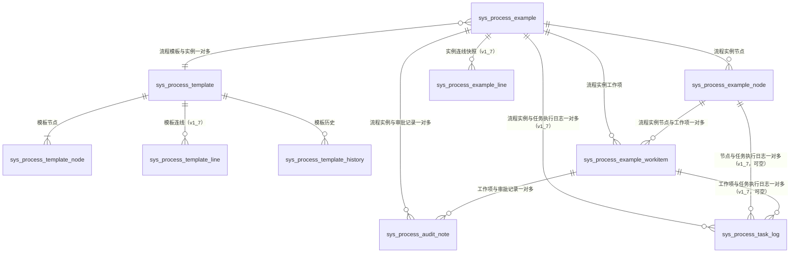

# 流程表结构

> **字段、索引与迁移明细以 [流程v1_7数据库设计分册](流程v1_7数据库设计分册.md) 为准**；本文件为流程模块表结构的字段视图（含 v1_7 改造后的目标态），两者冲突时以分册为准并回写本文件。

## 表字段

```mermaid
erDiagram
%%    流程模板
    sys_process_template {
    	varchar(32) field_id "id"
    	varchar(200) field_name "模板名称"
    	varchar(200) field_model_name "所属模块"
    	varchar(50) field_code "模板编号"
    	int field_version "版本号"
    	varchar(2000) field_remark "备注"
    	bit field_default "是否默认模板（每分类最多一个）"
    	varchar(32) field_creator_id "创建人"
    	timestamp field_create_time "创建时间"
    	varchar(32) field_updater_id "修改人"
    	timestamp field_update_time "修改时间"
    	bit field_enable "是否启用"
    }
%%    历史流程模板
    sys_process_template_history {
        varchar(32) field_id "id"
        varchar(32) field_template_id "模板id"
        int field_version "历史版本号"
        json field_content "流程定义历史（v1_7 起含节点 + 连线）"
    }
%%    流程模板节点
    sys_process_template_node {
        varchar(32) field_id "id"
        varchar(32) field_template_id "模板id"
        int field_no "节点编号"
        varchar(50) field_node_key "节点业务键（v1_7 新增：N1/N2/N3/…）"
        varchar(200) field_node_name "节点名称"
        varchar(20) field_node_type "节点类型"
        json field_node_config "节点配置"
    }
%%    流程模板连线（v1_7 新增）
    sys_process_template_line {
        varchar(32) field_id "id"
        varchar(32) field_template_id "模板id"
        varchar(50) field_from_key "起始节点键"
        varchar(50) field_to_key "目标节点键"
        varchar(20) field_line_type "连线类型：NORMAL/CONDITION/PARALLEL/MANUAL"
        int field_branch_order "分支序号"
        varchar(200) field_branch_name "分支名称"
        text field_condition "分支条件公式"
        bit field_is_default "是否默认分支"
    }
%%    流程实例
    sys_process_example {
        varchar(32) field_id "id"
        varchar(32) field_template_id "模板id"
        int field_template_version "模板版本号"
        varchar(32) field_model_id "所属模块id"
        varchar(200) field_model_name "所属模块"
        varchar(50) field_code "流程编号"
        varchar(32) field_creator_id "创建人"
        timestamp field_create_time "创建时间"
        timestamp field_finish_time "完成时间"
        varchar(20) field_status "流程状态"
    }
%%    流程实例节点
    sys_process_example_node {
        varchar(32) field_id "id"
        varchar(32) field_example_id "流程实例id"
        int field_node_no "节点编号"
        varchar(50) field_node_key "节点业务键（v1_7 新增，快照）"
        varchar(200) field_node_name "节点名称"
        varchar(20) field_node_type "节点类型"
        json field_node_config "节点配置"
        json field_runtime "节点运行态（v1_7 新增：并行汇聚进度等）"
        varchar(20) field_status "节点状态"
    }
%%    流程实例连线快照（v1_7 新增）
    sys_process_example_line {
        varchar(32) field_id "id"
        varchar(32) field_example_id "流程实例id"
        varchar(50) field_from_key "起始节点键"
        varchar(50) field_to_key "目标节点键"
        varchar(20) field_line_type "连线类型：NORMAL/CONDITION/PARALLEL/MANUAL"
        int field_branch_order "分支序号"
        varchar(200) field_branch_name "分支名称"
        text field_condition "分支条件公式"
        bit field_is_default "是否默认分支"
    }
%%    流程工作项
    sys_process_example_workitem {
        varchar(32) field_id "id"
        varchar(32) field_example_id "流程实例id"
        varchar(32) field_node_id "节点id"
        varchar(32) field_handler_id "处理人id"
        varchar(32) field_expect_handler_id "期望处理人id"
        varchar(32) field_from_workitem_id "来源工作项id（v1_7 新增：转办/收回追溯）"
        timestamp field_create_time "创建时间"
        timestamp field_finish_time "完成时间"
        varchar(20) field_status "工作项状态"
        json field_config "工作项配置"
    }
%%    审批记录
    sys_process_audit_note {
        varchar(32) field_id "id"
        varchar(32) field_example_id "流程实例id"
        varchar(32) field_workitem_id "工作项id"
        varchar(32) field_handler_id "处理人id"
        varchar(200) field_content "审批内容"
        timestamp field_create_time "创建时间"
        varchar(50) field_handle_type "处理操作（v1_7 起列宽 20→50，承载新增类型）"
    }
%%    流程任务执行日志（v1_7 新增，流水只增不改）
    sys_process_task_log {
        varchar(32) field_id "id"
        varchar(32) field_example_id "流程实例id"
        varchar(32) field_node_id "节点id（可空）"
        varchar(32) field_workitem_id "工作项id（可空）"
        varchar(200) field_task_name "@ProcessTask name"
        varchar(200) field_task_bean "任务实现类/bean 标识"
        varchar(50) field_task_type "执行步骤（ProcessTaskType）"
        json field_params "任务参数（可空）"
        json field_result "执行结果摘要（可空）"
        bit field_success "是否成功"
        text field_error_msg "失败信息（可空）"
        bigint field_cost_ms "耗时毫秒"
        timestamp field_create_time "创建时间"
    }
```

## 表关系

## 枚举值

sys_process_template_node.field_node_type, sys_process_example_node.field_node_type

| 枚举值        | 描述 | v1_7 |
|------------| --- | --- |
| START      | 开始节点 | 沿用 |
| END        | 结束节点 | 沿用 |
| DRAFT      | 草稿节点（起草节点） | 沿用 |
| APPROVE    | 审批节点 | 沿用 |
| ROBORT     | 机器人节点 | 沿用（**历史拼写**，正确拼写为 ROBOT，为避免数据迁移与兼容负担**沿用不改名**；常量、文档、页面均使用 ROBORT） |
| CC         | 抄送节点 | 新增 |
| CONDITION  | 条件分支节点 | 新增 |
| FORK       | 并行开始节点 | 新增 |
| JOIN       | 并行结束节点 | 新增 |
| MANUAL     | 人工决策节点 | 新增 |

sys_process_template_line.field_line_type, sys_process_example_line.field_line_type

| 枚举值       | 描述 |
|-----------| --- |
| NORMAL    | 普通连线 |
| CONDITION | 条件分支连线 |
| PARALLEL  | 并行分支连线（并行启动条件） |
| MANUAL    | 人工决策连线 |

sys_process_example.field_status

| 枚举值     | 描述 |
|---------| --- |
| ABANDON | 废弃（v1_7 起同时承载「起草人取消」语义，决策 D2，不新增 CANCEL） |
| DRAFT   | 草稿 |
| PROCESSING | 审批中 |
| PAUSE   | 暂停（v1_7 起同时承载流程异常 `SYSTEM_ERROR` 后的暂停态） |
| FINISH  | 完成 |
| RETURN  | 驳回 |

sys_process_example_node.field_status

| 枚举值     | 描述 |
|---------| --- |
| WAITING | 等待处理 |
| PROCESSING | 审批中 |
| FINISH | 完成 |
| PASS | 跳过 |
| REJECT | 驳回 |

sys_process_example_workitem.field_status

| 枚举值     | 描述 |
|---------| --- |
| PROCESSING | 审批中 |
| FINISH | 完成 |
| ABANDON | 废弃（v1_7 起转办/收回亦置此状态） |
| PAUSE | 暂停 |

sys_process_audit_note.field_handle_type（21 值 = 既有 11 + v1_7 新增 10）

| 枚举值             | 描述    | v1_7 |
|-----------------|-------| --- |
| DRAFTER_SUBMIT  | 起草人提交 | 既有 |
| DRAFTER_BACK    | 起草人收回 | 既有 |
| DRAFTER_ABANDON | 起草人废弃 | 既有 |
| HANDLER_PASS    | 处理人通过 | 既有 |
| HANDLER_RETURN  | 处理人驳回 | 既有（**保留兼容历史数据**，新驳回统一用 HANDLER_REJECT） |
| AUTO_PASS       | 自动跳过 | 既有 |
| ADMIN_PAUSE      | 管理员暂停 | 既有 |
| ADMIN_RESUME    | 管理员恢复 | 既有 |
| ADMIN_JUMP      | 管理员跳转 | 既有 |
| ADMIN_ABANDON   | 管理员废弃 | 既有 |
| ADMIN_FINISH    | 管理员办结 | 既有 |
| HANDLER_REJECT  | 处理人驳回（新） | 新增 |
| CC_AUTO         | 抄送节点自动抄送留痕 | 新增 |
| DRAFTER_EXPEDITE | 起草人催办 | 新增 |
| HANDLER_CC      | 审批人抄送 | 新增 |
| HANDLER_TRANSFER | 审批人转办 | 新增 |
| HANDLER_TRANSFER_RETRACT | 转办收回 | 新增 |
| PROCESSED_RETRACT | 已审批人收回 | 新增 |
| PROCESSED_EXPEDITE | 已审批人催办 | 新增 |
| ADMIN_CHANGE_HANDLER | 管理员更换审批人 | 新增 |
| SYSTEM_ERROR    | 流程异常（附错误摘要，实例转 PAUSE） | 新增 |

sys_process_task_log.field_task_type（ProcessTaskType，v1_7 新增）

| 枚举值           | 描述 |
|---------------| --- |
| CreateProcess | 创建实例 |
| StartProcess  | 流程发起 |
| StartNode     | 节点进入 |
| StartWorkitem | 工作项开始 |
| SendTodo      | 发送待办 |
| EndWorkitem   | 工作项结束（审批操作后） |
| EndNode       | 节点结束 |
| EndProcess    | 流程结束 |

## 节点配置 JSON 结构（field_node_config）v2

`sys_process_template_node.field_node_config` 与 `sys_process_example_node.field_node_config` 为 JSON 字符串，结构映射至 `SysProcessTemplateNodeConfigDo`（统一 Do + 可空字段，向后兼容）。**分支条件、分支序号、默认分支标记存连线表**（`sys_process_template_line`），不在节点配置中冗余。

| 字段 | 类型 | 说明 | v1_7 |
| --- | --- | --- | --- |
| handlerSource | string | 审批来源：`org`=组织架构（默认）/ `field`=表单字段 / `formula`=公式定义器；缺失视为 org（兼容旧模板） | 扩展 `formula` |
| handlerIds | string | 审批人 id 列表（';' 分隔）；`handlerSource=org` 时有效；v1_7 扩为机构/部门/人员/岗位/群组/角色全类型 | 扩展类型 |
| handlerNames | string | 审批人名称列表（';' 分隔）；`handlerSource=org` 时有效 | 既有 |
| handlerField | string | 审批人字段（文档实体字段属性名，取自 `process_template.${fieldModelName}.fields` 字典）；`handlerSource=field` 时有效 | 既有 |
| handlerFormula | string | 审批人公式；`handlerSource=formula` 时必填 | 新增 |
| handlerResolveMode | string | 审批人解析方式：`leader`（默认，部门/岗位/机构负责人）/ `member`（部门/岗位/机构成员或员工）；仅对选中对象中的部门/岗位/机构生效 | 新增 |
| approveMode | string | 审批方式：`single`=单签（默认）/ `serial`=串行 / `countersign`=会签 | 扩展 `serial` |
| skipMode | string | 相同审批人是否跳过：`system`（默认）/ `none` / `prev` / `any`；**旧值归一 `yes`→`prev`、`no`→`none`（读取时归一，不改写存量 JSON）** | 新增（承接旧 `autoSkip`） |
| autoSkip | string | 旧字段：自动跳过 `system` / `yes` / `no`；**v1_7 起由 `skipMode` 承接，存量值保留不改写** | 保留（只读兼容） |
| autoContinueSkip | string | 连续跳过：`system` / `yes` / `no`，默认 system | 既有 |
| emptyHandlerMode | string | 无审批人时：`system`（默认，同系统配置=跳过）/ `skip` 跳过该节点 / `error` 不跳过（转流程异常） | 新增 |
| triggerType | string | 旧字段：节点触发 `fixed` / `condition`；**v1_7 起不再参与流转判定**，条件路由改由条件分支节点 + 连线分支条件表达；存量值保留不改写 | 保留（只读兼容） |
| condition | string | 旧字段：触发条件（判断公式）；同上保留不改写 | 保留（只读兼容） |
| rejectTargets | array&lt;string&gt; | 可驳回目标节点 key 列表（候选限定起草节点 + 图上游审批节点）；空 = 默认仅起草节点 | 新增 |
| operations | array | 审批操作三段明细（起草人/审批人/已处理人）× `{ operateType, operateName, defaultContent }`；必须包含且仅包含一个 `handler_pass` | 新增 |
| ops | object | 操作标识开关（key=操作标识，value=true=开启），key 定义于 `process_template.${fieldModelName}.ops` 字典；未配置/缺失视为不允许（默认不允许，兼容旧模板），见《流程核心业务》「审批中审批人特定操作业务」 | 既有（维持不变） |
| tasks | array | 流程任务明细：`{ taskName, taskBean(@ProcessTask name), taskType(ProcessTaskType), params }` | 新增 |
| ccSource / ccIds / ccNames / ccFormula | string | 抄送节点（CC）配置：抄送源 `org`/`formula`、抄送对象、抄送公式 | 新增 |
| flowDecisions / defaultFlowKey | array / string | 人工决策节点（MANUAL）配置：流向决策来源节点 key 列表 / 默认流向（本节点出边目标之一） | 新增 |
| joinMode | string | 并行开始节点（FORK）配置：`all` 全部激活分支到达 JOIN 后流出 / `any` 任一到达即流出 | 新增 |

固定节点（START/DRAFT/END）`field_node_config` 为空；条件分支（CONDITION）与并行结束（JOIN）无节点配置（配置在连线上）。模板创建流程实例时**节点与连线全量快照复制**到实例侧（`sys_process_example_node` / `sys_process_example_line`），保证审批时按流程创建时的版本配置判定。

## 存量数据迁移（SourceDataMigration）

不新增 SQL 迁移脚本（`db/migration/` 为只读历史档案）；存量回填走 `SourceDataMigration` SPI（code 格式 `DM-yyyyMMdd-nnn`，幂等、失败阻断启动）：

| 迁移码 | 中文名 | 目标 |
| --- | --- | --- |
| `DM-20261119-001` | 流程模板节点业务键回填 | `sys_process_template_node.field_node_key`（按 `field_no` 顺序 N1..Nn） |
| `DM-20261119-002` | 流程模板线性连线生成 | `sys_process_template_line`（N1→N2→…→N3） |
| `DM-20261119-003` | 流程实例节点业务键回填与连线快照生成 | `sys_process_example_node.field_node_key` + `sys_process_example_line`（含在途实例） |

详见 [流程v1_7数据库设计分册](流程v1_7数据库设计分册.md) 第 5 章。
