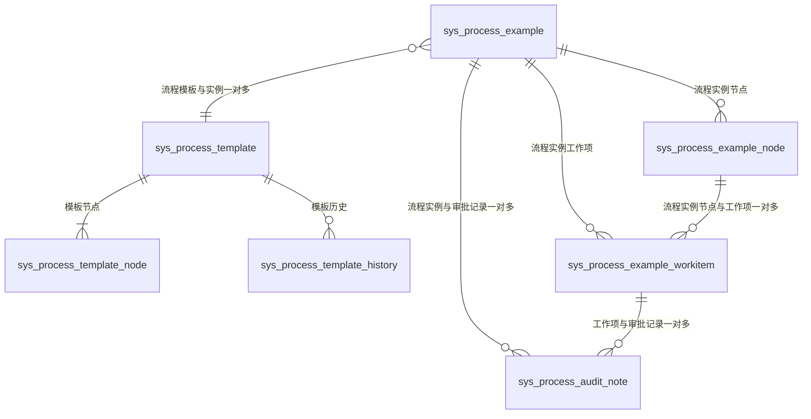

# 流程表结构

## 表字段

```mermaid
erDiagram
%%    流程模板
    sys_process_template {
    	varchar(32) field_id "id"
    	varchar(200) field_name "模板名称"
    	varchar(200) field_model_name "所属模块"
    	varchar(50) field_code "模板编号"
    	int field_version "版本号"
    	varchar(2000) field_remark "备注"
    	bit field_default "是否默认模板（每分类最多一个）"
    	varchar(32) field_creator_id "创建人"
    	timestamp field_create_time "创建时间"
    	varchar(32) field_updater_id "修改人"
    	timestamp field_update_time "修改时间"
    	bit field_enable "是否启用"
    }
%%    历史流程模板
    sys_process_template_history {
        varchar(32) field_id "id"
        varchar(32) field_template_id "模板id"
        int field_version "历史版本号"
        json field_content "流程定义历史"
    }
%%    流程模板节点
    sys_process_template_node {
        varchar(32) field_id "id"
        varchar(32) field_template_id "模板id"
        int field_no "节点编号"
        varchar(200) field_node_name "节点名称"
        varchar(20) field_node_type "节点类型"
        json field_node_config "节点配置"
    }
    
%%    流程实例
    sys_process_example {
        varchar(32) field_id "id"
        varchar(32) field_template_id "模板id"
        int field_template_version "模板版本号"
        varchar(32) field_model_id "所属模块id"
        varchar(200) field_model_name "所属模块"
        varchar(50) field_code "流程编号"
        varchar(32) field_creator_id "创建人"
        timestamp field_create_time "创建时间"
        timestamp field_finish_time "完成时间"
        varchar(20) field_status "流程状态"
    }
%%    流程实例节点
    sys_process_example_node {
        varchar(32) field_id "id"
        varchar(32) field_example_id "流程实例id"
        int field_node_no "节点编号"
        varchar(200) field_node_name "节点名称"
        varchar(20) field_node_type "节点类型"
        json field_node_config "节点配置"
        varchar(20) field_status "节点状态"
    }
%%    流程工作项
    sys_process_example_workitem {
        varchar(32) field_id "id"
        varchar(32) field_example_id "流程实例id"
        varchar(32) field_node_id "节点id"
        varchar(32) field_handler_id "处理人id"
        varchar(32) field_expect_handler_id "期望处理人id"
        timestamp field_create_time "创建时间"
        timestamp field_finish_time "完成时间"
        varchar(20) field_status "工作项状态"
        json field_config "工作项配置"
    }
%%    审批记录
    sys_process_audit_note {
        varchar(32) field_id "id"
        varchar(32) field_example_id "流程实例id"
        varchar(32) field_workitem_id "工作项id"
        varchar(32) field_handler_id "处理人id"
        varchar(200) field_content "审批内容"
        timestamp field_create_time "创建时间"
        varchar(20) field_handle_type "处理操作"
    }
```

## 表关系

## 枚举值

sys_process_template_node.field_node_type, sys_process_example_node.field_node_type

| 枚举值     | 描述 |
|---------| --- |
| START   | 开始节点 |
| END     | 结束节点 |
| DRAFT   | 草稿节点 |
| APPROVE | 审批节点 |
| ROBORT  | 机器人节点 |

sys_process_example.field_status

| 枚举值     | 描述 |
|---------| --- |
| ABANDON | 废弃 |
| DRAFT | 草稿 |
| PROCESSING | 审批中 |
| PAUSE | 暂停 |
| FINISH | 完成 |
| RETURN | 驳回 |

sys_process_example_node.field_status

| 枚举值     | 描述 |
|---------| --- |
| WAITING | 等待处理 |
| PROCESSING | 审批中 |
| FINISH | 完成 |
| PASS | 跳过 |
| REJECT | 驳回 |

sys_process_example_workitem.field_status

| 枚举值     | 描述 |
|---------| --- |
| PROCESSING | 审批中 |
| FINISH | 完成 |
| ABANDON | 废弃 |
| PAUSE | 暂停 |

sys_process_audit_note.field_handle_type

| 枚举值             | 描述    |
|-----------------|-------|
| DRAFTER_SUBMIT  | 起草人提交 |
| DRAFTER_BACK    | 起草人收回 |
| DRAFTER_ABANDON | 起草人废弃 |
| HANDLER_PASS    | 处理人通过 |
| HANDLER_RETURN  | 处理人驳回 |
| ADMIN_PAUSE      | 管理员暂停 |
| ADMIN_RESUME    | 管理员恢复 |
| ADMIN_JUMP      | 管理员跳转 |
| ADMIN_ABANDON   | 管理员废弃 |
| ADMIN_FINISH    | 管理员办结 |

## 节点配置 JSON 结构（field_node_config）

`sys_process_template_node.field_node_config` 与 `sys_process_example_node.field_node_config`（审批节点 APPROVE）为 JSON 字符串，结构映射至 `SysProcessTemplateNodeConfigDo`：

| 字段 | 类型 | 说明 |
| --- | --- | --- |
| handlerSource | string | 审批来源：org=组织架构（默认）/ field=表单字段；缺失视为 org（兼容旧模板） |
| handlerIds | string | 审批人 id 列表（';' 分隔）；`handlerSource=org` 时有效 |
| handlerNames | string | 审批人名称列表（';' 分隔）；`handlerSource=org` 时有效 |
| handlerField | string | 审批人字段（文档实体字段属性名，取自 `process_template.${fieldModelName}.fields` 字典）；`handlerSource=field` 时有效，运行期读取该字段值解析出组织架构作为审批人 |
| approveMode | string | 审批模式：single=单签 / countersign=会审 |
| triggerType | string | 节点触发：fixed=固定 / condition=条件判断 |
| condition | string | 触发条件（判断公式） |
| autoSkip | string | 自动跳过：system / yes / no |
| autoContinueSkip | string | 连续跳过：system / yes / no |
| ops | object | 操作标识开关（key=操作标识，value=true=开启），key 定义于 `process_template.${fieldModelName}.ops` 字典；未配置/缺失视为不允许（默认不允许，兼容旧模板），见《流程核心业务》「审批中审批人特定操作业务」 |

固定节点（START/DRAFT/END）`field_node_config` 为空。模板创建流程实例时节点配置原样复制到实例节点，保证审批时按流程创建时的版本配置判定。
