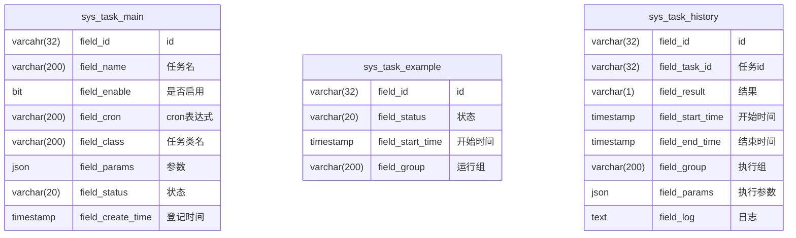
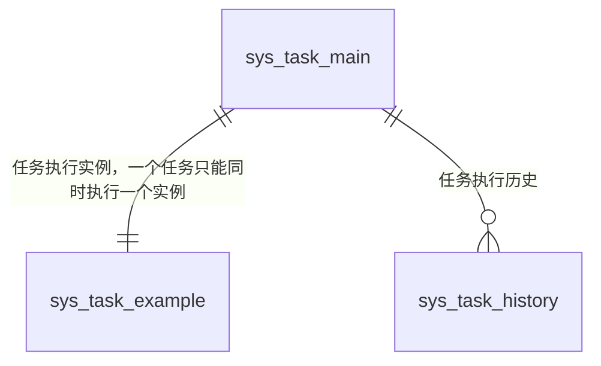

# 定时任务表结构

## 表字段

## 表关系

## 枚举字段

sys_task_main.field_status, sys_task_example.field_status

| 枚举值 | 实际值 |
| --- | --- |
| WAITING | 等待中 |
| RUNNING | 运行中 |
| FINISH | 完成 |
| BLOCK | 阻塞 |
| FAIL | 失败 |

sys_task_history.field_result

| 枚举值 | 描述 |
|-----| --- |
| 1   | 成功 |
| 0   | 失败 |

